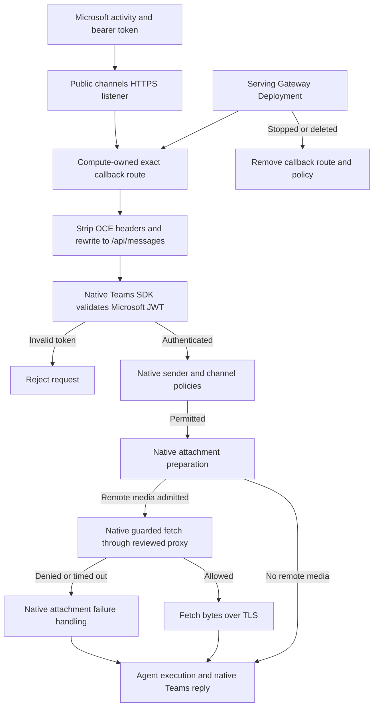

# Agent channel callback flow

## Overview

Microsoft Teams delivers an authenticated activity to an Agent-specific public
callback. The Kubernetes Compute Driver exposes the serving Gateway's native
Teams handler through a separate listener; the SDK validates the Microsoft token
and the native channel policy decides whether the sender may invoke the Agent.
Remote attachment downloads use the Gateway's reviewed channel proxy; native
media admission and credential forwarding remain separate checks.
Slack Socket Mode uses an outbound connection and does not enter this flow.

## Entry Points

- Deployment reconciliation: `apps/controller/src/drivers/compute/kubernetes/index.ts:reconcileGatewayRoute`.
- Public request: POST `/namespaces/<namespace-id>/agents/<agent-id>/channels/msteams`.
- Native handler: pinned OpenClaw `extensions/msteams/src/monitor.ts:monitorMSTeamsProvider`.
- Prerequisites: Dedicated runtime, admitted Secret bindings, reviewed proxy,
  separate channel hostname/listener, and an installed Microsoft bot app.

## Flow

## Execution Trace

### 1. Admit runtime prerequisites and credentials

`apps/controller/src/drivers/compute/kubernetes/index.ts:enabledChannels`
uses `configuration-rules.ts:enabledChannelProviders` and `requireChannelTopology`
to require supported providers and an admitted topology: dedicated by default,
or the trusted embedded evaluation opt-in. Compute requires revision-owned
managed outbound for enabled channels.
It additionally requires channel routing for enabled Teams. An omitted `webhook.path`, including `webhook: {}`, uses the native
`/api/messages` default. Non-object webhook values, custom paths, legacy
listeners and sovereign clouds are refused.
`validateChannelSecretBindings` requires matching admitted bindings.
`deployment` projects channel Secrets only into the Gateway and records whether
that serving Deployment owns a Teams callback.
`configuration-rules.ts:requireChannelProxyEnvironment` refuses Agent-authored
proxy environment overrides and guarded-fetch trust markers. With admitted
managed outbound, `deployment` supplies the revision proxy and
`OPENCLAW_PROXY_ACTIVE=1`. Native guarded fetch delegates DNS/IP enforcement
to that proxy, which validates all answers and pins the public destination.
Additional storage hosts require exact Agent approval; native media and
credential-forwarding checks remain independent.

### 2. Reconcile the serving revision's callback

`apps/controller/src/drivers/compute/kubernetes/index.ts:reconcileGatewayRoute` reads the serving Deployment's revision annotations.
`reconcileTeamsRoute` uses its Teams marker rather than a candidate's settings.
It creates an exact POST HTTPRoute on the **channels** listener, rewriting only
that path to `/api/messages`. A route-specific SecurityPolicy replaces inherited
OCE API-key authentication. `gatewayRouteHeaderFilter("channel")` preserves the
Microsoft Authorization header and removes OCE identity, scopes, cookies, and
API keys. Other paths have no callback route.

### 3. Authenticate and process the activity

The [pinned native monitor](https://github.com/openclaw/openclaw/blob/90d30a1178a79dddd92e6190b66b95d89dfb3ca8/extensions/msteams/src/monitor.ts)
`extensions/msteams/src/monitor.ts:monitorMSTeamsProvider` registers
`/api/messages` with plugin authentication. Its Express adapter and
Microsoft Teams SDK reject unauthenticated activities before Agent execution.
Native personal/group policies and mention rules then gate execution. The plugin
sends the response using its admitted app credentials through provider egress.

### 4. Fetch remote attachment bytes

The [pinned native attachment downloader](https://github.com/openclaw/openclaw/blob/90d30a1178a79dddd92e6190b66b95d89dfb3ca8/extensions/msteams/src/attachments/download.ts)
`extensions/msteams/src/attachments/download.ts:downloadMSTeamsAttachments` retains its media-host admission,
redirect and authentication-header policy. Its guarded fetch uses the Gateway's
proxy transport when Compute supplies the reviewed-proxy declaration.
`apps/controller/src/slack-proxy.mjs:readTeamsFileHosts` adds only the explicitly
configured Microsoft storage hosts to the proxy's CONNECT policy when Teams is
enabled. `createSlackProxyServer` resolves an admitted hostname's IPv4 addresses,
refuses any nonpublic answer and opens the socket to the validated address.
One deadline covers DNS and connection; late resolution cannot create a socket
after cancellation or timeout. TLS remains between the native client and origin.
Each redirect must pass the proxy policy independently. Proxy access does not
grant bearer-token forwarding, and the shared proxy's host list is
Installation-wide.

### 5. Revoke the endpoint

`apps/controller/src/drivers/compute/kubernetes/index.ts:reconcileTeamsRoute` removes stale callback resources when the serving Gateway
disables Teams. `deleteGatewayUnauthenticatedRoutes` removes the HTTPRoute before
its SecurityPolicy during stop/delete, using observed revision, UID, and resource
version preconditions. Retiring a failed candidate cannot delete a route owned
by the serving revision.

## Debugging and Verification

- Inspect the Agent's `gateway-<agent-hash>-msteams` HTTPRoute and SecurityPolicy,
  serving revision annotations, and Envoy listener acceptance.
- [Teams verification](../testing/teams.md) distinguishes native SDK rejection,
  console persistence, simulated UI evidence, and pending live-provider proof.
- Check Gateway logs for native channel initialization and policy refusals.
  Saved Secret bindings alone do not establish working Microsoft credentials.
- For attachment failures, inspect native media/redirect admission and the
  proxy's exact destination policy separately. Do not log signed download URLs
  or bearer tokens.

## Related docs

- [Teams setup](../guides/integrations/teams.md)
- [Kubernetes networking](../reference/drivers/kubernetes-compute/networking-and-isolation.md)
- [Secret configuration](../reference/configuration/secrets.md)
- [Agent channel directory](agent-channel-directory.md)

## Manual Notes

[keep this for the user to add notes. do not change between edits]

## Changelog

- 2026-10-15 13:12: Document reviewed proxy delegation and exact Teams storage destinations in the accompanying uncommitted change (authoring-run/d5112085-b889-44de-a3c9-3fc6420c77cb - 339aa5d26f4c)
- 2026-10-10 22:48: Preserve the native Teams default callback path during deployment admission (authoring-run/4c4cf7ac-5025-4ac6-9cb5-1ae3fcc217a9 - a2f7ad762117)
- 2026-10-06 16:42: Documented the source-backed Teams callback path (codex/authoring-run/5ef92e66-9d7a-4101-a43a-59a23d70ef72 - 447c387b63c1)
