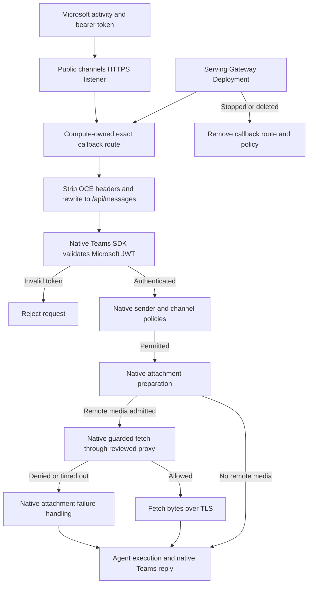

# Agent channel callback flow

## Overview

Microsoft Teams delivers an authenticated activity to an Agent-specific public
callback. The Kubernetes Compute Driver exposes the serving Gateway's native
Teams handler through a separate listener; the SDK validates the Microsoft token
and the native channel policy decides whether the sender may invoke the Agent.
Remote attachment downloads use the Gateway's reviewed channel proxy; native
media admission and credential forwarding remain separate checks.
Slack Socket Mode uses an outbound connection and does not enter this flow.

## Entry Points

- Deployment reconciliation: `apps/controller/src/drivers/compute/kubernetes/index.ts:reconcileGatewayRoute`.
- Public request: POST `/namespaces/<namespace-id>/agents/<agent-id>/channels/msteams`.
- Native handler: pinned OpenClaw `extensions/msteams/src/monitor.ts:monitorMSTeamsProvider`.
- Prerequisites: Dedicated runtime or the explicitly enabled embedded trial,
  admitted Secret bindings, managed outbound,
  separate channel hostname/listener, and an installed Microsoft bot app.

## Flow

## Execution Trace

### 1. Admit runtime prerequisites and credentials

`apps/controller/src/drivers/compute/kubernetes/index.ts:enabledChannels`
uses `configuration-rules.ts:enabledChannelProviders` and `requireChannelTopology`
to require supported providers and the admitted topology.
`configuration-rules.ts:requireTeamsConfiguration` validates app-password settings;
`validateAdmittedHarnessAuth` also requires public callback routing during
deployment admission, before the worker stops
a serving predecessor. Admission returns `ConfigurationHarnessError`, so the API
returns the Teams refusal reason with HTTP 400 before creating an Agent revision.
Preparation repeats the check with its diagnostic error type. Configuration saves
and Agent saves do not require this Installation-specific listener. An omitted
`webhook.path`, including `webhook: {}`, uses the native
`/api/messages` default. Non-object webhook values, custom paths, legacy
listeners and sovereign clouds are refused.
`validateChannelSecretBindings` requires matching admitted bindings.
`deployment` projects channel Secrets only into the Gateway and records whether
that serving Deployment owns a Teams callback.
`configuration-rules.ts:requireChannelProxyEnvironment` refuses Agent-authored
proxy environment overrides. With admitted managed outbound, `deployment` supplies the
revision-owned proxy and the
native `OPENCLAW_PROXY_ACTIVE=1` trust marker. That marker delegates guarded
fetch DNS/IP enforcement throughout the Gateway to the reviewed proxy.

### 2. Reconcile the serving revision's callback

`apps/controller/src/drivers/compute/kubernetes/index.ts:reconcileGatewayRoute` reads the serving Deployment's revision annotations.
`reconcileTeamsCallback` requires both the matching revision and the serving
Deployment's Teams marker. A candidate leaves its predecessor's callback intact.
The callback owns a Service selecting that revision and a scoped NetworkPolicy.
It creates an exact POST HTTPRoute on the **channels** listener, rewriting only
that path to `/api/messages`. A route-specific SecurityPolicy replaces inherited
OCE API-key authentication. The callback header filter preserves the
Microsoft Authorization header and removes OCE identity, configured-role and
role-policy headers, scopes, cookies, and
API keys. Other paths have no callback route.

### 3. Authenticate and process the activity

The [pinned native monitor](https://github.com/openclaw/openclaw/blob/554f0b886bde6c089578c49967227f8b50d1cf16/extensions/msteams/src/monitor.ts)
`extensions/msteams/src/monitor.ts:monitorMSTeamsProvider` registers
`/api/messages` with plugin authentication. Its Express adapter and
Microsoft Teams SDK reject unauthenticated activities before Agent execution.
Native personal/group policies and mention rules then gate execution. The plugin
sends the response using its admitted app credentials through provider egress.

### 4. Fetch remote attachment bytes

The [pinned native attachment downloader](https://github.com/openclaw/openclaw/blob/554f0b886bde6c089578c49967227f8b50d1cf16/extensions/msteams/src/attachments/download.ts)
`extensions/msteams/src/attachments/download.ts:downloadMSTeamsAttachments` retains its media-host admission,
redirect and authentication-header policy. Its guarded fetch uses the Gateway's
proxy transport when Compute supplies the reviewed-proxy declaration.
`apps/controller/src/gateway/outbound-proxy.mjs:createOutboundProxyServer`
checks the admitted revision's destination policy, refuses private, reserved and
infrastructure addresses, and connects to the validated numeric address.
TLS remains between the native client and origin. Each redirect must pass the
policy independently. Proxy access does not grant bearer-token forwarding.
Additional storage hosts are Dedicated-only and belong to the Agent's outbound
policy; the embedded trial permits only channel-derived destinations.

### 5. Revoke the endpoint

`apps/controller/src/drivers/compute/kubernetes/index.ts:reconcileTeamsCallback`
removes the HTTPRoute, Service, SecurityPolicy and NetworkPolicy when the serving
Gateway disables Teams. `deleteGatewayUnauthenticatedRoutes` removes those
resources during stop/delete, using observed revision, UID and resource-version
preconditions. Retiring a failed candidate cannot delete a callback owned by the
serving revision.

## Debugging and Verification

- Inspect the Agent's `gateway-<agent-hash>-msteams` HTTPRoute, Service, SecurityPolicy and NetworkPolicy,
  serving revision annotations, and Envoy listener acceptance.
- [Teams verification](../testing/teams.md) distinguishes native SDK rejection,
  console persistence, simulated UI evidence, and pending live-provider proof.
- Check Gateway logs for native channel initialization and policy refusals.
  Saved Secret bindings alone do not establish working Microsoft credentials.
- For attachment failures, inspect native media/redirect admission and the
  proxy's exact destination policy separately. Do not log signed download URLs
  or bearer tokens.

## Related docs

- [Teams setup](../guides/integrations/teams.md)
- [Kubernetes networking](../reference/drivers/kubernetes-compute/networking-and-isolation.md)
- [Secret configuration](../reference/configuration/secrets.md)
- [Agent channel directory](agent-channel-directory.md)

## Manual Notes

[keep this for the user to add notes. do not change between edits]

## Changelog

- 2026-10-28 23:20: Compose Teams with revision-owned outbound and callback cleanup in the accompanying uncommitted change. (authoring-run/29552e5d-baf0-4837-99f3-371a7cca1bbc - c773fc031e7dfef4f164cec0b8652f94356c298a)

- 2026-10-28 22:29: Preserve actionable Teams deployment refusals through the API in the accompanying uncommitted change. (authoring-run/8eb34ae4-b76a-44dd-bb2e-5e09e180d7af - 66c908e7b4e6)

- 2026-10-28 22:25: Share Teams deployment checks with admission so predictable callback refusals precede predecessor shutdown. (authoring-run/d2bd1414-d73d-4eca-b675-32310d3d3c26 - 93c1dc4f24b9)

- 2026-10-15 13:12: Document reviewed proxy delegation and exact Teams storage destinations in the accompanying uncommitted change (authoring-run/d5112085-b889-44de-a3c9-3fc6420c77cb - 339aa5d26f4c)
- 2026-10-10 22:48: Preserve the native Teams default callback path during deployment admission (authoring-run/4c4cf7ac-5025-4ac6-9cb5-1ae3fcc217a9 - a2f7ad762117)
- 2026-10-06 16:42: Documented the source-backed Teams callback path (codex/authoring-run/5ef92e66-9d7a-4101-a43a-59a23d70ef72 - 447c387b63c1)
