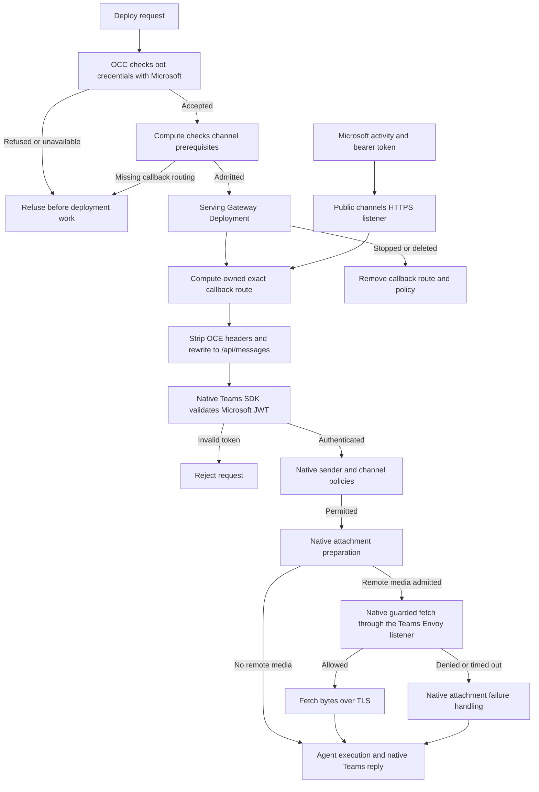

# Agent channel callback flow

## Overview

Microsoft Teams delivers an authenticated activity to an Agent-specific public
callback. The Kubernetes Compute Driver exposes the serving Gateway's native
Teams handler through a separate listener; the SDK validates the Microsoft token
and the native channel policy decides whether the sender may invoke the Agent.
Remote attachment downloads use the Gateway's managed Envoy listener; native
media admission and credential forwarding remain separate checks.
Slack Socket Mode uses an outbound connection and does not enter this flow.

## Entry Points

- Deployment reconciliation: `apps/controller/src/drivers/compute/kubernetes/index.ts:reconcileGatewayRoute`.
- Public request: POST `/namespaces/<namespace-id>/agents/<agent-id>/channels/msteams`.
- Native handler: pinned OpenClaw `extensions/msteams/src/monitor.ts:monitorMSTeamsProvider`.
- Prerequisites: A Dedicated Agent or the Installation-selected embedded Teams Agent, admitted Secret bindings, managed channel egress,
  separate channel hostname/listener, and an installed Microsoft bot app.

## Flow

## Execution Trace

### 1. Admit runtime prerequisites and credentials

`packages/occ/src/index.ts:prepareDeploymentChannels` checks the bound Secret
and requests credential validation before queuing deployment.
`apps/controller/src/drivers/channel/teams.ts:validateCredentials` requests a Bot
Connector token through the managed OCC listener. OCC refuses rejected or
unavailable credentials and leaves the serving revision in place. Draft saves
do not make the OAuth request.

`apps/controller/src/drivers/compute/kubernetes/index.ts:enabledChannels`
uses `configuration-rules.ts:enabledChannelProviders` and `requireChannelTopology`
to require managed egress and an eligible workload. Embedded Teams checks the
server-owned Agent ID against the Installation selection. `requireTeamsCallback`
checks the callback listener and native Teams settings during admission and
preparation. An omitted webhook path defaults to `/api/messages`. Custom paths,
legacy webhook listeners and sovereign clouds fail admission before the worker
can stop a predecessor. Draft saves may precede listener setup.
`validateChannelSecretBindings` requires matching admitted bindings.
`deployment` projects channel Secrets only into the Gateway and records whether
that serving Deployment owns a Teams callback.
`configuration-rules.ts:requireChannelProxyEnvironment` refuses Agent-authored
proxy environment overrides. After the worker verifies the revision's Envoy
binding, `deployment` sets `HTTPS_PROXY` and, for Teams, `NODE_USE_ENV_PROXY=1`
on the Gateway, because the Teams SDK follows only Node's process-wide proxy.
`NO_PROXY` names loopback and the exact hosts of the Compute-assigned Harness
and peer status URLs. The selected embedded Gateway also bypasses the proxy for
its authorized repository broker and uses it for public model and plugin HTTPS.
`OPENCLAW_PROXY_ACTIVE=1` delegates guarded-fetch address selection to Envoy
while native media and credential checks stay in place.

### 2. Reconcile the serving revision's callback

`apps/controller/src/drivers/compute/kubernetes/index.ts:reconcileGatewayRoute` reads the serving Deployment's revision annotations.
`reconcileTeamsRoute` uses its Teams marker rather than a candidate's settings.
For an embedded Gateway it selects the observed revision through a callback
Service once the Gateway Service is active. It creates an exact POST HTTPRoute on the **channels** listener, rewriting only
that path to `/api/messages`. A route-specific SecurityPolicy replaces inherited
OCE API-key authentication. `gatewayRouteHeaderFilter("channel")` preserves the
Microsoft Authorization header and removes OCE identity, scopes, cookies, and
API keys. Other paths have no callback route.

### 3. Authenticate and process the activity

The [pinned native monitor](https://github.com/openclaw/openclaw/blob/82b682c627ba8bfc2c2bd51cf46ad8f51c583857/extensions/msteams/src/monitor.ts)
`extensions/msteams/src/monitor.ts:monitorMSTeamsProvider` registers
`/api/messages` with plugin authentication. Its Express adapter and
Microsoft Teams SDK reject unauthenticated activities before Agent execution.
Native personal/group policies and mention rules then gate execution. The plugin
sends the response using its admitted app credentials through provider egress.

### 4. Fetch remote attachment bytes

The [pinned native attachment downloader](https://github.com/openclaw/openclaw/blob/82b682c627ba8bfc2c2bd51cf46ad8f51c583857/extensions/msteams/src/attachments/download.ts)
`extensions/msteams/src/attachments/download.ts:downloadMSTeamsAttachments` retains its media-host admission,
redirect and authentication-header policy. Its guarded fetch uses the Gateway's
managed Envoy listener. `apps/controller/src/drivers/channel/teams.ts:TeamsChannelDriver.enableRouting`
declares the exact messaging hosts and the Installation's optional storage hosts.
Envoy checks every CONNECT target and rejects nonpublic or excluded addresses.
Provider TLS stays inside the tunnel. Each redirect needs its own permitted
destination. The native plugin independently controls bearer-token forwarding.

### 5. Revoke the endpoint

`apps/controller/src/drivers/compute/kubernetes/index.ts:reconcileTeamsRoute` removes stale callback resources when the serving Gateway
disables Teams. `deleteGatewayUnauthenticatedRoutes` removes the HTTPRoute before
its SecurityPolicy during stop/delete, using observed revision, UID, and resource
version preconditions. Retiring a failed candidate cannot delete a route owned
by the serving revision.

## Debugging and Verification

- Inspect the Agent's `gateway-<agent-hash>-msteams` HTTPRoute and SecurityPolicy,
  serving revision annotations, and Envoy listener acceptance.
- [Teams verification](../testing/teams.md) distinguishes native SDK rejection,
  console persistence, simulated UI evidence, and pending live-provider proof.
- Check Gateway logs for native channel initialization and policy refusals.
  Saved Secret bindings alone do not establish working Microsoft credentials.
- For attachment failures, inspect native media/redirect admission and the
  proxy's exact destination policy separately. Do not log signed download URLs
  or bearer tokens.

## Related docs

- [Teams setup](../guides/integrations/teams.md)
- [Managed channel egress](../reference/drivers/kubernetes-compute/channel-egress.md)
- [Secret configuration](../reference/configuration/secrets.md)
- [Agent channel directory](agent-channel-directory.md)

## Manual Notes

[keep this for the user to add notes. do not change between edits]

## Changelog

- 2026-11-23 13:05: Trace embedded callback selection. (authoring-run/01a2083c-f35b-7263-8be2-9428a9825a57 - acf695ee1d)

- 2026-11-21 10:29: Document Microsoft Teams credential refusal before deployment. (authoring-run/a12fb922-8253-47eb-99b7-937292ecd93a - 0fe994ad187a0b59dc0107279d24284697776d1d)

- 2026-11-20 00:40: Describe Teams callbacks and guarded media with managed Envoy egress. (authoring-run/54a714d8-60c2-4824-b3a2-2fbd2b090ead - e88dc5883143e5fe39cffb0199ae5c0bac147cb7)

- 2026-11-05 03:21: Document early channel prerequisite refusal before deployment work in the accompanying change. (authoring-run/d608e15a-be6e-41e1-8b09-5470f5abc4bc - 24ce51f702664d3f3fc450bb9b1b7c563664e267)

- 2026-11-05 00:21: Refresh callback, provider transport, and typed Console owners against pinned upstream in the accompanying uncommitted merge. (authoring-run/eb325c8c-65eb-4385-a7c0-21c2839e6da6 - 93c1dc4f24b9f544b26a451b71a0cfeff34be4fc)

- 2026-10-15 13:12: Document reviewed proxy delegation and exact Teams storage destinations in the accompanying uncommitted change (authoring-run/d5112085-b889-44de-a3c9-3fc6420c77cb - 339aa5d26f4c)
- 2026-10-10 22:48: Preserve the native Teams default callback path during deployment admission (authoring-run/4c4cf7ac-5025-4ac6-9cb5-1ae3fcc217a9 - a2f7ad762117)
- 2026-10-06 16:42: Documented the source-backed Teams callback path (codex/authoring-run/5ef92e66-9d7a-4101-a43a-59a23d70ef72 - 447c387b63c1)
