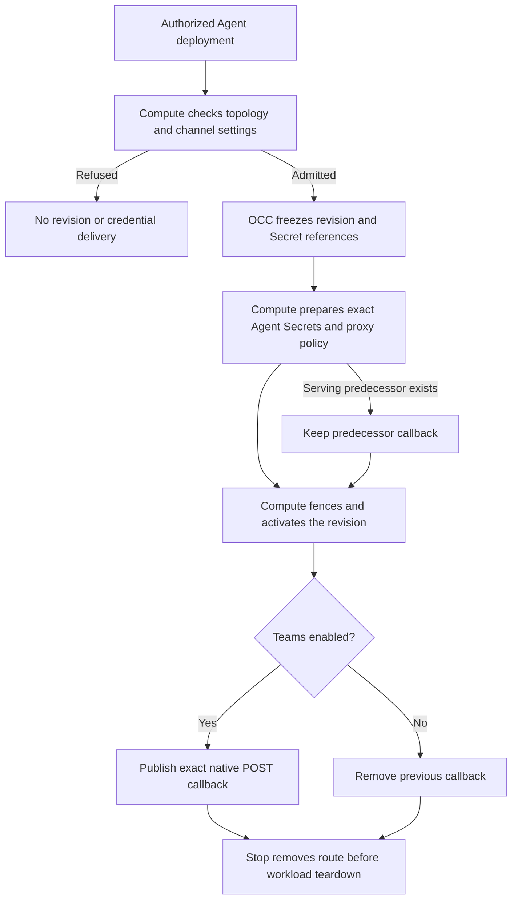

# Agent channel runtime

## Overview

An authorized Agent deployment freezes native channel settings and Secret bindings
into its revision. Kubernetes Compute prepares credentials and channel egress,
then publishes the native Teams callback for the serving revision. This flow
describes evaluation-branch source, not production or live-provider qualification.

## Entry Points

- `packages/occ/src/index.ts:deployAgentWithAuthorization`: exact Agent operation,
  Configuration ownership and Secret grants before revision admission.
- `apps/controller/src/drivers/compute/kubernetes/index.ts:validateHarnessAuth`:
  topology, trusted Installation channel runtime and native settings admission.
- `apps/controller/src/drivers/compute/kubernetes/index.ts:activateRevision`:
  worker-owned revision activation and serving callback reconciliation.

## Flow

## Execution Trace

### 1. Admit the caller's configuration

`packages/occ/src/index.ts:deployAgentWithAuthorization` authorizes the exact Agent
and validates same-Namespace resource references. Kubernetes
`validateHarnessAuth` applies provider settings and `requireChannelTopology` before
a revision can stop predecessors. `requireTeamsConfiguration` requires explicit
Public-cloud IDs, an environment Secret reference, the native `/api/messages` path
and the packaged plugin. Teams also requires an Installation public callback
hostname. Native JSON cannot provision a listener or change trusted Compute options.

### 2. Prepare owned credentials and networking

`apps/controller/src/drivers/compute/kubernetes/index.ts:prepareRevision` receives
the immutable revision and resolved Secret locators through the regular worker.
`deliverGatewaySecrets` verifies source ownership and projects credentials only
into the owning Gateway. Dedicated Harnesses receive model authentication separately.
`reconcileChannelNetworkPolicy` permits the configured exact proxy endpoint; its
hostname policy belongs to the external proxy or opt-in chart-managed process.

The runtime image selects upstream `msteams` in
`deploy/runtime/Dockerfile` and `scripts/build-runtime-assets.mjs`. No independent
Teams message engine or channel credential broker is introduced.

### 3. Publish the serving callback

`apps/controller/src/drivers/compute/kubernetes/index.ts:reconcileTeamsCallback`
reads the owned Gateway Deployment. A candidate whose revision does not match
that Deployment cannot claim or delete its predecessor's callback.
`activateRevisionWorkloads` rejects stale activation before publishing the new route.

The `channels` HTTPS listener accepts an exact Agent path and POST method, rewrites
to `/api/messages` on that Agent's Gateway Service and strips OCE identity, cookie,
API-key and forwarded identity headers. Authorization remains intact for the native
Microsoft SDK. A route-scoped SecurityPolicy replaces inherited OCE administration
authentication only for this route. Its NetworkPolicy admits the exact owning
Envoy Gateway peer to the native Gateway port; other tenants gain no ingress grant.

### 4. Disable, stop or delete

`apps/controller/src/drivers/compute/kubernetes/index.ts:reconcileTeamsCallback` removes obsolete callback resources when the activated
revision disables Teams. `stopRevision` removes the serving route first.
`deleteGatewayUnauthenticatedRoutes` deletes HTTPRoute before its SecurityPolicy,
then its NetworkPolicy, using the exact revision, observed UID and resourceVersion.
Retiring an older revision cannot delete a newer callback. Existing Agent deletion
uses the same owned Gateway cleanup and removes retained credential artifacts.

## Debugging and Verification

Run focused Kubernetes Compute conformance and the regular real-cluster provisioning
integration. Conformance proves manifest and admission contracts; it does not prove
Envoy enforcement, native SDK startup or provider authentication. Live delivery
requires the trial image, public DNS/certificate, enforcing NetworkPolicies, provider
credentials and scoped posting authorization. A CONNECT `403` proves proxy denial;
it does not establish native plugin support or execution containment.

## Related docs

- [Teams trial setup](../guides/integrations/teams.md)
- [Gateway isolation](../reference/drivers/kubernetes-compute/networking-and-isolation.md)
- [Configuration revision admission](configuration-driver/persistence-and-revisions.md)
- [Kubernetes verification](../testing/kubernetes.md)

## Manual Notes

## Changelog

- 2026-10-14 10:36: Trace fresh Teams callback admission, activation and cleanup. (authoring-run/63947ba2-fb2a-4559-b79d-a00d1cd4043c - d7595b9ce392c0558cf84c268bc31f093aba36bf)
