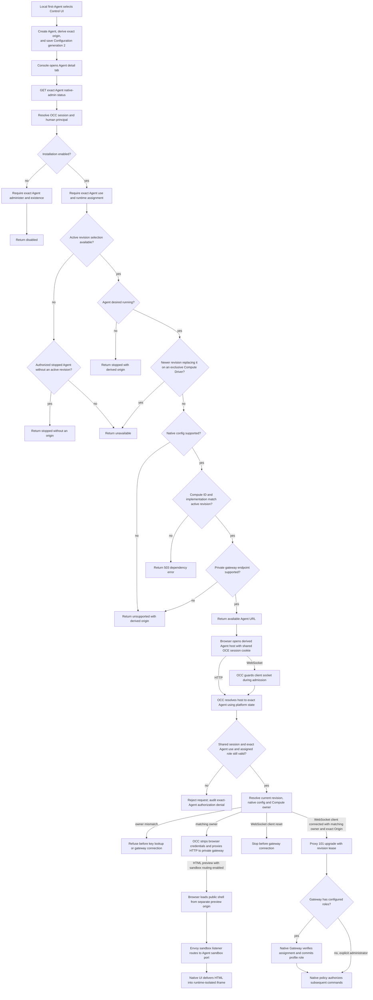

# Agent Native Admin UI Flow

## Overview

OCC checks a Console user's exact Agent `use` grant and runtime assignment,
then returns the active Gateway's stable per-Agent URL. That host authenticates
the shared OCE session cookie, resolves the exact Agent, rechecks authorization,
and proxies native HTTP and WebSocket traffic.

## Entry Points

- Trigger: Console opens an Agent URL, or `scripts/first-agent.mjs --control-ui` creates a compatible local Compose/OpenShell Agent.
- Source: `scripts/first-agent.mjs:nativeConfiguration`
- Source: `apps/controller/src/console/agents/runtime-access.mts:renderRuntimeAccess`
- Source: `apps/controller/src/http/native-admin.ts:resolveNativeAdminAvailability`
- Assumptions: The API has a valid controller session, `agentNativeAdmin.enabled` is true, `agentNativeAdmin.domain` and `agentNativeAdmin.sharedCookieDomain` are configured, Better Auth emits the shared session cookie at that parent domain, and private Agent gateway routing can return a `ComputeDriver.getAgentRuntimeAccess` value.

## Flow

## Execution Trace

### 0. Local first-Agent opts into native admin

`scripts/first-agent.mjs:loadLocalInstallation`
`scripts/first-agent.mjs:nativeConfiguration`
`scripts/first-agent.mjs:ensureManagedConfiguration`

With launcher-owned Compose/OpenShell browser state, the helper saves disabled
Configuration generation 1, creates the Agent, then derives its origin. Before
deployment, generation 2 enables `controlUi`, pins origins, and grants
`occ-workspace-files` trusted-proxy `operator.admin` with device auto-approval.
An existing helper-owned name cannot change this selection.
The printed Control UI URL does not grant human access. An Installation
administrator must assign the person's runtime role through **Share Agent**.

### 1. Console renders native admin availability

`apps/controller/src/console/agents/runtime-access.mts:renderRuntimeAccess`

Agent detail reads `${path}/native-admin` independently of the advisory OCE `administer` answer. Disabled responses and ordinary-user denials hide the panel; denied Installation administrators see self-assignment guidance and **Refresh access**. Other states explain refusals. Only `available` shows the header **Open Agent UI** link with `noopener noreferrer`.

`sessionStorage` caches audited `403` paths per session owner/tab. **Refresh access** forgets the path and retries; logout, sign-in or a new tab resets it. The [page cache](platform-console.md#2-resolve-the-session-before-private-reads) owns Back revalidation. Polling/**Refresh deployment** retries changed `activeRevisionId`/`desiredRuntimeState`, queuing one follow-up during pending reads. Native edits do not update OCE Configuration.

The target description names the version selected for
service; browsing a historical version does not change the destination. Stopped and
unsupported states offer **Open draft**. An unavailable deployment offers **View deployment**
when a readable version exists. Other unavailable states keep Refresh access.

The warning describes Gateway managed mode and OCE overwriting changes made while
it is off; durable configuration belongs in OCE.

Docker and Kubernetes also pass `OPENCLAW_CONFIG_READONLY_NOTICE` to the Gateway
child when the deployed revision enables managed mode
(`apps/controller/src/drivers/compute/runtime-startup.ts:gatewayManagedModeEnvironment`).
A supporting Gateway uses this text to direct administrators to the Console when
configuration is read-only. A change to the draft's managed mode takes effect at deployment.

### 2. OCC protects the availability route

`apps/controller/src/http/native-admin.ts:nativeAdminStatusOperation`

`createNativeAdminAccess` owns host interception, upgrades and socket shutdown.
A getter supplies the initialized controller after bootstrap. Shared route
admission remains in `apps/controller/src/index.ts`.

`GET /namespaces/:namespaceId/agents/:agentId/native-admin` admits humans through `admit`/`resolveIdentity`. Enabled access requires exact Agent `use` plus a runtime assignment, not just `read`/`operate`. Disabled access requires exact Agent `administer` and existence, without an assignment.

### 3. Shared availability resolver checks feature and active revision state

`apps/controller/src/http/native-admin.ts:getNativeAdminStatus`
`apps/controller/src/http/native-admin.ts:resolveNativeAdminAvailability`
`packages/occ/src/index.ts:getUsableActiveAgentRevision`

Enabled access requires a public origin and native domain.
`getUsableActiveAgentRevision` selects the active revision and successor.
Without an active revision, stopped Agents raise `ResourceConflictError`,
returning `stopped` even before first deployment. Desired-running Agents awaiting
activation raise `NoActiveAgentRevisionError`, returning `unavailable`.
Dependencies, including IAM Driver errors caught by `authorizeAgentRuntimeAccess`,
return `503`; denials return `403` with human IAM audits.
The panel reports the active revision.

A successor on a Compute Driver requiring stopped predecessors produces `unavailable`: the worker removes the old workload first. Failed replacement leaves the old revision active without a serving workload. Status and proxy admission both check this boundary.

OCC derives the target from the active revision; desired state other than
`running` returns `stopped`. Compute qualifies trusted-proxy identity, role
headers and device approval covering the selected role.
`nativeAdminConfigurationSupported` checks `controlUi.enabled`, exact
`allowedOrigins` and host-header/device-auth settings. Rejection returns
`unsupported` with the target and a reason: UI configuration, missing role,
insufficient device approval or unsupported transport. Missing endpoints and
unclean private `wss:` URLs also return `unsupported`. Only `available` carries
private `gatewayBase`, omitted from browser responses.
The selected Compute Driver ID and implementation must match `revision.compute`; mismatch returns `503 DEPENDENCY_UNAVAILABLE` before endpoint/key/transport lookup. Driver changes do not migrate revisions.

### 4. OCC derives the isolated Agent host

`apps/controller/src/gateway/native-admin.ts:nativeAdminTarget`
`apps/controller/src/gateway/native-admin-host.mjs:deriveNativeAdminHost`

`deriveNativeAdminHost` hashes Installation, Namespace and Agent IDs into an opaque hostname under the configured domain. `nativeAdminTarget` substitutes that host in `publicOrigin` and returns `/`. first-Agent imports this helper without workspace dependencies.

Native-host admission resolves the hash from Installation, Namespace, and Agent state. Unknown hosts, wrong suffixes, deleted Agents, and non-unique matches fail closed.

`nativeAdminGatewayHttpBase` requires a `wss:` endpoint without userinfo, query, or hash, then converts it to `https:` preserving authority and the Agent base path. Workspace-file WSS behavior stays unchanged.

### 5. Shared cookie admits the Agent host

`apps/controller/src/auth/index.ts:createControllerAuth`

When enabled, native admin passes the configured shared cookie domain to Better Auth. The controller validates that the console and Agent hosts fit that parent on DNS-label boundaries, rejecting public suffixes and malformed domains. It never infers a parent domain. When disabled, the console uses the host-only `openclaw_occ` cookie. A shared-domain cookie cannot use the `__Host-` prefix; one canonical name and scope prevents ambiguous duplicates.

### 6. OCC intercepts native-host HTTP requests

`apps/controller/src/http/native-admin.ts:interceptNativeAdminHttp`

The `onRequest` hook intercepts the native admin domain before routing, so an
Agent origin cannot expose console or controller routes. OCC authenticates the
shared session, resolves the IAM identity and exact Agent, requires `use` and a runtime assignment,
then checks the selected version and native configuration. An attributable IAM
denial records the human and Agent in the denial audit.
Admission owns one audit attempt per such denial, also when it arrives after the
five-second admission wait, a client disconnect or the shutdown wait. A timely HTTP
denial waits for its append before returning `403`; a failed append or admission
timeout returns `503`.

Without a valid session, a user-activated, top-level HTML GET to `/`,
`/chat/main`, or `/chat/main/<32 hex digits>` gets a `302` to the configured
console. Its fragment carries only the opaque host key, which the console resolves
after sign-in and exact-Agent `use` plus assignment checks. OCC drops queries and session suffixes.
API requests, writes, WebSockets and permission denials never redirect. Reload an
open native tab after expiry.

A signed-in runtime-access denial on that navigation stays HTTP 403. The page does
not name the Agent and links **Go to your Agents** to `/console/agents` on the
configured public origin. A JSON refusal names Agent `use` and the required runtime assignment but not
the Agent, the same for an unknown host; WebSocket refusals stay unchanged.

Status and proxy checks reuse one Better Auth lookup for identity, expiry and
attribution. Each WebSocket lease checks the current session again. After handling
stopped, replacing or unsupported Agents, admission rechecks both Compute owner
fields. A mismatch returns HTTP `403` or closes an upgrading socket without an
HTTP response, before gateway-key lookup or connection. A failed lease closes
both sockets.

`apps/controller/src/gateway/native-admin-proxy.ts:proxyNativeAdminHttp`

The proxy bounds paths to the Agent base, checks exact `Origin` for writes, strips browser credentials, forwarding/native authority headers and upstream `Set-Cookie`, and forwards to private HTTPS. It rewrites same-upstream redirects, refuses service-worker scripts and adds CSP `worker-src 'none'`. A user-photo `/api/users/<id>/avatar` upstream `502` becomes an empty `404`: the offline Gateway cannot fetch Gravatar, so the UI shows initials. The native Gateway never receives the OCE cookie.

### 7. OCC proxies native WebSocket upgrades

`apps/controller/src/http/native-admin.ts:handleNativeAdminUpgrade`

The API process intercepts `upgrade` before Fastify routing. It accepts only derived Agent hosts and tracks active sockets so `preClose` destroys them during shutdown. Before awaiting shared-session and exact-Agent admission, it handles client socket errors; a TCP reset during admission therefore does not raise an uncaught socket error. A refused socket closes without waiting for its denial audit, which still runs after a reset. An allowed admission checks for client destruction and shutdown before and after resolving the private transport context, so late success cannot open a gateway connection. A connected client proceeds with the selected version.

`apps/controller/src/gateway/native-admin-proxy.ts:proxyNativeAdminWebSocket`

The WebSocket proxy requires a non-null exact Agent `Origin`, forwards a sanitized upgrade request to the private `https:` gateway base, and only connects the browser after the upstream returns `101`. `onConnect` appends `openclaw.agents.native_admin.websocket.connect`; `onClose` appends `openclaw.agents.native_admin.websocket.close`. The `websocket.connect` audit record includes `connectionId`; the matching `websocket.close` audit record reuses that `connectionId` and includes `closeReason`, whose value distinguishes lifecycle, revocation, dependency, client, upstream, and shutdown paths. A timer rechecks the shared-session admission path every 25 seconds, with each check subject to a five-second timeout. Failed, denied, timed-out, version-changed, role-changed, or session-changed lease checks close both sockets. Denial closure does not wait for the append; a late attributable lease denial still gets its single audit attempt. An authorized reconnect uses the selected version. Native chat does not renew the OCE session.

Admission and close audits share one five-second shutdown drain. Work still pending
afterwards logs `native_admin.pending_work_unresolved` with its count and keeps its
audit attempt while the process lives. The drain neither cancels producers nor
guarantees durable delivery; process exit can prevent or interrupt an audit attempt.

### 8. Runtime commits the verified role before admission

`apps/controller/src/drivers/compute/kubernetes/runtime-access.ts:humanRuntimeAccess`
`deploy/runtime/openclaw-trusted-proxy-role.patch`

Kubernetes offers configured roles and `platform-administrator`; [runtime access](../reference/agent-native-admin.md#who-can-open-it) defines upgrade grants and compatibility. Malformed roles deny entry. `humanRuntimeAccess` rejects invalid scope headers with `role_unavailable` before proxy handoff.

Configured roles use `/people/namespaces/<namespaceId>/agents/<agentId>`, `oce:<Principal ID>` and a policy digest; service traffic uses `/namespaces`. Preparation preserves the serving route across failed candidates; role-free successors leave it for predecessor retirement. OCC overwrites browser authority headers.

The Gateway verifies trusted-proxy authentication, managed identity scope and policy digest. Profiles with multiple managed identities fail. Admission commits the role; HTTP retires prior authority with `401`. Subsequent requests use that role without OCC replay. OpenClaw enforces permissions; backend connections retain `oce-service` and independently authenticated local owners retain access.

OpenClaw intersects requested/proxy scopes for operators; other connections require exact matches. Leases close changed assignments/descriptors within 30 seconds. HTTP/upgrades check current policy; reconnect updates profiles.

### 9. Runtime renders HTML on a separate origin

`apps/controller/src/drivers/compute/kubernetes/index.ts:gatewaySandboxConfiguration`
`apps/controller/src/drivers/compute/kubernetes/index.ts:reconcileGatewayRoute`

With operator sandbox routing configured, preparation and activation render the
Agent's stable preview origin and adjacent sandbox port in its native document.
The worker reconciles its GET/HEAD route, public-shell SecurityPolicy and
Agent-scoped backend ingress policy under the serving revision. A separate Helm listener admits only configured ingress
peers, and the backend targets the sandbox port instead of the admin port.
The preview domain is outside the shared session cookie scope. Native UI still
reads private file content through its authenticated connection, then delivers
it to the runtime's isolated iframe. The sandbox listener serves public shell
and registered renderer assets; runtime CSP and nested frame isolation remain
responsible for executing generated content. See the [routing contract](../reference/gateway-routing.md#public-preview-routing).

For opted-in Kubernetes gateways, `KubernetesComputeDriver.privateStateInitContainer`
copies the admitted configuration from `/etc/openclaw-managed/openclaw.json` to
`/runtime-state/home/.openclaw/openclaw.json` on the init container's writable
volume. The gateway mounts that same home subdirectory at `/home/node`, so native
edits remain Pod-local and the next Pod starts from the admitted configuration.
The init container cannot write through the gateway's later mount path.

`apps/controller/src/drivers/compute/kubernetes/runtime-entrypoints.ts:configureNativeWorkerProfile`
reuses only the exact generated worker profile after a container restart;
conflicting settings fail. `KubernetesComputeDriver.gatewayPrivateStateVolumeMounts`
retains `client/` and its migration receipt with the Gateway database. Native
admin Configuration remains Pod-local.

## Debugging and Verification

Use the [availability states and startup checks](../reference/agent-native-admin.md#failure-behavior)
to distinguish configuration, lifecycle, authorization and dependency failures.
Check `agentNativeAdmin.domain` and platform state for host refusals. The Gateway
must never receive the OCE session cookie.

Attributable IAM denials identify the human and exact Agent. Socket connect/close
audits share `connectionId`; `closeReason` identifies lifecycle, revocation,
dependency, client, upstream or shutdown. A TCP reset during admission must leave
the API running, preserve a later denial audit and open no upstream connection.
Service workers are blocked by the HTTP proxy and `worker-src 'none'`.

Browser tests cover panel states, warnings and launch. Integration covers shared
cookies, service-key/host denials, assets, WebSocket leases/reconnects and native
edits. The [installed sharing case](../testing/kubernetes.md#native-gateway-sharing)
checks role changes and selective revocation with real model turns.

## Related docs

- [Agent native admin UI](../reference/agent-native-admin.md)
- [Platform console](../reference/console.md#open-the-native-admin-ui)
- [Gateway routing with Envoy](../reference/gateway-routing.md#native-admin-ui-routing)
- [Deploy native admin UI access](../guides/deploy/native-admin.md)
- [Workspace files flow](workspace-files.md)

## Manual Notes

[keep this for the user to add notes. do not change between edits]

## Changelog

- 2026-10-28 21:59: Preserve managed-mode guidance and transport refusal before audit settlement while admitting exact runtime assignments. (authoring-run/e355786c-5fa9-4530-a99c-9a6c7c3875d4 - f30db5c4045cbf2c1f5eef4576361112535ed8b4)

- 2026-10-28 19:58: Document how managed deployments supply read-only configuration guidance. (codex/01a1558e-c27f-7bc0-a403-af59e9364ddf - aa352e92bcdc7cab58364c692a01042c5e459db0)

- 2026-10-27 09:30: Document direct Open Agent UI navigation and availability recovery. Accompanying uncommitted changes. (authoring-run/f3434faa-8624-4f34-83a2-521047f80329 - 24a35dff22e1efb2a9b7058f5c90d6d9e2f9caf7)

- 2026-10-26 22:00: Close refused sockets and denied leases before their denial audit settles; track admission through its audit attempt and bound the shutdown drain. (wf-land-1707 - #1707)
- 2026-10-26 01:00: A JSON `administer` denial names the grant, not the Agent.
- 2026-10-25 12:00: Skip the status read when the permission answer denies `administer`.
- 2026-10-24 23:25: Documented the authenticated browser 403 Agents link.
- 2026-10-20 14:54: Extract persistence repair; trim repeated prose. (agent:roboclaw:dashboard:830a6ba7-3357-4ae0-9037-95d98205608c - 1ce18eeea10c83c856c8c08f6b0815e4b39308e0)

[Agent native admin documentation history](agent-native-admin/history.md) preserves the older dated entries.
