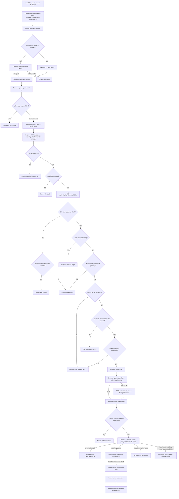

# Agent Native Admin UI Flow

## Overview

Deployment prepares enabled Kubernetes native admin policy in an immutable revision, preserving the reusable Configuration. The console checks exact-Agent `administer` access and returns a stable native admin URL for the selected gateway version. The Agent host uses the OCE session cookie; OCC rechecks access before proxying HTTP and WebSocket traffic.

## Entry Points

- Trigger: Deployment or provisioning admits a revision; Console opens an Agent native admin URL, or `scripts/first-agent.mjs --control-ui` creates a compatible local Compose/OpenShell Agent.
- Source: `scripts/first-agent.mjs:nativeConfiguration`
- Source: `apps/controller/src/console/agents/native-admin.mjs:renderNativeAdminAccess`
- Source: `apps/controller/src/http/native-admin.ts:resolveNativeAdminAvailability`
- Assumptions: The API has a valid controller session, `agentNativeAdmin.enabled` is true, `agentNativeAdmin.domain` and `agentNativeAdmin.sharedCookieDomain` are configured, Better Auth emits the shared session cookie at that parent domain, and private Agent gateway routing can return a `ComputeDriver.getGatewayEndpoint` value.

## Flow

## Execution Trace

### 0. Local first-Agent opts into native admin

`scripts/first-agent.mjs:loadLocalInstallation`
`scripts/first-agent.mjs:nativeConfiguration`
`scripts/first-agent.mjs:ensureManagedConfiguration`

With launcher-owned Compose/OpenShell browser state, the helper saves disabled
Configuration generation 1, creates the Agent, then derives its origin. Before
deployment, generation 2 enables `controlUi`, pins origins, and grants
`occ-workspace-files` trusted-proxy `operator.admin` with device auto-approval.
An existing helper-owned name cannot change this selection.

### 0.5. Deployment admission prepares the Agent copy

`apps/controller/src/gateway/native-admin-origin.ts:nativeAdminOriginResolver`
`packages/occ/src/index.ts:deployAgentWithAuthorization`
`apps/controller/src/drivers/compute/kubernetes/index.ts:configureAgent`

API and worker derive trusted Installation origins through `nativeAdminTarget`.
Helm supplies matching inputs. For the Compose/OpenShell profile,
`compose.native-admin.yaml:services` supplies the same enablement, Agent domain
and public HTTPS origin to the controller and Kubernetes worker. Cookie settings
remain API-only. Deployment and provisioning pass the allocated
Agent and frozen Sandbox copy to Compute through `agentRuntimeConfiguration`.
Agent save remains unchanged. Kubernetes prepares gateway identity, device
approval and exact origins; conflicts refuse admission and opt-outs stay disabled.
OCC then applies Gateway security defaults, logging and validation. It adds the
Agent display name and freezes the result in an Agent revision.
The source Configuration and history stay unchanged. `admitRevision` records
separate Compute metadata; the runtime renders a writable copy.

### 1. Console renders native admin availability

`apps/controller/src/console/agents/native-admin.mjs:renderNativeAdminAccess`

Agent detail reads `${path}/native-admin` only when the Agent permission answer
allows `administer` or is unknown. Disabled or denied access stays hidden;
other refusals explain why. Only `available` enables the header **Open Agent UI** link, opening directly
with `noopener noreferrer`. An audited `403` in the session owner’s tab
`sessionStorage` suppresses reads until logout, sign-in, or a new tab. Changes to
`activeRevisionId` or `desiredRuntimeState` refresh access, coalescing concurrent
requests into one follow-up. The target description names the version selected for
service; browsing a historical version does not change the destination. Stopped and
unsupported states offer **Open draft**. An unavailable deployment offers **View deployment**
when a readable version exists. Other unavailable states keep Refresh access.

The warning describes Gateway managed mode and OCE overwriting changes made while
it is off; durable configuration belongs in OCE.

Docker and Kubernetes also pass `OPENCLAW_CONFIG_READONLY_NOTICE` to the Gateway
child when the deployed revision enables managed mode
(`apps/controller/src/drivers/compute/runtime-startup.ts:gatewayManagedModeEnvironment`).
A supporting Gateway uses this text to direct administrators to the Console when
configuration is read-only. A change to the draft's managed mode takes effect at deployment.

### 2. OCC protects the availability route

`apps/controller/src/http/native-admin.ts:nativeAdminStatusOperation`

`createNativeAdminAccess` owns host interception, upgrades and socket shutdown.
A getter supplies the initialized controller after bootstrap. Shared route
admission remains in `apps/controller/src/index.ts`.

`GET /namespaces/:namespaceId/agents/:agentId/native-admin` requires exact-Agent `administer` through `admit` and `resolveIdentity`. `read` and `operate` do not grant access. Even `disabled` is returned only after authorization and existence checks.

### 3. Shared availability resolver checks feature and selected version state

`apps/controller/src/http/native-admin.ts:getNativeAdminStatus`
`apps/controller/src/http/native-admin.ts:resolveNativeAdminAvailability`
`packages/occ/src/index.ts:getAdministerableActiveAgentRevision`

After the authorization and existence checks above, enabled access requires a public origin/domain and `getAdministerableActiveAgentRevision`.

`ResourceConflictError` for an authorized stopped Agent without a selected version becomes only `status: "stopped"`, including new Agents and completed stops. `NoActiveAgentRevisionError` for a running Agent awaiting activation returns `unavailable`. Other dependencies, including IAM/State outages, remain `503` before gateway routing. The console offers deployment checks and refresh for the selected version, independently of the viewed snapshot.

With a selected version, OCC derives its native target. Non-running Agents return `stopped` with host/origin; a newer exclusive replacement returns `unavailable`. Unsupported trusted-proxy auth, admin scopes/device auto-approval, `controlUi.enabled`, exact `allowedOrigins`, or host-header/device-auth settings return `unsupported` with the target.

Then the selected Compute Driver's `id` and `implementation` must match `revision.compute`. Selection changes do not migrate versions. A mismatch raises status `503 DEPENDENCY_UNAVAILABLE` before endpoint/key/transport. Matching ownership proceeds to endpoint validation; a missing or unclean private `wss:` endpoint returns `unsupported`. Only `available` carries `gatewayBase`, which `nativeAdminAvailabilityData` omits from browser responses.

### 4. OCC derives the isolated Agent host

`apps/controller/src/gateway/native-admin.ts:nativeAdminTarget`
`apps/controller/src/gateway/native-admin-host.mjs:deriveNativeAdminHost`

`deriveNativeAdminHost` hashes Installation, Namespace, and Agent IDs into an opaque hostname under the configured domain. `nativeAdminTarget` substitutes it in `publicOrigin` and returns `/`.

Native-host admission resolves the hash from Installation, Namespace, and Agent state. Unknown hosts, wrong suffixes, deleted Agents, and non-unique matches fail closed.

`nativeAdminGatewayHttpBase` requires a `wss:` endpoint without userinfo, query, or hash, then converts it to `https:` preserving authority and the Agent base path. Workspace-file WSS behavior stays unchanged.

### 5. Shared cookie admits the Agent host

`apps/controller/src/auth/index.ts:createControllerAuth`

When enabled, native admin passes the configured shared cookie domain to Better Auth. The controller validates that the console and Agent hosts fit that parent on DNS-label boundaries, rejecting public suffixes and malformed domains. It never infers a parent domain. When disabled, the console uses the host-only `openclaw_occ` cookie. A shared-domain cookie cannot use the `__Host-` prefix; one canonical name and scope prevents ambiguous duplicates.

### 6. OCC intercepts native-host HTTP requests

`apps/controller/src/http/native-admin.ts:interceptNativeAdminHttp`

The `onRequest` hook intercepts the native admin domain before routing, so an
Agent origin cannot expose console or controller routes. OCC authenticates the
shared session, resolves the IAM identity and exact Agent, requires `administer`,
then checks the selected version and native configuration. An attributable IAM
denial records the human and Agent in the denial audit.
Admission owns one audit attempt per such denial, also when it arrives after the
five-second admission wait, a client disconnect or the shutdown wait. A timely HTTP
denial waits for its append before returning `403`; a failed append or admission
timeout returns `503`.

Without a valid session, a user-activated, top-level HTML GET to `/`,
`/chat/main`, or `/chat/main/<32 hex digits>` gets a `302` to the configured
console. Its fragment carries only the opaque host key, which the console resolves
after sign-in and exact-Agent authorization. OCC drops queries and session suffixes.
API requests, writes, WebSockets and permission denials never redirect. Reload an
open native tab after expiry.

A signed-in `administer` denial on that navigation stays HTTP 403. The page does
not name the Agent and links **Go to your Agents** to `/console/agents` on the
configured public origin. A JSON refusal names the `administer` grant but not
the Agent, the same for an unknown host; WebSocket refusals stay unchanged.

Status and proxy checks reuse one Better Auth lookup for identity, expiry and
attribution. Each WebSocket lease checks the current session again. After handling
stopped, replacing or unsupported Agents, admission rechecks both Compute owner
fields. A mismatch returns HTTP `403` or closes an upgrading socket without an
HTTP response, before gateway-key lookup or connection. A failed lease closes
both sockets.

`apps/controller/src/gateway/native-admin-proxy.ts:proxyNativeAdminHttp`

The HTTP proxy validates and normalizes the request URL, which must not exceed 4,096 characters, rejects missing or nonmatching `Origin` on non-GET/HEAD requests, strips browser cookies, service keys, forwarding headers, native identity, native scopes, and upstream `Set-Cookie`, rejects service-worker script requests, rewrites same-upstream `Location` values to the Agent origin, appends `worker-src 'none'` to proxied Content Security Policy, and forwards to the private `https:` gateway base. A `502` from the gateway's user-photo route (`/api/users/<id>/avatar`) becomes an empty `404`: it means OpenClaw could not fetch a Gravatar fallback, which a dedicated Gateway without internet egress never can, and the UI shows initials for both. The native gateway never receives the OCE session cookie.

### 7. OCC proxies native WebSocket upgrades

`apps/controller/src/http/native-admin.ts:handleNativeAdminUpgrade`

The API process intercepts `upgrade` before Fastify routing. It accepts only derived Agent hosts and tracks active sockets so `preClose` destroys them during shutdown. Before awaiting shared-session and exact-Agent admission, it handles client socket errors; a TCP reset during admission therefore does not raise an uncaught socket error. A refused socket closes without waiting for its denial audit, which still runs after a reset. An allowed admission checks for client destruction and shutdown before and after resolving the private transport context, so late success cannot open a gateway connection. A connected client proceeds with the selected version.

`apps/controller/src/gateway/native-admin-proxy.ts:proxyNativeAdminWebSocket`

The WebSocket proxy requires a non-null exact Agent `Origin`, forwards a sanitized upgrade request to the private `https:` gateway base, and only connects the browser after the upstream returns `101`. `onConnect` appends `openclaw.agents.native_admin.websocket.connect`; `onClose` appends `openclaw.agents.native_admin.websocket.close`. The `websocket.connect` audit record includes `connectionId`; the matching `websocket.close` audit record reuses that `connectionId` and includes `closeReason`, whose value distinguishes lifecycle, revocation, dependency, client, upstream, and shutdown paths. A timer rechecks the shared-session admission path every 25 seconds, with each check subject to a five-second timeout. Failed, denied, timed-out, or version-changed lease checks close both sockets. Denial closure does not wait for the append; a late attributable lease denial still gets its single audit attempt. An authorized reconnect uses the selected version. Native chat does not renew the OCE session.

Admission and close audits share one five-second shutdown drain. Work still pending
afterwards logs `native_admin.pending_work_unresolved` with its count and keeps its
audit attempt while the process lives. The drain neither cancels producers nor
guarantees durable delivery; process exit can prevent or interrupt an audit attempt.

### 8. Runtime renders HTML on a separate origin

`apps/controller/src/drivers/compute/kubernetes/index.ts:gatewaySandboxConfiguration`
`apps/controller/src/drivers/compute/kubernetes/index.ts:reconcileGatewayRoute`

With operator sandbox routing configured, preparation and activation render the
Agent's stable preview origin and adjacent sandbox port in its native document.
The worker reconciles its GET/HEAD route, public-shell SecurityPolicy and
Agent-scoped backend ingress policy under the serving version. A separate Helm listener admits only configured ingress
peers, and the backend targets the sandbox port instead of the admin port.
The preview domain is outside the shared session cookie scope. Native UI still
reads private file content through its authenticated connection, then delivers
it to the runtime's isolated iframe. The sandbox listener serves public shell
and registered renderer assets; runtime CSP and nested frame isolation remain
responsible for executing generated content. See the [routing contract](../reference/gateway-routing.md#public-preview-routing).

For opted-in Kubernetes gateways, `KubernetesComputeDriver.privateStateInitContainer`
copies the admitted configuration from `/etc/openclaw-managed/openclaw.json` to
`/runtime-state/home/.openclaw/openclaw.json` on the init container's writable
volume. The gateway mounts that same home subdirectory at `/home/node`, so native
edits remain Pod-local and the next Pod starts from the admitted configuration.
The init container cannot write through the gateway's later mount path.

`apps/controller/src/drivers/compute/kubernetes/runtime-entrypoints.ts:configureNativeWorkerProfile`
reuses only the exact generated worker profile after a container restart;
conflicting settings fail. `KubernetesComputeDriver.gatewayPrivateStateVolumeMounts`
retains `client/` and its migration receipt with the Gateway database. Native
admin Configuration remains Pod-local.

## Debugging and Verification

- Startup rejects invalid settings with `AGENT_NATIVE_ADMIN_INVALID`,
  `AUTH_BASE_URL_INVALID`, `AUTH_SECRET_INVALID` or `GATEWAY_API_KEY_UNAVAILABLE`.
  Follow [troubleshooting](../guides/deploy/native-admin.md#troubleshooting).
- Check [availability outcomes](../reference/agent-native-admin.md#authorization-and-availability)
  against the selected Agent version and runtime state; unknown hosts never reach
  the gateway. The gateway must not receive OCE cookies.
- Verify attributable IAM denials, including after a reset during WebSocket
  admission. No connection opens for a disconnected client.
- WebSocket connect/close audits must share `connectionId`; close includes
  `closeReason`. Service-worker registration must fail.
- Browser tests cover visibility and launch. Integration and WebSocket cases
  cover admission, assets, leases, reconnects and denied effects. Genuine native
  UI proof uses the [Kubernetes procedure](../testing/kubernetes.md#native-gateway-sharing).

## Related docs

- [Proposed Compute preparation contract](../../specs/rfcs/0024-native-admin-deployment-preparation.md)
- [Agent native admin UI](../reference/agent-native-admin.md)
- [Platform console](../reference/console.md#open-the-native-admin-ui)
- [Gateway routing with Envoy](../reference/gateway-routing.md#native-admin-ui-routing)
- [Deploy native admin UI access](../guides/deploy/native-admin.md)
- [Workspace files flow](workspace-files.md)

## Manual Notes

[keep this for the user to add notes. do not change between edits]

## Changelog

- 2026-10-28 21:19: Preserve deployment preparation with Gateway security defaults, Agent naming and managed-mode write restrictions. Accompanying uncommitted refresh. (authoring-run/5f285180-08bf-4414-abea-d615c472c459 - 37fac70dfb784351544189ad07909588b327ef47)

- 2026-10-28 19:58: Document how managed deployments supply read-only configuration guidance. (codex/01a1558e-c27f-7bc0-a403-af59e9364ddf - aa352e92bcdc7cab58364c692a01042c5e459db0)

- 2026-10-27 09:30: Document direct Open Agent UI navigation and availability recovery. Accompanying uncommitted changes. (authoring-run/f3434faa-8624-4f34-83a2-521047f80329 - 24a35dff22e1efb2a9b7058f5c90d6d9e2f9caf7)

- 2026-10-26 22:00: Close refused sockets and denied leases before their denial audit settles; track admission through its audit attempt and bound the shutdown drain. (wf-land-1707 - #1707)
- 2026-10-26 01:00: A JSON `administer` denial names the grant, not the Agent.
- 2026-10-25 12:00: Skip the status read when the permission answer denies `administer`.
- 2026-10-24 23:25: Documented the authenticated browser 403 Agents link.
- 2026-10-20 14:54: Extract persistence repair; trim repeated prose. (agent:roboclaw:dashboard:830a6ba7-3357-4ae0-9037-95d98205608c - 1ce18eeea10c83c856c8c08f6b0815e4b39308e0)

[Agent native admin documentation history](agent-native-admin/history.md) preserves the older dated entries.
