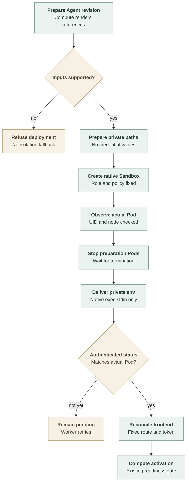

# Application Sandbox provisioning flow

## Overview

Kubernetes Compute delegates the Gateway application to the selected Sandbox
Driver's optional application provider. Dedicated Codex keeps its ordinary
Kubernetes Harness; embedded OpenClaw moves its combined Gateway/Harness into
the same boundary. This trace describes the fork's development experiment,
not production qualification. It ends when Compute can activate the existing
route through a credential-minimal frontend, or must keep the revision pending.

## Entry Points

- Trigger: the worker prepares or activates an Agent revision whose Installation
  selects application containment.
- Source: `apps/controller/src/drivers/compute/kubernetes/index.ts:reconcileApplicationDeployment`
- Source: `apps/controller/src/drivers/sandbox/openshell.ts:createOpenShellSandboxDriver`
- Assumptions: OCC has authorized deployment and frozen the Agent revision;
  Kubernetes Compute has prepared Namespace isolation, configuration, identity,
  and storage references; the development profile selects stock OpenShell.

## Flow

The arrows show source integration. They do not establish a passing real-runtime
qualification run.

## Execution Trace

### 1. Keep Compute ownership and select the application role

`apps/controller/src/drivers/compute/kubernetes/index.ts:reconcileApplicationDeployment`

Compute prepares the original application specification, including exact Secret
references and state mounts. `applicationRequirements` converts this into the
shared application contract rather than passing an arbitrary Pod. It rejects
implicit environment sources, projected identities, host privileges, and extra
declared listeners. Compute supplies trusted runtime peers, model hosts where
needed, and Installation address exclusions.

`admitRevision` records application placement in `compute.admission`. Preparation
refuses a stored revision whose selected provider no longer matches that fact.
Stop and retirement use it to remove the Compute-owned ordinary Codex Harness
even when the native provider is unavailable, then report incomplete native cleanup.

`apps/controller/src/drivers/sandbox/openshell.ts:createOpenShellSandboxDriver`

`workloadTarget: application` selects the application provider, not
`provisionHarness`. The factory retains Workspace ownership but omits the
OpenShell Harness configuration transform. Dedicated Codex therefore keeps its
internal sandbox and ordinary Kubernetes lifecycle.

### 2. Prepare paths without exposing private environment values

`apps/controller/src/drivers/sandbox/openshell-application.ts:provision`

The provider derives the role and Sandbox name from the Agent revision. It
checks existing ownership and fingerprints prepared requirements and source
resource versions. A changed generation requires replacement, not adoption of
another configuration.

`apps/controller/src/drivers/sandbox/openshell-application-projection.ts:buildApplicationProjection`

The first preparation phase mounts only the new bootstrap PVC and read-only
ConfigMaps. The second checks state ownership and runs private-state
initialization without a pod-level `fsGroup` that could rewrite existing state.
Both phases have no API token and deny-all networking. Phase progression must
not return from initialization to preparation on a later worker pass.

A separate environment PVC is reserved for the native payload. Neither
preparation phase mounts it or receives model, channel, or Harness credentials.

### 3. Create the native boundary and deliver credentials inside it

`apps/controller/src/drivers/sandbox/openshell-application-policy.ts:compileOpenShellApplicationNetworkPolicy`

The compiler combines the admitted Gateway destinations with Compute-generated
dependencies and current/admitted exclusions. It creates whole-application
host/port rules with public-address restrictions for both DNS answer families.
The initial cluster profile targets IPv4 transport. It rejects `publicHttps`; it does
not copy Harness network authority or authorize HTTP methods.

`apps/controller/src/drivers/sandbox/openshell-application.ts:provision`

The provider creates or verifies the native Sandbox and its guarded Gateway and
status exposures. It verifies the actual Pod's identity and token isolation.
Preparation must finish, and its Pods must terminate, before private delivery.

`apps/controller/src/drivers/sandbox/openshell-gateway-client.ts:execSandbox`

Resolved environment values travel only on private native-exec stdin. The
in-Pod delivery command accepts at most 400,000 bytes, verifies generation and
Pod identity, and atomically publishes owner-only environment and readiness
files in the native-only environment PVC. An identical retry succeeds without
rewriting active material; another identity or different values fail.

### 4. Authenticate the transport and return readiness to Compute

`apps/controller/src/drivers/sandbox/openshell-application-guard.ts:createApplicationGuardProgram`

The guard waits for the private marker, starts the original application, and
authenticates the revision transport token before forwarding Gateway and status
requests. It removes that transport header before forwarding. This guard is not
an isolation boundary between code in the same application.

`apps/controller/src/drivers/compute/kubernetes/application-workload.ts:applicationFrontend`

Compute reconciles its existing Gateway Deployment as a fixed-target frontend.
It receives the transport token but no integration/model credentials. The
provider's `readStatus` binds status to the current native Pod and container;
Compute retains its activation checks. Missing or mismatched evidence leaves
the revision pending. Stop and retirement call application cleanup before
releasing private storage.

## Debugging and Verification

- Compare `openclaw.dev/application-projection-phase` with Deployment readiness
  and `observedGeneration`. Repeated preparation after initialization indicates
  incorrect phase progression.
- Check native Pod UID/GID, read-only configuration mounts, and the native-only
  environment claim. Never print its environment files or Secret contents.
- Use [application checks](../testing/application-sandbox.md) for real Agent
  allow/deny, authenticated routing, ClawHub, filesystem, and lifecycle evidence.
  Source, syntax, and local component checks do not prove those outcomes.

## Related docs

- [Application containment](../reference/drivers/application-sandbox.md)
- [SandboxDriver contract](../reference/drivers/sandbox.md)
- [Harness execution topology](harness-execution-topology.md)
- [OpenShell Harness provisioning](openshell-sandbox-provisioning.md)

## Manual Notes

[keep this for the user to add notes. do not change between edits]

## Changelog

- 2026-10-25 22:58: Document the accompanying experimental application provider and private delivery path (authoring-run/6e9694ae-69d3-4c1b-a0d0-1f79208798c5 - 05aba03f1a51362b5b309d73617d6418874c6411)
