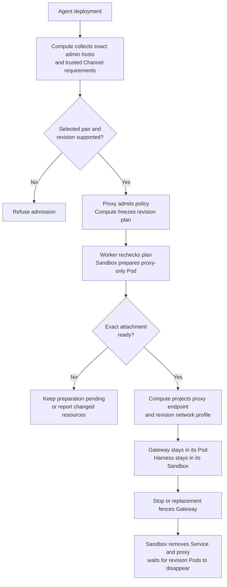

# Gateway outbound destination flow

## Overview

**Experimental — UNVERIFIED. Not supported for production.** This trace describes
the draft source for [RFC-0024](../../specs/rfcs/0024-gateway-outbound-proxy-reuse.md),
not an accepted or qualified deployment. The experiment must remain a draft and
must not be merged. The [implementation plan](../../specs/plans/0024-gateway-outbound-proxy-reuse.md)
tracks required acceptance evidence.

A regular Agent deployment asks Kubernetes Compute to admit destination-only
Gateway access. The selected Credential Proxy admits a nonsecret policy; its
paired Sandbox owns a separate proxy-only Pod. Compute keeps Gateway and Harness
placement unchanged, freezes the plan in the Agent revision, and owns routing
and retirement. The flow stops after revision-owned attachment cleanup.

Source inspection establishes callers, not working enforcement. No real cluster,
stock-binary forwarding, TLS, Channel, or model result has been obtained for this
experiment. Cross-component selectors and cleanup remain acceptance conditions,
not guarantees inferred from these helpers.

## Entry Points

- Trigger: authorized Agent deployment through the ordinary revision and worker
  lifecycle, with trusted Compute `runtime.gatewayOutbound` configuration.
- Admission: `apps/controller/src/drivers/compute/kubernetes/index.ts:admitRevision`.
- Registration: `apps/controller/src/drivers/egress-proxy/openshell-registration.ts:createOpenShellCapabilities`.
- Attachment: `apps/controller/src/drivers/sandbox/gateway-proxy-attachment.ts:openShellGatewayProxyAttachment`.
- Scope: dedicated, single-cluster execution with the exact selected Sandbox and
  destination-only Credential Proxy; no combined protected execution, egress plan,
  or anonymous GitHub-read admission. Embedded execution is unchanged.

## Flow

The arrows describe draft source calls. They do not show live enforcement proof.

## Execution Trace

### 1. Select the paired capabilities

Startup constructs these capabilities before Agent deployment. Registration does
not admit a revision or perform its network operations.

`apps/controller/src/drivers/egress-proxy/openshell-registration.ts:createOpenShellCapabilities`
creates the paired views. Destination-only selection refuses repository or
credential authority, passes attachment options to the Sandbox, and constructs
`createOpenShellDestinationProxy`. Its credential-execution methods refuse calls;
it does not manufacture a CredentialSource, protected execution, or receipt.

`packages/contracts/src/gateway-destinations.ts:GatewayDestinationControl`
separates pure admission from `GatewayProxyAttachment.prepare/remove`. The Sandbox
constructor installs the attachment capability when the registration selects it.
The adapter checks stock asset hashes and digest-pinned supervisor/relay images.

### 2. Freeze destination permission in the revision

`apps/controller/src/drivers/compute/kubernetes/index.ts:gatewayDestinationRequirements`
combines the administrator's exact DNS hosts on TCP/443 with requirements from
one selected Channel contributor per enabled provider. Administrator wildcards
are rejected. `apps/controller/src/drivers/channel/slack.ts:gatewayDestinations`
contributes the apex and single-label wildcard forms of `slack.com`,
`slack-edge.com`, and `slack-msgs.com` for Socket Mode. These are trusted
implementation contributions, not user-supplied wildcard grants or Slack channel IDs.

`apps/controller/src/drivers/compute/kubernetes/index.ts:admitGatewayDestinations`
checks the selected pair and revision scope.
`apps/controller/src/drivers/egress-proxy/gateway-destinations.ts:openShellGatewayDestinations`
builds the policy and revision endpoint. Compute returns the serialized result
under `gateway-destinations:v1:`;
`packages/occ/src/index.ts:10495` saves it in the immutable Agent revision. The result
binds Namespace, Agent, revision, Driver identities, policy hash, attachment digest,
and endpoint. The implementation admits at most 128 contributed entries.

`apps/controller/src/drivers/compute/kubernetes/index.ts:gatewayDestinationPlan`
re-admits the saved destinations and compares the complete result before use.
It does not derive fresh permissions for a revision without that admission.
A changed selected capability or asset requires a new revision rather than a
broader retry. Destination permission grants no credential, provider action,
plugin identity, or tenant authorization.

### 3. Prepare the proxy-only attachment

`apps/controller/src/drivers/compute/kubernetes/index.ts:prepareGatewayProxy`
refuses an unprofiled legacy runtime egress grant and clears the old channel
route before calling the paired Sandbox. Gateway preparation waits for that result.
`apps/controller/src/drivers/sandbox/gateway-proxy-attachment.ts:openShellGatewayProxyAttachment`
creates a revision-owned immutable ConfigMap, NetworkPolicy, Deployment, and
ClusterIP Service. It checks ownership and authored fields instead of patching
an existing attachment into a different policy.

The separate Pod runs stock OpenShell `--role=network-proxy` on
`127.0.0.1:3128` and stock `socat` on TCP/3129. The relay transports bytes to
loopback; it does not implement HTTP authorization. The Pod has no Gateway,
Harness, credential Secret, workspace, projected identity, or service-account
token. Readiness requests a denied CONNECT from the actual policy engine; a
listening relay alone is insufficient. The adapter also compares the observed
container image identities with the pinned digests. A false readiness result
keeps preparation pending. Unexpected ownership or configuration throws.

The attachment authors DNS and public IPv4 TCP/443 egress, excluding built-in
nonpublic ranges and configured infrastructure CIDRs. These rules require an
enforcing CNI and accurate cluster ranges. Stock OpenShell remains responsible
for CONNECT/DNS decisions. No TLS interception or credential injection is added;
the Gateway retains upstream certificate verification.

### 4. Route the existing Gateway

`apps/controller/src/drivers/compute/kubernetes/index.ts:prepareGatewayProxy`
adds DNS, inbound Gateway access, configured private status ingress, and exact
proxy-peer grants.
The workload projection in `apps/controller/src/drivers/compute/kubernetes/index.ts`
sets uppercase/lowercase proxy variables to the revision Service and sets
`NO_PROXY` for loopback and required Harness names. Gateway Pods use
`gateway-destinations-v1`; ordinary channel/model grants select a different
profile. Existing direct Harness and workspace-node transports retain their
own grants. Secret environment bindings cannot override proxy variables. Neither
workload moves into the proxy Pod.

NetworkPolicy allows are additive. Acceptance must show that every matching
policy preserves the boundary, reciprocal peer labels agree with actual Pods,
and clients without proxy settings cannot reach public destinations or another
proxy. Proxy variables alone do not establish mandatory routing. CONNECT limits
host/port, not encrypted HTTP actions or response contents.

### 5. Fence and retire the revision

`apps/controller/src/drivers/compute/kubernetes/index.ts:removeStoppedGateway`
removes serving routes and Gateway resources, waits for its Pods, and calls
`removeGatewayProxy`. Yielding stop and retirement paths also call cleanup.
The Sandbox removes the revision Service before the Deployment, waits for
proxy Pods to disappear, then removes the policy files and NetworkPolicy.
Deletion checks ownership and UID/resource-version preconditions. Incomplete
removal returns false; Compute reports a dependency failure rather than cleanup
success. Replacement uses a distinct revision attachment.

Pod disappearance is not yet measured proof that established connections close
at the required boundary. Do not infer immediate withdrawal from a policy-file
edit, Service removal, or deletion of one additive NetworkPolicy.

## Debugging and Verification

Use the [experimental QA procedure](../testing/gateway-outbound-destinations.md)
for inputs, commands, expected results, cleanup, and missing acceptance cases.
Inspect `compute.admission`, the policy/attachment annotations, actual Pod labels,
and every matching NetworkPolicy before diagnosing a routing failure. A proxy
readiness denial is expected; it is not a successful upstream request.

The draft real scenario exercises Agent admission, proxy forwarding, direct
TCP/443 denial, revision isolation, replacement, outage, and cleanup when run.
Its presence is not a passing result. Documentation structural checks and
syntax-only checks cannot qualify the stock binary or CNI boundary.

## Related docs

- [Architecture implementation status](../design.md#implementation-status)
- [Kubernetes networking](../reference/drivers/kubernetes-compute/networking-and-isolation.md)
- [Credential Proxy contract](../reference/drivers/credential-proxy.md)
- [Sandbox contract](../reference/drivers/sandbox.md)
- [Harness execution topology](harness-execution-topology.md)

## Manual Notes

[keep this for the user to add notes. do not change between edits]

## Changelog

- 2026-10-28 19:04: Trace experimental draft source and mark runtime acceptance unverified. (authoring-run/e4a4150b-1969-47ea-a5ab-88dc8b4a2061 - 45224b0b8ea6927e16d95c2e525ca182c28f365f)
