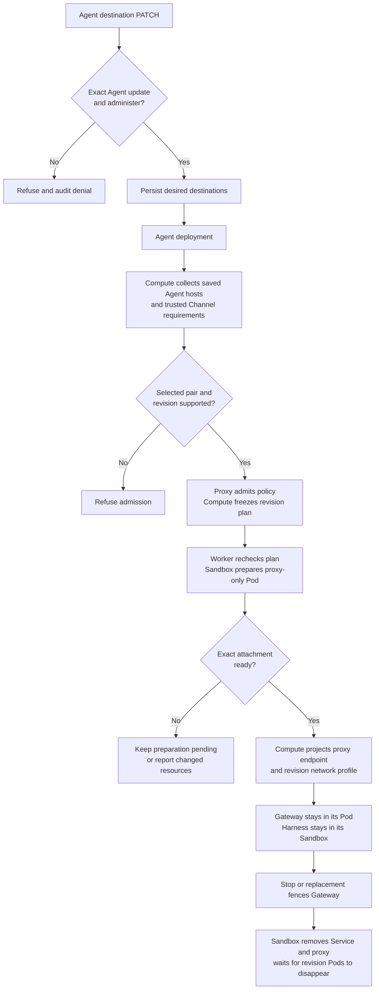

# Gateway outbound destination flow

## Overview

**Experimental — UNVERIFIED. Not supported for production.** This trace describes
the draft source for [RFC-0024](../../specs/rfcs/0024-gateway-outbound-proxy-reuse.md),
not an accepted or qualified deployment. The experiment must remain a draft and
must not be merged. The [implementation plan](../../specs/plans/0024-gateway-outbound-proxy-reuse.md)
tracks required acceptance evidence.

Gateway-hosted integrations need external connections; a separate Harness's
network access does not carry those requests. This experiment extends the selected Credential Proxy
capability with destination policy, without moving either workload. Requests pass from
the Gateway through a Kubernetes Service to a separate Pod containing a socat TCP
relay and OpenShell's network proxy. OpenShell checks the destination; Kubernetes
must block direct Internet access from the Gateway. Integration credentials and
external TLS verification stay in the Gateway. Embedded networking is unchanged.

The controller saves the policy for the Agent revision, creates and checks the
proxy resources, configures Gateway routing, and removes those resources when the
revision stops. The [RFC](../../specs/rfcs/0024-gateway-outbound-proxy-reuse.md)
explains the request path and why the existing platform interfaces own this work.
Here, “proxy attachment” means the proxy Pod, Service, policy files and network rules;
“paired” means the policy and resource-management implementations selected together.
Neither term means that the Gateway runs inside an OpenShell sandbox. The selected OpenShell Credential Proxy retains its protected Harness operations
and also admits Gateway destination policies. The Sandbox creates separate proxy
instances for these paths; Gateway permission grants no protected credential authority.

Every dedicated single-cluster Gateway uses the new route instead of the bundled
Slack proxy. Compute clears the old Channel grant and projects the revision proxy
address. The bundled Slack proxy remains available for control-plane credential
validation and directory lookup; separate execution clusters retain their existing route. Enabled Channels
remain refused in embedded mode. See the
[Slack consumer paths](../guides/integrations/slack.md#configure-both-slack-proxies).

The stock OpenShell/relay Docker test and scoped real attachment checks pass.
Full Gateway integration traffic, Channel behavior, Compute network enforcement
and the complete Agent workflow remain unverified. The
[QA procedure](../testing/gateway-outbound-destinations.md) defines each proof boundary.

## Entry Points

- Trigger: an authorized Agent destination update followed by ordinary deployment
  and worker reconciliation. Destination writes require exact-Agent `update` and
  `administer`; deployment uses existing deployment permissions.
- Admission: `apps/controller/src/drivers/compute/kubernetes/index.ts:admitRevision`.
- Registration: `apps/controller/src/drivers/egress-proxy/openshell-registration.ts:createOpenShellCapabilities`.
- Attachment: `apps/controller/src/drivers/sandbox/gateway-proxy-attachment.ts:openShellGatewayProxyAttachment`.
- Scope: dedicated, single-cluster execution with the exact selected Sandbox and
  Credential Proxy. Protected Harness and repository admission facts coexist with
  the Gateway policy. Embedded execution and separate execution clusters are unchanged.

## Flow

The arrows describe draft source calls. They do not show live enforcement proof.

## Execution Trace

### 1. Select policy validation and proxy resource management

Startup constructs these capabilities before Agent deployment. Registration does
not admit a revision or perform its network operations.

`apps/controller/src/drivers/egress-proxy/openshell-registration.ts:createOpenShellCapabilities`
creates the paired views, passes attachment options to the Sandbox, and constructs
`OpenShellCredentialProxyDriver`. Its `gatewayDestinations` capability admits
nonsecret Gateway policy while existing credential and repository methods retain
their own authority checks and proxy instances.

`apps/controller/src/composition/installation-config.ts:loadInstallationConfiguration`
interprets `drivers.credential_proxy.usage: gateway` as attachment-only selection.
API and worker register the pair without selecting its Sandbox or Credential Proxy
for execution. Compute receives `gatewayProxyDriver` separately from its protected
execution owner. The revision's Harness `sandboxDriverId` is not a Gateway proxy
ownership field. Default execution usage retains its existing selection and
credential authority checks. Both processes close the pair at shutdown.

`scripts/render-installation-profile.mjs:renderGatewayProxy` requires explicit
operator pair configurations and infrastructure ranges. It uses the portable
Driver-owned `apps/controller/src/drivers/egress-proxy/gateway-destinations-configuration.ts:gatewayDestinationsOptions`
validator, so rendering does not load the runtime dependency graph. API and worker
startup validate the remaining Driver configuration and asset files.

`packages/contracts/src/gateway-destinations.ts:GatewayDestinationControl`
separates pure admission from `GatewayProxyAttachment.prepare/remove`. The Sandbox
constructor installs the attachment capability when the registration selects it.
The adapter checks stock asset hashes and digest-pinned supervisor/relay images.

### 2. Freeze destination permission in the revision

`apps/controller/src/http/agents.ts:updateAgent` calls
`packages/occ/src/index.ts:updateAgent`. OCC requires both `update` and
`administer` on the exact Agent for an explicit destination write, including an
empty list. Create, provision and preflight reject nonempty lists because no
Agent exists yet to authorize. The API records successful mutations and
authorization denials. `packages/occ/src/state/postgres-state.ts:updateConfiguration`
saves the desired list in `occ.agents.gateway_outbound`; deployment saves a
separate immutable copy in the revision.

`apps/controller/src/drivers/compute/kubernetes/index.ts:gatewayDestinationRequirements`
combines the revision's saved `gatewayOutbound.destinations` on TCP/443 with requirements from
one selected Channel contributor per enabled provider. Administrator wildcards
are rejected. `apps/controller/src/drivers/channel/slack.ts:gatewayDestinations`
contributes the apex and single-label wildcard forms of `slack.com`,
`slack-edge.com`, and `slack-msgs.com` for Socket Mode. These are trusted
implementation contributions, not user-supplied wildcard grants or Slack channel IDs.

`apps/controller/src/drivers/compute/kubernetes/index.ts:admitGatewayDestinations`
checks the selected pair and revision scope. It requires explicit Compute
`network.infrastructureCidrs` and checks that the plan's IPv4 exclusions cover
those ranges, built-in nonpublic ranges and configured literal infrastructure
endpoints. `apps/controller/src/drivers/kubernetes/gateway-proxy-network.ts:gatewayProxyExclusionsCover`
rejects missing coverage and partial overlap.
`apps/controller/src/drivers/egress-proxy/gateway-destinations.ts:openShellGatewayDestinations`
builds the policy and revision endpoint. Compute returns the serialized result
under `kubernetes:v1:` as `gatewayDestinations`, beside optional `execution`
admission facts, the paired Driver reference and each Channel's provider, Driver
identity and required destinations. `packages/occ/src/index.ts:deployAgent` saves
it in the immutable
Agent revision with the additional destinations and Channel configuration. The result
binds Namespace, Agent, revision, Driver identities, policy hash, attachment digest,
and endpoint. The implementation admits at most 128 contributed entries.

`apps/controller/src/drivers/compute/kubernetes/index.ts:gatewayDestinationPlan`
checks the saved plan against the destinations and Channel configuration in that
same revision. Missing admission refuses a dedicated single-cluster deployment;
it does not restore an older Slack route.
A changed selected capability or asset requires a new revision rather than a
broader retry. Destination permission grants no credential, provider action,
plugin identity, or tenant authorization.

### 3. Prepare the proxy-only attachment

`apps/controller/src/drivers/compute/kubernetes/index.ts:prepareGatewayProxy`
refuses an unprofiled legacy runtime egress grant and clears the old channel
route before calling the paired Sandbox. Gateway preparation waits for that result.
`apps/controller/src/drivers/sandbox/gateway-proxy-attachment.ts:openShellGatewayProxyAttachment`
creates a revision-owned immutable ConfigMap, NetworkPolicy, Deployment, and
ClusterIP Service. It checks ownership and authored fields instead of patching
an existing attachment into a different policy. Before `KubernetesObjectApi.create`,
it deserializes the NetworkPolicy manifest into the SDK model so `ingress.from`
uses the SDK's `_from` field. Read verification restores the wire field and compares
the complete policy. Pod verification accepts omitted false host-access defaults;
Deployment verification permits only the controller's numeric revision annotation
in addition to the attachment annotations.

The separate Pod runs stock OpenShell `--role=network-proxy` on
`127.0.0.1:3128` and stock `socat` on TCP/3129. The relay transports bytes to
loopback; it does not implement HTTP authorization. The Pod has no Gateway,
Harness, credential Secret, workspace, projected identity, or service-account
token. Readiness requests a denied CONNECT from the actual policy engine; a
listening relay alone is insufficient. Stock OpenShell creates `/tls/private` as
UID 10001 with mode 0700 inside the memory-backed volume; it does not use the
kubelet-owned volume root as its private directory. The adapter checks the pinned
Pod image specifications and observed container image digests. It does not require
the container runtime's reported image name to retain the input spelling. A false readiness result
keeps preparation pending. Unexpected ownership or configuration throws.

The attachment authors DNS and public IPv4 TCP/443 egress using exactly the
exclusions saved in `plan.egress.excludedCidrs`. It rechecks that plan against
the selected assets and configuration before applying or deleting resources. These rules require an
enforcing CNI and accurate cluster ranges. Stock OpenShell remains responsible
for CONNECT/DNS decisions. No TLS interception or credential injection is added;
the Gateway retains upstream certificate verification.

### 4. Route the existing Gateway

`apps/controller/src/drivers/compute/kubernetes/index.ts:prepareGatewayProxy`
adds DNS, inbound Gateway access, configured private status ingress, and exact
proxy-peer grants.
The workload projection in `apps/controller/src/drivers/compute/kubernetes/index.ts`
sets uppercase/lowercase proxy variables to the revision Service and sets
`NO_PROXY` for loopback and required Harness names. It also sets
`NODE_USE_ENV_PROXY=1` for the image's Node HTTP(S) and fetch clients. Gateway Pods use
`gateway-destinations-v1`; ordinary channel/model grants select a different
profile. Existing direct Harness and workspace-node transports retain their
own grants. Secret environment bindings cannot override proxy variables. Neither
workload moves into the proxy Pod.

NetworkPolicy allows are additive. Acceptance must show that every matching
policy preserves the boundary, reciprocal peer labels agree with actual Pods,
and clients without proxy settings cannot reach public destinations or another
proxy. Proxy variables alone do not establish mandatory routing. CONNECT limits
host/port, not encrypted HTTP actions or response contents.

### 5. Fence and retire the revision

`apps/controller/src/drivers/compute/kubernetes/index.ts:removeStoppedGateway`
removes serving routes and Gateway resources, waits for its Pods, and calls
`removeGatewayProxy`. Yielding stop and retirement paths also call cleanup.
The Sandbox removes the revision Service before the Deployment, waits for
proxy Pods to disappear, then removes the policy files and NetworkPolicy.
Deletion checks ownership and UID/resource-version preconditions. Incomplete
removal returns false; Compute reports a dependency failure rather than cleanup
success. Replacement uses a distinct revision attachment.

Pod disappearance is not yet measured proof that established connections close
at the required boundary. Do not infer immediate withdrawal from a policy-file
edit, Service removal, or deletion of one additive NetworkPolicy.

## Debugging and Verification

Use the [experimental QA procedure](../testing/gateway-outbound-destinations.md)
for inputs, commands, expected results, cleanup, and missing acceptance cases.
Inspect `compute.admission`, the policy/attachment annotations, actual Pod labels,
and every matching NetworkPolicy before diagnosing a routing failure. A proxy
readiness denial is expected; it is not a successful upstream request.

The draft real scenario exercises Agent admission, proxy forwarding, direct
TCP/443 denial, revision isolation, replacement, outage, and cleanup when run.
Its presence is not a passing result. Documentation structural checks and
syntax-only checks cannot qualify the stock binary or CNI boundary.

## Related docs

- [Architecture implementation status](../design.md#implementation-status)
- [Kubernetes networking](../reference/drivers/kubernetes-compute/networking-and-isolation.md)
- [Credential Proxy contract](../reference/drivers/credential-proxy.md)
- [Sandbox contract](../reference/drivers/sandbox.md)
- [Harness execution topology](harness-execution-topology.md)

## Manual Notes

[keep this for the user to add notes. do not change between edits]

## Changelog

- 2026-10-29 23:01: Correct SDK NetworkPolicy creation, API default comparisons and non-root proxy TLS storage in the accompanying fix. (agent:main:dashboard:2274f430-9287-4227-b8b3-4feaebe04da3 - e69e52e999ba61a4718c603e9e00b1a860e57ce0)
- 2026-10-29 16:36: Trace independent Gateway selection, exclusions and portable profile validation in the accompanying implementation. (agent:main:dashboard:2274f430-9287-4227-b8b3-4feaebe04da3 - 72fa7ce820fe53ad3cd5aee248a8aaea9d4da72b)
- 2026-10-29 12:35: Trace Agent-owned settings, composed admission and mandatory routing in the accompanying implementation. (agent:main:dashboard:2274f430-9287-4227-b8b3-4feaebe04da3 - fae0c334f7736612e6d85a87ff419b9794384caa)
- 2026-10-28 19:04: Trace experimental draft source and mark runtime acceptance unverified. (authoring-run/e4a4150b-1969-47ea-a5ab-88dc8b4a2061 - 45224b0b8ea6927e16d95c2e525ca182c28f365f)
