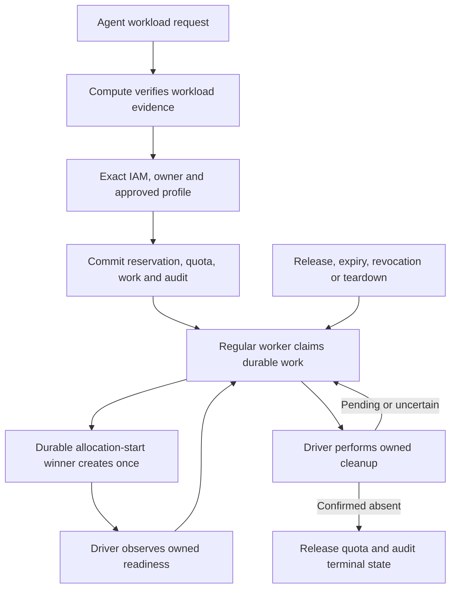

# Temporary environment workload lifecycle flow

## Overview

The draft connects verified Agent workload requests to platform reservations,
existing controller work and selected Compute lifecycle methods. Kubernetes owns
allocation and provider ownership checks; core contains no Kubernetes branches.
The packaged Crabbox external adapter invokes these routes through runtime-owned
TLS, scope, profile and key settings. This is source wiring, not deployment or
live-runtime acceptance.

## Entry Points

- Workload-only routes in `packages/contracts/src/api/routes.ts` expose readiness,
  acquire, read/list, touch and release. `apps/controller/src/index.ts:admit` applies the
  same no-cookie/no-service-key admission gate to all six operation IDs.
- `packages/occ/src/index.ts` verifies workload evidence through the selected
  Compute Driver and resolves the exact ServicePrincipal through IAM.
- `apps/controller/src/worker.ts:process` dispatches ordinary `temporary_environment` claims
  to `apps/controller/src/temporary-environment-worker.ts:reconcileTemporaryEnvironment`.
- `deploy/runtime/temporary-environments/provider.mjs` reads only runtime-delivered authority.
  It translates pinned protocol-v1 lifecycle requests and polls exact deletion receipts.

## Flow

## Execution Trace

### 1. Verify workload evidence

`packages/occ/src/index.ts:verifyTemporaryEnvironmentCaller` delegates verification to Compute. Kubernetes TokenReview must
provide Pod name/UID and ServiceAccount evidence; the Driver rereads the managed
Pod and validates immutable ownership metadata. Errors cannot reveal the bearer.
Human cookies, API keys and mixed credentials fail at admission, not by fallback.
The same bearer remains invalid on ordinary OCC routes.

### 2. Authorize the exact operation

`packages/occ/src/index.ts:withTemporaryEnvironmentAuthority` checks exact-Agent IAM operate before lookups and again under
Namespace then Agent locks. It checks the current revision, ServicePrincipal and
selected Compute descriptor. Agent PATCH stores an optional generic
`temporaryEnvironments: {profileId}` selection outside Harness JSON; deployment
validates it against the selected Compute policy and freezes it in AgentRevision.
Absence disables discovery and acquisition. The Driver renders provider settings,
key setup and native skill enablement only from that revision selection. Edits apply
on deployment, not to an already running revision. Profile policy is selected-driver configuration,
not a caller image, manifest or network grant. The request admits only a bounded
identity, approved profile ID and canonical public Ed25519 key. Private keys stay
with the Agent.

### 3. Durable admission and reconciliation

`packages/occ/src/index.ts:acquireTemporaryEnvironment` uses the existing UOW. The repository reserves capacity, persists
the immutable request and enqueues one work obligation; core appends the mutation
audit in that same transaction. Replays keep their identity and hard deadline;
changed parameters conflict. Touch extends only idle expiry. Release records
`deleting` and returns HTTP 202, not a successful deletion receipt.

The SQL transition `occ.reconcile_temporary_environment` locks Namespace, Agent, record, quota and
work, checks the exact claim token/lease, and commits allocation-start before
provider I/O. The regular worker rechecks owner, IAM, profile and Compute identity.
Only the single allocation-start winner calls create; recovery observes instead.
Work stays scheduled while ready, with idle/hard deadline checks no later than
the next 30-second pass. Stop, revision cutover and Namespace teardown wake the
same existing work. No caller request or LLM turn is needed for cleanup.

### 4. Driver-owned execution and confirmed cleanup

`apps/controller/src/drivers/compute/kubernetes/index.ts:createTemporaryEnvironment` implements allocation beside observation and deletion. It creates a restricted Pod,
private Service and two exact-owner-revision NetworkPolicies using the existing
SDK clients. It validates cluster and Namespace UIDs, resource annotations, UIDs and a complete
opaque receipt. Readiness requires the owned Pod plus Service-owned EndpointSlice
evidence. Public responses expose only usable SSH host/port/user; expired or
unapproved endpoints and internal receipts are withheld.

Deletion uses UID preconditions and keeps policy until the Pod is absent. Missing
receipts after allocation-start remain uncertain even on 404; partial or late
effects retain work and quota. Only Driver-confirmed absence permits the fenced
terminal transition, quota release, owner-link detachment and deletion audit.
Allocation-start, first ready observation and confirmed deletion are audited with
their state transition. A changed selected Driver cannot attest another provider's
absence. Memory supports admission only and refuses worker claim emulation.

## Debugging and Verification

Local coverage uses the real core, Native IAM, memory UOW and Kubernetes policy
implementation. Separate SDK-double conformance checks protect Driver ownership
and manifest decisions; they do not prove a cluster or network boundary.

The existing real Agent API/worker scenario contains admission, queue, SSH,
renewal and confirmed deletion. The production Helm/TUI workflow also invokes
packaged unmodified Crabbox inside its real Agent, transfers a dirty checkout and
runs twice at capacity one to verify cleanup and reuse. Both are authored but not run.
See [Kubernetes testing](../testing/kubernetes.md#temporary-environment-workload-probe)
and [PostgreSQL testing](../testing/postgresql.md) for authorized prerequisites.
No integration-test waiver is claimed.

Image builds, native image qualification, real PostgreSQL execution and actual
unmodified Crabbox invocation remain required proof. The adapter rejects indefinite
keep requests; nested-cluster profiles are not supported.

## Related docs

- [Workload API and limits](../reference/authentication/agent-workload-probe.md)
- [Repository contract](../reference/platform-repositories.md#draft-temporary-environment-reservations)
- [Implementation plan](../../specs/plans/0019-temporary-test-environments.md)

## Manual Notes

[keep this for the user to add notes. do not change between edits]

## Changelog

- 2026-10-30 21:00: Add per-Agent desired/admitted profile selection and disabled runtime discovery. (authoring-run/698bf847-f591-4d16-9cea-b5bb5ea44aa1 - 72c8087a6cb24a0b0f83fbba8e66444479755b59)

- 2026-10-30 20:33: Recover the connected draft, verify local contracts and route worker identity checks through the selected IAM Driver; SQL, image and live Agent acceptance remain unrun. (authoring-run/3f41f626-a22b-4df0-a178-4ddc9bd4eeca - 2e6981e9fd640c8e6179e046bcb0f690c2ff38cb)

- 2026-10-30 12:12: Connect workload API admission to the existing durable worker and Kubernetes lifecycle; live proof and Crabbox mapping remain incomplete. (authoring-run/3f41f626-a22b-4df0-a178-4ddc9bd4eeca - 2e6981e9fd640c8e6179e046bcb0f690c2ff38cb)
- 2026-10-30 11:33: Trace internal reservation/UOW admission and retained quota; no public acquisition is connected. (authoring-run/3f41f626-a22b-4df0-a178-4ddc9bd4eeca - b72b39771708547e35bd1dc8c2492d90f4ce3820)
- 2026-10-30 02:42: Trace the draft probe added beside baseline 51c19ed91; allocation remains absent. (authoring-run/3f41f626-a22b-4df0-a178-4ddc9bd4eeca - 51c19ed9131d8a7e10aae1c6939e8cbdb2561832)
