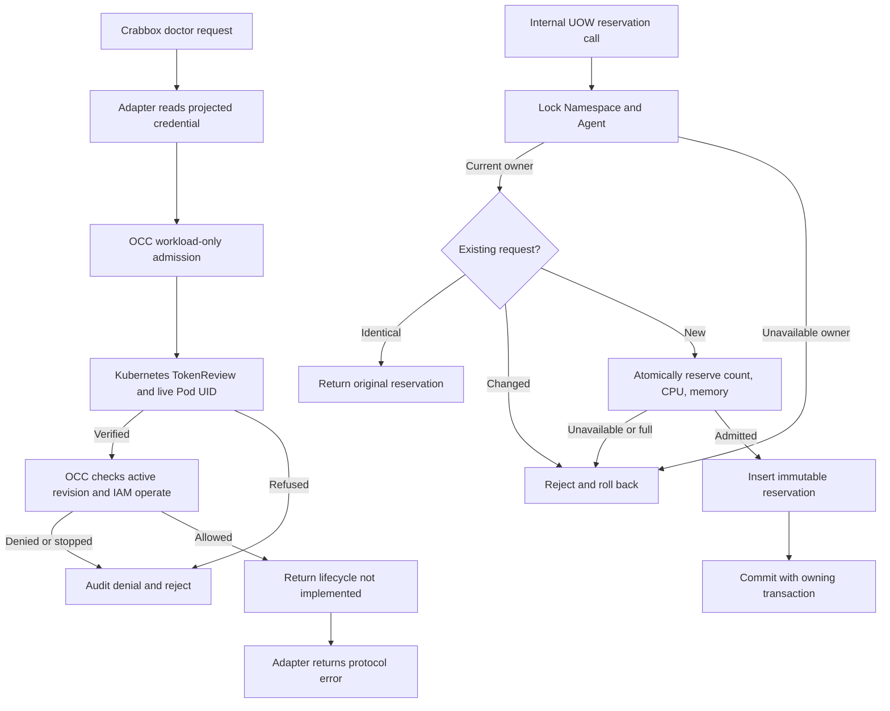

# Temporary environment readiness flow

## Overview

This draft connects a Crabbox protocol-v1 external-provider probe to OCC's
Agent workload authentication. It does not create temporary environments.
The provider always exits unsuccessfully: successful identity and permission
checks report that the environment lifecycle is not implemented. Allocation,
SSH, renewal, expiry and deletion remain RFC-0019 work.

## Entry Points

- `occ-crabbox-provider` reads one JSON request from stdin. The runtime image packages
  `deploy/runtime/temporary-environments/provider.mjs` as that executable.
- `GET /namespaces/:namespaceId/agents/:agentId/temporary-environments/readiness` accepts only a workload bearer credential, without cookies or API keys.
  See `apps/controller/src/index.ts:admit`.
- Kubernetes operators must opt in through `temporaryEnvironmentApiUrl` and enable projected
  ServicePrincipal credentials. The API process needs permission to create
  `authentication.k8s.io/tokenreviews` and read the exact managed Pod. No new cluster-admin grant,
  network rule or deployment is installed by this draft.

## Flow

This diagram describes source wiring, not completed live-runtime proof.

## Execution Trace

### 1. Read only runtime-delivered connection settings

`deploy/runtime/temporary-environments/provider.mjs:main` bounds input, accepts protocol version 1 and rejects
all operations except doctor before reading credentials. It ignores repository
configuration as a source of OCC endpoints or credentials. Runtime-delivered
variables select the HTTPS endpoint, Agent scope and projected token file.
The adapter never follows HTTP redirects or prints credentials.

The Kubernetes Deployment builder in
`apps/controller/src/drivers/compute/kubernetes/index.ts` delivers those variables only to the executing Harness
or embedded workload with the token projection. It does not grant IAM permission.

### 2. Verify the actual workload

`packages/occ/src/index.ts:verifyTemporaryEnvironmentCaller` calls the selected ComputeDriver's optional
`verifyAgentWorkloadIdentity`. Other Drivers have no implementation and fail unsupported.
The Kubernetes implementation uses TokenReview with the configured audience,
requires the returned Pod name and UID, then reads that Pod. It checks UID,
deletion state, managed ownership, ServiceAccount username, token projection,
Agent and revision metadata. It does not decode an unverified JWT or try a
second cluster after failure. Provider errors are redacted at the OCC boundary.

### 3. Bind current state and authorize

`packages/occ/src/index.ts:requireActiveAgentWorkload` reads the existing platform repositories. The Namespace
must be ready; the Agent must be active and desired running; its active revision,
ServicePrincipal and selected Compute implementation must match. The API resolves
the exact Agent-owned identity through IAM before readiness requires `operate`
and checks this lifecycle state. Denials after identity lookup name that actor. Stop, replacement or removed
grants invalidate subsequent requests. No authentication cache grants authority.

The API audits denials through its existing denial path. Verification is bounded
to four concurrent attempts and 60 attempts/minute per direct client address,
with 16 concurrent and 600/minute overall per API instance.

### 4. Report the unfinished lifecycle

`packages/occ/src/index.ts:getTemporaryEnvironmentReadiness` returns `supported: false` and
`TEMPORARY_ENVIRONMENT_LIFECYCLE_NOT_IMPLEMENTED`. The probe creates no lease row,
quota reservation, provider allocation or queued cleanup. The adapter converts
this into a protocol error, not a usable lease or successful release.

### 5. Draft persistence admission (not connected to the probe)

The `packages/occ/src/ports/temporary-environments.ts` contract is bound by the existing
`packages/occ/src/ports/platform-unit-of-work.ts` and read-view factories. It is an internal persistence path;
the readiness request above never reserves capacity.

`packages/occ/src/state/postgres-temporary-environments.ts:postgresTemporaryEnvironments` calls
`occ.reserve_temporary_environment` in
[`0052_temporary_environment_reservations.sql`](../../migrations/0052_temporary_environment_reservations.sql)
from the caller's transaction. The SQL locks Namespace
then Agent, checks current lifecycle ownership, and resolves the owner-scoped
request ID. An identical retry returns the immutable original. Otherwise one
quota-row update reserves count, CPU and memory before inserting the record with
server time and a hard deadline. Any subsequent transaction failure rolls back
both. The reservation retains its Agent/revision/principal through restrictive
foreign keys and cannot be rewritten or deleted by the application role.

`packages/occ/src/state/memory-temporary-environments.ts:memoryTemporaryEnvironments` mirrors this inside
`InMemoryPlatformState`'s single-writer snapshot. Both implementations expose only
reads through read views; escaped handles follow the existing transaction
lifetime rules. Expiry does not free capacity. Provider cleanup, worker dispatch,
profile approval, HTTP acquisition and adapter allocation remain disconnected.

## Debugging and Verification

Run `node --test tests/integration/temporary-environment-provider.test.mjs`
for local API credential-precedence and adapter transport checks. Its local HTTP
server is transport proof only, not workload verification.

The existing real Kubernetes API/worker integration adds checks using a token
from an API-deployed Agent, real TokenReview, PostgreSQL state, IAM grant
revocation and Agent stop. It requires the genuine runtime-image selection;
fixture-only Pod success does not prove it. See
[Kubernetes testing](../testing/kubernetes.md#temporary-environment-workload-probe).

Still unverified: that real-runtime extension, runtime-image build, unmodified
Crabbox invocation inside the Agent, and all environment allocation/cleanup.
Missing prerequisites are not an integration-test waiver. The new
`tests/integration/postgres-temporary-environments.test.mjs` exercises the real
UOW adapters, independent quota dimensions, retry/rollback and owner retention.
Its PostgreSQL case needs the existing migrated disposable application-role
connection described in [PostgreSQL testing](../testing/postgresql.md); memory
success is not SQL, lock-contention or durability proof.

## Related docs

- [Draft workload authentication](../reference/authentication/agent-workload-probe.md)
- [Compute Driver](../reference/drivers/compute.md)
- [RFC-0019 implementation plan](../../specs/plans/0019-temporary-test-environments.md)

## Manual Notes

[keep this for the user to add notes. do not change between edits]

## Changelog

- 2026-10-30 11:33: Trace internal reservation/UOW admission and retained quota; no public acquisition is connected. (authoring-run/3f41f626-a22b-4df0-a178-4ddc9bd4eeca - b72b39771708547e35bd1dc8c2492d90f4ce3820)
- 2026-10-30 02:42: Trace the draft probe added beside baseline 51c19ed91; allocation remains absent. (authoring-run/3f41f626-a22b-4df0-a178-4ddc9bd4eeca - 51c19ed9131d8a7e10aae1c6939e8cbdb2561832)
