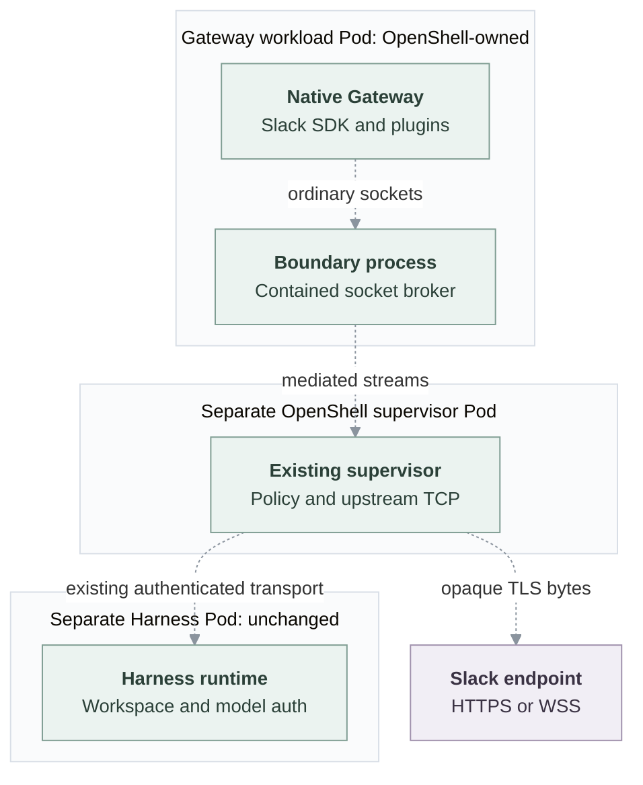

# Proposal: Policy-controlled outbound connectivity for dedicated Gateways

- **ID:** RFC-0024
- **Created:** 2026-10-28
- **Last updated:** 2026-10-29
- **Implementation plan:** [Gateway connectivity](../plans/0024-dedicated-gateway-containment.md)

## Problem and decision

Native OpenClaw plugins and channels run in the Gateway and need connections
to external services. OpenClaw Enterprise (OCE) restricts dedicated Gateway
egress. The current Slack HTTP proxy provides a route to Slack, but covers only
Slack destinations and requires clients to honor proxy settings. Other
integrations need a way to reach approved services without a new proxy for each
integration.

This proposal is to run each dedicated Gateway inside a Sandbox, with OpenShell
as the first implementation. OpenShell checks the Gateway's socket connections
against destination policy and opens approved connections through its existing
supervisor. The Gateway no longer uses the Slack HTTP proxy. Native OpenClaw
keeps the integration logic, credentials and TLS verification.

The control-plane API continues using the Slack HTTP proxy for credential
checks and directory lookups. Its networking, the separate Harness's placement,
workspace and credentials, and embedded execution stay unchanged. Dedicated
startup must support the registration sequence described below.

## One outbound request, before and after

Consider the native Slack SDK sending
`POST https://slack.com/api/chat.postMessage` with its bot token.

**Current path:** Gateway Pod → Slack HTTP proxy → Slack TCP/443.
Kubernetes denies direct public egress.

**Proposed path:** contained Gateway → OpenShell socket broker → existing
supervisor → authorized Slack TCP/443. The supervisor identifies the executable
and destination, authorizes the connection and relays opaque bytes. The Gateway
keeps its bot token and verifies Slack's TLS certificate. A denied connection
fails without a direct-network fallback.

Socket Mode also opens a long-lived WSS connection to a temporary URL returned
by Slack. The enabled Channel Driver contributes both API and Socket Mode
destinations; native code retains login and reconnect behavior. Preserve the
existing proxy's Slack destination coverage: `slack.com`, `slack-edge.com`,
`slack-msgs.com` and their subdomains on TCP/443. Destinations outside that set
need an explicit additional grant.

Stop injecting `HTTPS_PROXY` from `runtime.channels.proxyUrl` into the contained
Gateway. An explicitly configured upstream proxy must preserve destination
enforcement or be rejected: authorizing only the proxy address would not enforce
the Slack destination rule.

## Gateway outbound policy

The proposed OCE Agent setting `gatewayOutbound` controls external application
access, separately from native OpenClaw Configuration. It has two selections:

| Selection                  | External application access                                                             |
| -------------------------- | --------------------------------------------------------------------------------------- |
| `restricted` **(default)** | Enabled-channel destinations plus optional administrator-approved DNS hosts on TCP/443. |
| `publicHttps`              | Public TCP/443, only when the Installation explicitly permits it.                       |

Omitting the setting selects `restricted` with an empty additional host list.
Only enabled, supported channels then contribute destinations; with no enabled
channel, external application access is denied. Enabling Slack adds its API and
Socket Mode destinations, while unrelated services remain denied.

Installing a plugin does not authorize its provider or package registry.
An administrator can allow those destinations by adding exact DNS hosts under
`restricted`, without changing modes, or by selecting explicitly permitted
`publicHttps` access.

Exact internal Gateway/Harness transport and necessary DNS are separate runtime
grants. External rules cannot override the Installation ceiling or forbidden
private, loopback, link-local, metadata and infrastructure addresses. The
Sandbox must validate both DNS results and IP-literal destinations. TCP/443
permission does not inspect the application protocol or authorize provider
actions.

Changing access requires `update` and `administer` on the exact Agent. OCE
records mutations and authorization denials and freezes the selection, channel
requirements and Installation ceiling in the Agent revision. Native
Configuration cannot widen that authority. Disabling a channel removes its
contribution on replacement; an independently approved grant may still allow
the same destination.

## Processes, Pods and connections

- **Gateway workload Pod:** OpenShell owns the workload containing its boundary
  launcher and the native Gateway Node process. Plugins and supported descendants
  run inside that boundary. Gateway-private state survives workload replacement;
  its credentials and storage remain separate from the Harness workspace.
- **Supervisor Pod:** OpenShell's existing supervisor authorizes connections and
  opens upstream TCP sockets. Authenticated boundary streams connect it to the
  workload's socket broker.
- **Harness Pod:** the existing separate Harness retains its runtime, workspace,
  model credentials and authenticated Gateway connection. Allowed private
  destinations come from its rendered transport configuration.
- **OCE and OpenShell control services:** OCE owns Agent lifecycle and requests
  provisioning; OpenShell creates its runtime Pods. Its inbound service relay
  is separate from the supervisor's outbound proxy.

Proposed logical traffic flow:

## Dedicated and embedded behavior

**Dedicated** means the Gateway and Harness run as separate processes. The
Harness is the Codex or OpenClaw worker that executes Agent tasks; dedicated
mode does not itself select OpenShell for that worker. An Installation can
select a Sandbox Driver for the Harness. With no Harness Sandbox selected,
Kubernetes starts the ordinary separate Harness workload. When the Installation
selects `drivers.sandbox`, it uses that Driver for the Harness unless
`useForHarness: false` selects Gateway-only containment. Gateway and Harness
containment are independent choices; when both use OpenShell, they remain
separate Sandboxes.

This proposal makes **Gateway containment required for dedicated execution**.
That changes the existing option to run an ordinary Kubernetes Gateway, even
when the Harness stays in Kubernetes. Egress selections change permissions,
not whether containment applies. Compute replaces the ordinary Gateway
workload; it does not run an uncontained serving copy alongside it. Missing
containment support or failed setup rejects deployment without a fallback to
an uncontained Gateway or channel proxy.

**Embedded:** the combined Gateway/Harness workload, workspace, credentials and
networking remain unchanged. This proposal does not add embedded containment
or channel support. An explicit request for the dedicated-only capability in
embedded mode is rejected rather than changing execution mode.

## Dedicated startup and worker registration

Compute must use one dedicated startup sequence for Kubernetes and
Sandbox-managed Harnesses. A Gateway that can register a worker is not yet an
Agent ready to execute tasks. Driver-specific launch and connection mechanics
stay in the selected Driver, not a parallel OpenShell startup sequence.

A Kubernetes Service gives the ordinary Harness a stable address before its
process starts. The OpenShell Harness integration instead returns its
connection address and TLS trust after creating the Sandbox. That creation
requires worker registration material issued by a running Gateway. Waiting for
the final Harness address before starting the Gateway therefore prevents both
from starting. Freezing one Gateway configuration for the whole Agent revision
also prevents adding that address afterward.

The proposed shared sequence is:

1. Prepare a contained Gateway that can issue authenticated worker registration
   material. If the final Harness connection details are not known, start it
   in setup mode without enabling Agent task execution.
2. Obtain registration material and start the Harness through its selected
   Driver. Read and validate the returned connection address and TLS trust.
3. Complete the Gateway configuration. If setup mode was necessary, replace
   that Gateway process with a final launch while preserving the private
   state needed for registration and reconnection. If all connection details
   were known beforehand, use the final configuration from the first launch;
   do not require an extra restart.
4. Verify the final Gateway, registered Harness and installed policy before
   activation. Registration alone does not establish readiness.

Each launch keeps immutable requirements. Compute must record the setup-to-final
transition for the same Agent revision and distinguish the two launches; it
must not overwrite a launch snapshot or accept arbitrary configuration changes.
The transition preserves Agent identity, outbound authorization and credential
separation. Setup does not grant broader network access or bypass native
authentication. Late results from the setup process must not activate or
configure the final process.

Retries must resume from the recorded stage and reconcile owned resources
before repeating provider effects. A failure or uncertain transition keeps the
candidate unready; an already serving predecessor remains selected until a
verified replacement activates. Stop and delete must clean up both launches
without deleting another revision's resources. Integration proof must cover
first deployment, replacement, interrupted transitions and cleanup with both
Harness placements. Embedded execution does not acquire this separate-worker
sequence.

## Gateway and control-plane egress

The Slack HTTP proxy remains in use by the control-plane API. Its Slack Channel
Driver validates credentials and looks up users and channels at the fixed
`https://slack.com/api/` endpoint. Those calls keep their existing proxy route
and Kubernetes network restrictions; they do not pass through the Gateway's
OpenShell supervisor.

The HTTP proxy checks destination hostnames and port 443, then relays bytes
without decrypting native TLS. Messaging and Socket Mode stay in native
OpenClaw; credential validation and directory lookups stay in the control-plane
Driver.

Keeping this service avoids introducing Sandbox lifecycle or another egress
component for fixed-endpoint API calls. The cost is retaining a separate proxy
for that caller. Other control-plane integrations, such as configured identity
providers, have their own destinations and keep their existing routes.

## Credentials and TLS

Channel and integration credentials remain in the Gateway. Its existing
Harness transport credential stays there; selected model credentials remain
only in the separate Harness. Policies contain destination requirements, not
credential values. The supervisor does not need application or model tokens
for destination enforcement.

Use OpenShell's explicit `tls: skip` mode to relay native TLS without
interception. The native client still verifies certificates and hostnames.
There is no credential substitution, request rewriting or interception CA.

## Platform interfaces and ownership

- **Compute** owns Agent provisioning, routes, readiness, private-state claims,
  activation, stop and delete. It invokes the Gateway containment capability
  and activates only a workload with its required policy installed.
- **Sandbox** owns contained launch, process/filesystem restrictions, socket
  enforcement and provider-resource cleanup. Gateway containment is selected
  independently of the Harness's existing `sandboxDriverId`.
- **Channel** contributes non-secret hosts, ports and HTTPS/WSS requirements
  from its enabled configuration. The Sandbox maps these to executable
  identities and provider rules; Compute contains no Slack-specific host list.

The Installation administrator selects the Gateway Sandbox provider through
the proposed `gatewaySandbox` setting in Installation configuration. Agent
authors choose outbound policy, not the provider. The Installation can set
`drivers.sandbox.useForHarness: false` for Gateway-only containment without
moving the ordinary Harness or selecting model credential capabilities.
Compute uses the selected Driver's `SandboxDriver.gateway` capability for Gateway startup/configuration,
private state, resources, policy, endpoint and cleanup. This capability is
Gateway-specific, not a general workload executor. Its observation supplies the
exact network peer that opens Gateway connections. Compute uses that peer for
Harness transport and status grants; it does not infer provider Pod labels.
OpenShell translation stays in its Driver and reuses the provider's existing
enforcement and proxy.

## Ingress integration and open questions

OpenShell confines workload INET listeners to loopback. Its service relay can
reach them, but the pinned native Gateway rejects ordinary loopback trusted-proxy
authentication. Routing to the Pod IP does not solve that mismatch.

The proposed integration verifies OCE-signed ingress evidence in the native
Gateway over the existing relay. Signing authority stays outside the Sandbox;
the Gateway receives verification material. Ordinary loopback identity trust
remains disabled. Invalid operator evidence grants no authority, and valid
operator evidence cannot grant node authority. Native compatibility changes can
use OCE's existing runtime patch build.

Three details remain open:

1. **Ingress authentication:** define request binding, key-policy changes and
   operator-versus-node attribution while retaining native node credentials,
   pairing and scopes.
2. **Private status and readiness:** map the loopback-confined status listener
   to a private provider route rather than the public operator relay.
3. **Address enforcement:** OpenShell handles wildcard DNS and IP-literal dials
   differently. Translation must enforce the same external address exclusions
   in both cases, while retaining exact private runtime peers. Unsupported
   policies must be rejected before activation.

The [integration analysis](../plans/0024-dedicated-gateway-containment.md#minimum-ingress-dependency)
and [policy translation](../plans/0024-dedicated-gateway-containment.md#outbound-policy-implementation-details)
cover the provider details.

## Alternatives and tradeoffs

- **Keep the cooperative channel proxy for Gateway traffic:** less lifecycle
  change, but clients that ignore proxy settings still lack usable outbound
  access, and the Slack allowlist does not cover other integrations.
- **Allow broad direct egress:** simple connectivity without the proposed
  destination enforcement.
- **Contain the Gateway using the existing Sandbox primitive:** reuses socket
  enforcement and covers native clients, at the cost of provider-owned workload
  lifecycle, a supervisor Pod and ingress compatibility work.

## Related

- [Compute Driver](../../docs/reference/drivers/compute.md)
- [Sandbox Driver](../../docs/reference/drivers/sandbox.md)
- [OpenShell Sandbox](../../docs/reference/drivers/openshell-sandbox.md)
- [Channel Driver](../../docs/reference/drivers/channel.md)
- [Slack Channel Driver and API proxy](../../docs/reference/drivers/slack-channel.md)
- [Storage and credentials](../../docs/reference/drivers/kubernetes-compute/storage-and-credentials.md)
- [Experiment procedure](../../docs/testing/gateway-containment.md)
