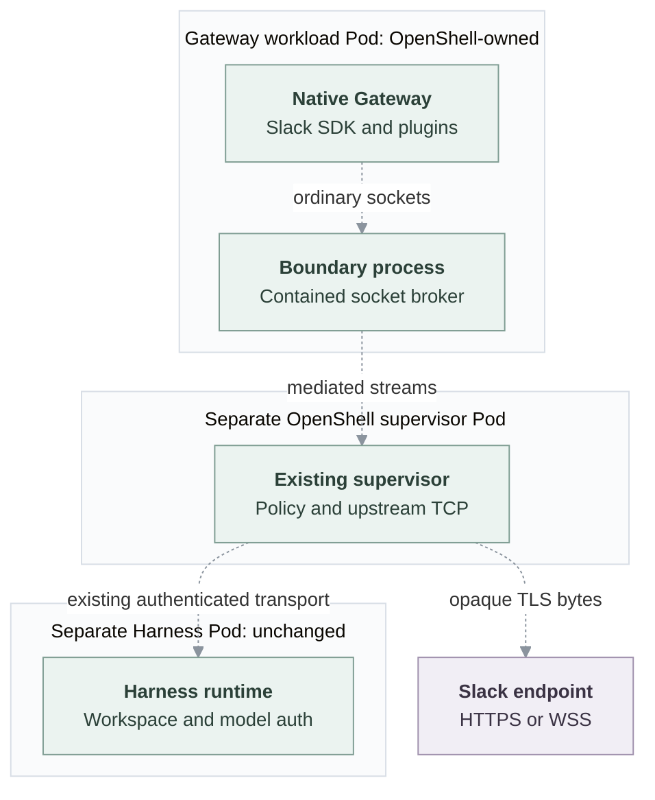

# Proposal: Policy-controlled outbound connectivity for dedicated Gateways

- **ID:** RFC-0024
- **Created:** 2026-10-28
- **Last updated:** 2026-10-29
- **Implementation plan:** [Gateway connectivity](../plans/0024-dedicated-gateway-containment.md)

## Problem and decision

Native OpenClaw plugins and channels run in the Gateway and need connections
to external services. OpenClaw Enterprise (OCE) restricts dedicated Gateway
egress. The current Slack HTTP proxy provides a route to Slack, but covers only
Slack destinations and requires clients to honor proxy settings. Other
integrations need a way to reach approved services without a new proxy for each
integration.

Run each dedicated Gateway inside the selected Sandbox, using OpenShell first.
Enforce destination policy on socket connections instead of relying on client
proxy settings. Reuse OpenShell's existing supervisor to open approved upstream
connections. This replaces the Gateway's Slack HTTP proxy route and also covers
other approved channel and plugin destinations. Native OpenClaw keeps the
integration logic, credentials and TLS verification.

The default still allows only enabled-channel destinations. Broader access
requires explicit permission. The separate Harness, embedded execution and
control-plane networking stay unchanged.

## One outbound request, before and after

Consider the native Slack SDK sending
`POST https://slack.com/api/chat.postMessage` with its bot token.

**Current path:** Gateway Pod → Slack HTTP proxy → Slack TCP/443.
Kubernetes denies direct public egress.

**Proposed path:** contained Gateway → OpenShell socket broker → existing
supervisor → authorized Slack TCP/443. The supervisor identifies the executable
and destination, authorizes the connection and relays opaque bytes. The Gateway
keeps its bot token and verifies Slack's TLS certificate. A denied connection
fails without a direct-network fallback.

Socket Mode also opens a long-lived WSS connection to a temporary URL returned
by Slack. The enabled Channel Driver contributes both API and Socket Mode
destinations; native code retains login and reconnect behavior. Preserve the
existing proxy's Slack destination coverage: `slack.com`, `slack-edge.com`,
`slack-msgs.com` and their subdomains on TCP/443. Destinations outside that set
need an explicit additional grant.

Stop injecting `HTTPS_PROXY` from `runtime.channels.proxyUrl` into the contained
Gateway. An explicitly configured upstream proxy must preserve destination
enforcement or be rejected: authorizing only the proxy address would not enforce
the Slack destination rule.

## Gateway outbound policy

The proposed OCE Agent setting `gatewayOutbound` controls external application
access, separately from native OpenClaw Configuration. Omitting it selects
`channelsOnly`.

| Selection                    | External application access                                                  |
| ---------------------------- | ---------------------------------------------------------------------------- |
| `channelsOnly` **(default)** | Only destinations contributed by enabled, supported channels.                |
| `restricted`                 | Channel destinations plus exact administrator-approved DNS hosts on TCP/443. |
| `publicHttps`                | Public TCP/443, only when the Installation explicitly permits it.            |

With no enabled channel, the default grants no external application access.
Enabling Slack adds its API and Socket Mode destinations; unrelated services
remain denied. Installing a plugin does not authorize its provider or package
registry. Additional access requires an explicit wider selection.

Exact internal Gateway/Harness transport and necessary DNS are separate runtime
grants. External rules cannot override the Installation ceiling or forbidden
private, loopback, link-local, metadata and infrastructure addresses. The
Sandbox must validate both DNS results and IP-literal destinations. TCP/443
permission does not inspect the application protocol or authorize provider
actions.

Changing access requires `update` and `administer` on the exact Agent. OCE
records mutations and authorization denials and freezes the selection, channel
requirements and Installation ceiling in the Agent revision. Native
Configuration cannot widen that authority. Disabling a channel removes its
contribution on replacement; an independently approved grant may still allow
the same destination.

## Processes, Pods and connections

- **Gateway workload Pod:** OpenShell owns the workload containing its boundary
  launcher and the native Gateway Node process. Plugins and supported descendants
  run inside that boundary. Gateway-private state survives workload replacement;
  its credentials and storage remain separate from the Harness workspace.
- **Supervisor Pod:** OpenShell's existing supervisor authorizes connections and
  opens upstream TCP sockets. Authenticated boundary streams connect it to the
  workload's socket broker.
- **Harness Pod:** the existing separate Harness retains its runtime, workspace,
  model credentials and authenticated Gateway connection. Allowed private
  destinations come from its rendered transport configuration.
- **OCE and OpenShell control services:** OCE owns Agent lifecycle and requests
  provisioning; OpenShell creates its runtime Pods. Its inbound service relay
  is separate from the supervisor's outbound proxy.

Proposed logical traffic flow:

## Dedicated and embedded behavior

**Dedicated:** Gateway containment is required. Egress selections change
permissions, not whether containment applies. Compute replaces the ordinary
Gateway workload; it does not run an uncontained serving copy alongside it.
Missing containment support or failed setup rejects deployment without a
fallback to the old Gateway or channel proxy.

**Embedded:** the combined Gateway/Harness workload, workspace, credentials and
networking remain unchanged. This proposal does not add embedded containment
or channel support. An explicit request for the dedicated-only capability in
embedded mode is rejected rather than changing execution mode.

## Gateway and control-plane egress

The Slack HTTP proxy remains in use by the control-plane API. Its Slack Channel
Driver validates credentials and looks up users and channels at the fixed
`https://slack.com/api/` endpoint. Those calls keep their existing proxy route
and Kubernetes network restrictions; they do not pass through the Gateway's
OpenShell supervisor.

The HTTP proxy checks destination hostnames and port 443, then relays bytes
without decrypting native TLS. Messaging and Socket Mode stay in native
OpenClaw; credential validation and directory lookups stay in the control-plane
Driver.

Keeping this service avoids introducing Sandbox lifecycle or another egress
component for fixed-endpoint API calls. The cost is retaining a separate proxy
for that caller. Other control-plane integrations, such as configured identity
providers, have their own destinations and keep their existing routes.

## Credentials and TLS

Channel and integration credentials remain in the Gateway. Its existing
Harness transport credential stays there; selected model credentials remain
only in the separate Harness. Policies contain destination requirements, not
credential values. The supervisor does not need application or model tokens
for destination enforcement.

Use OpenShell's explicit `tls: skip` mode to relay native TLS without
interception. The native client still verifies certificates and hostnames.
There is no credential substitution, request rewriting or interception CA.

## Platform interfaces and ownership

- **Compute** owns Agent provisioning, routes, readiness, private-state claims,
  activation, stop and delete. It invokes the Gateway containment capability
  and activates only a workload with its required policy installed.
- **Sandbox** owns contained launch, process/filesystem restrictions, socket
  enforcement and provider-resource cleanup. Gateway containment is selected
  independently of the Harness's existing `sandboxDriverId`.
- **Channel** contributes non-secret hosts, ports and HTTPS/WSS requirements
  from its enabled configuration. The Sandbox maps these to executable
  identities and provider rules; Compute contains no Slack-specific host list.

The proposed `gatewaySandbox` selection and `SandboxDriver.gateway`
capability carry Gateway startup/configuration, private state, resources,
policy, endpoint and cleanup requirements. They are Gateway-specific, not a
general workload executor. OpenShell translation stays in its Driver and reuses
the provider's existing enforcement and proxy.

## Ingress integration and open questions

OpenShell confines workload INET listeners to loopback. Its service relay can
reach them, but the pinned native Gateway rejects ordinary loopback trusted-proxy
authentication. Routing to the Pod IP does not solve that mismatch.

The proposed integration verifies OCE-signed ingress evidence in the native
Gateway over the existing relay. Signing authority stays outside the Sandbox;
the Gateway receives verification material. Ordinary loopback identity trust
remains disabled. Invalid operator evidence grants no authority, and valid
operator evidence cannot grant node authority. Native compatibility changes can
use OCE's existing runtime patch build.

Three details remain open:

1. **Ingress authentication:** define request binding, key-policy changes and
   operator-versus-node attribution while retaining native node credentials,
   pairing and scopes.
2. **Private status and readiness:** map the loopback-confined status listener
   to a private provider route rather than the public operator relay.
3. **Address enforcement:** OpenShell handles wildcard DNS and IP-literal dials
   differently. Translation must enforce the same external address exclusions
   in both cases, while retaining exact private runtime peers. Unsupported
   policies must be rejected before activation.

The [integration analysis](../plans/0024-dedicated-gateway-containment.md#minimum-ingress-dependency)
and [policy translation](../plans/0024-dedicated-gateway-containment.md#outbound-policy-implementation-details)
cover the provider details.

## Alternatives and tradeoffs

- **Keep the cooperative channel proxy for Gateway traffic:** less lifecycle
  change, but clients that ignore proxy settings still lack usable outbound
  access, and the Slack allowlist does not cover other integrations.
- **Allow broad direct egress:** simple connectivity without the proposed
  destination enforcement.
- **Contain the Gateway using the existing Sandbox primitive:** reuses socket
  enforcement and covers native clients, at the cost of provider-owned workload
  lifecycle, a supervisor Pod and ingress compatibility work.

## Related

- [Compute Driver](../../docs/reference/drivers/compute.md)
- [Sandbox Driver](../../docs/reference/drivers/sandbox.md)
- [OpenShell Sandbox](../../docs/reference/drivers/openshell-sandbox.md)
- [Channel Driver](../../docs/reference/drivers/channel.md)
- [Slack Channel Driver and API proxy](../../docs/reference/drivers/slack-channel.md)
- [Storage and credentials](../../docs/reference/drivers/kubernetes-compute/storage-and-credentials.md)
- [Experiment procedure](../../docs/testing/gateway-containment.md)
