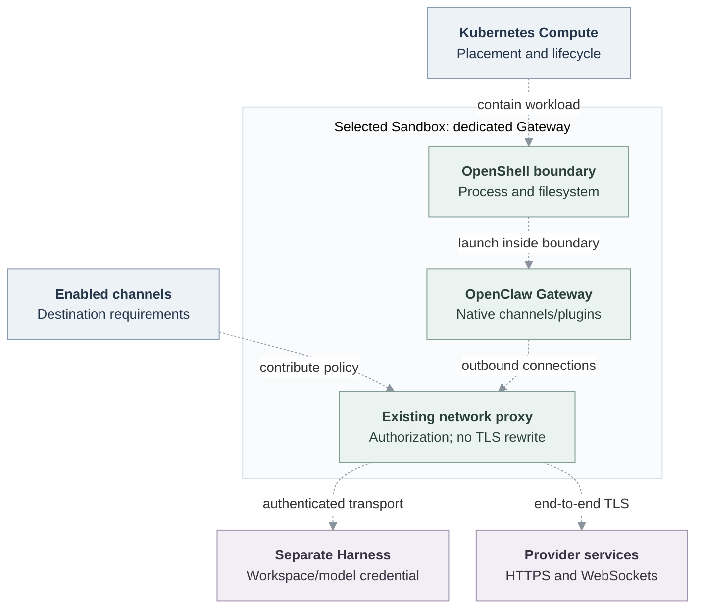

# Proposal: Contain dedicated Gateways through the Sandbox Driver

- **ID:** RFC-0024
- **Created:** 2026-10-28
- **Last updated:** 2026-10-28
- **Implementation plan:** [Gateway containment](../plans/0024-dedicated-gateway-containment.md)

## Summary

Run the dedicated OpenClaw Gateway inside the Installation-selected Sandbox,
using OpenShell first. Kubernetes Compute continues to own the Gateway workload,
its private state, identity, routing and lifecycle. The Sandbox supplies the
containment boundary and existing network enforcement. The dedicated Harness
remains a separate workload with its existing placement, authentication,
workspace and model-credential path.

This is an opt-in experiment. Establish a working containment boundary before
restricting every destination. Initial network authorization may be permissive
where native plugins, channels and integrations require it. Enabling containment
does not implicitly enable credential substitution or TLS interception.

## Motivation

A dedicated Gateway needs outbound connections independently of model execution:
channel WebSockets and HTTPS APIs, native integrations, plugin startup and the
connection to its dedicated Harness. Network controls that prevent these normal
paths make a contained Gateway unusable.

OCE already has Compute, Sandbox and Credential Proxy contracts. A separate
Gateway-specific proxy would duplicate transport, enforcement and lifecycle.
Instead, Compute should request containment from its selected Sandbox and reuse
the implementation's network-proxy primitives. Credential operations remain a
separate capability with separate admission and custody.

## Goals

1. Deploy a contained dedicated Gateway through normal OCE Agent provisioning
   on Linux, not a manually launched demonstration process.
2. Preserve the dedicated Harness's selected placement, authenticated transport
   and model credentials. Gateway containment must not imply Harness relocation.
3. Preserve Gateway runtime behavior: image, native plugins, channel setup,
   readiness, private state and normal replacement/stop/delete operations.
4. Keep Compute dependent on a Sandbox contract that another implementation can
   satisfy; OpenShell protocol and supervisor details belong in its Driver.
5. Include enabled channels' required destinations in network authorization.
   State explicitly which additional compatibility access remains permitted.
6. Prove containment, connectivity and cleanup with the actual Linux runtime.
   Source and fixture checks alone do not establish these outcomes.

## Non-goals

- A new proxy service, credential broker, credential type or public resource.
- Moving the Harness into the Gateway Sandbox or giving its model credentials
  to the Gateway, supervisor or controller.
- Automatically replacing channel credentials, rewriting requests, trusting a
  generated interception CA or terminating upstream TLS.
- A restrictive-by-default network redesign for all existing integrations.
- Embedded Gateway/Harness containment, production qualification or merging
  this experimental proposal.

## Proposal

### Ownership and placement

Compute renders the normal dedicated Gateway workload and passes the selected
Sandbox the information needed to contain that workload. The Sandbox's optional
Gateway capability is distinct from its Harness provisioning capability.
Installation opt-in must select a supported capability explicitly; a missing
capability or invalid combination fails before launching an uncontained Gateway.
Absence of opt-in preserves the existing deployment path.

The contract must preserve the workload's command, configuration, Secret
references, volumes, init steps, readiness probes and resource limits. OpenShell
owns the supervisor, runtime containment, translated network policy and any
provider-specific resources. Compute owns the Gateway Service and route, workload
identity, PVCs and its reconciliation result. Neither owner may silently fall
back to an uncontained workload after a containment error.

The selected Harness continues through its existing path. Its Sandbox selection,
if any, is independent of Gateway containment. Gateway-to-Harness transport keeps
its existing authentication and certificate verification. Harness workspace-node
connections and OCC/plugin-status traffic remain explicit connectivity needs.

### Placement diagram

The dashed connections below are the proposed Gateway containment integration.
The dedicated Harness remains outside the Gateway boundary, whether Compute or
its separately selected Sandbox owns that Harness.

### Networking and channel contributions

The policy input distinguishes runtime-required destinations from channel
contributions and operator compatibility access. Enabled channels contribute
hostnames, ports and protocols through a generic channel contract; Compute
collects these contributions from the admitted revision. Provider translation
belongs to the Sandbox Driver, not OCC core. Removing a channel removes its
contribution on replacement, although a broader compatibility grant may still
permit the same destination.

OpenShell reuses its supervisor's existing outbound network proxy and policy
authorization. There is no OCE forwarder in the data path. Ordinary HTTPS remains
end-to-end TLS; WebSockets and long-lived connections must keep working. A
channel's contributed hostname is not permission to rewrite its credentials.

A permissive compatibility policy is a conscious experimental setting, not a
claim of destination isolation. Document its actual port, protocol and address
coverage. In particular, DNS, private Harness endpoints, OCC callbacks, native
plugin/package downloads, public HTTPS and channel-specific transports must be
considered. Unsupported traffic must produce a concrete configuration refusal
or runtime diagnostic rather than bypassing the Sandbox. Restricting the policy
later must not require another network-proxy implementation.

### Credentials and state

The Gateway retains only the credentials its existing role requires, including
channel/integration credentials and the dedicated Harness transport token.
Model credentials remain in their existing Harness-owned path. Gateway
containment must not cause Credential Proxy provider registration, model-key
projection or automatic credential rewriting.

Compute retains the Gateway's private persistent state and ownership checks.
It does not mount the Harness workspace into the Gateway merely to satisfy the
Sandbox. Supervisor state is separate from Gateway private state. The implementation
must identify required writable paths and preserve existing restart behavior.
No host container socket, broad host filesystem mount or new model credential
is justified by this experiment.

### Lifecycle and failure

1. Normal admission freezes the Agent revision and selected Driver inputs.
   Containment configuration is checked before workload effects.
2. Namespace preparation establishes baseline Kubernetes isolation and any
   Sandbox-owned prerequisites. Compute renders the dedicated Gateway and
   applies containment before starting it.
3. Readiness requires the contained Gateway and the separately selected Harness
   to satisfy the existing Agent workflow. A running supervisor alone is not
   Gateway readiness.
4. Replacement retains the established state and routing semantics. Immutable
   configuration or policy changes require the corresponding workload rollout;
   the serving revision is not falsely reported as the candidate.
5. Stop and retirement terminate the contained Gateway and release its
   provider-owned effects in the correct order. Delete removes Agent-owned
   resources; Namespace cleanup does not delete operator-owned infrastructure.
6. Missing provider resources, failed policy setup and uncertain cleanup remain
   pending or fail explicitly. Retries reconcile owned resources idempotently;
   uncertainty is never evidence of successful containment or removal.

## Delivery and verification

The [implementation plan](../plans/0024-dedicated-gateway-containment.md) records
work and actual evidence. Required Linux proof uses normal Agent provisioning,
the selected Sandbox and genuine Gateway/Harness images:

- Inspect the deployed workload's containment and supervisor configuration.
  Confirm the Gateway process is inside that boundary, not merely attached to
  an HTTP proxy.
- Complete authenticated Gateway access and a model turn through the separate
  Harness. Inspect credential placement without logging values.
- Exercise outbound HTTPS, a long-lived connection and channel-contributed
  authorization. Configuration projection alone is not a live channel test.
- Check private-state survival across Gateway restart/replacement and verify
  stop, redeploy and delete clean up owned containment resources.
- Exercise a consequential containment/setup failure and confirm no uncontained
  fallback becomes serving.

Record source revision, runtime/image identity, exact commands, passed cases,
skips and missing prerequisites. The draft remains incomplete when required
runtime proof is unavailable; a permissive policy does not prove restrictive
network isolation.

## Rationale and alternatives

**Full containment through Sandbox** supplies process/filesystem/network
containment with the existing enforcement runtime. It keeps Compute responsible
for workload lifecycle and leaves provider details behind a contract. Its cost
is integrating supervisor startup, filesystem needs and resource cleanup without
breaking the native Gateway.

**Proxy attachment only** would simplify startup and leave the Gateway outside
the selected Sandbox. It can control cooperative traffic, but does not establish
the full containment boundary selected for this experiment.

**A Gateway-specific proxy** duplicates existing primitives and creates another
service, policy translation and failure path. It is unnecessary.

**Making the Gateway a Harness** reuses a convenient provisioning path but
confuses workload identity, model credentials, storage and placement. Distinct
roles need distinct contracts even when a provider shares implementation code.

**Restrict every destination immediately** increases disruption before native
traffic is understood. Explicit compatibility access allows a working boundary
first, with narrower authorization as a separate policy iteration.

## References

- [Platform architecture](../../docs/design.md)
- [Compute Driver](../../docs/reference/drivers/compute.md)
- [Sandbox Driver](../../docs/reference/drivers/sandbox.md)
- [OpenShell Sandbox](../../docs/reference/drivers/openshell-sandbox.md)
- [Credential Proxy](../../docs/reference/drivers/credential-proxy.md)
- [Channel Driver](../../docs/reference/drivers/channel.md)
