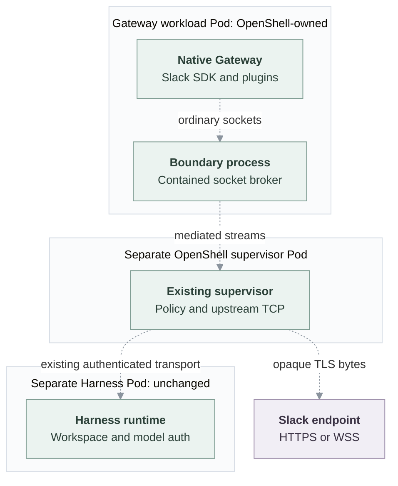

# Proposal: Policy-controlled outbound connectivity for dedicated Gateways

- **ID:** RFC-0024
- **Created:** 2026-10-28
- **Last updated:** 2026-10-29
- **Implementation plan:** [Gateway connectivity](../plans/0024-dedicated-gateway-containment.md)

## Application problem

Native plugins, channels and integrations execute in the OpenClaw Gateway.
They need HTTPS APIs and long-lived WebSocket connections to external services.
In dedicated execution, the Harness runs in a different Pod. Giving that
Harness network access does not let a Gateway plugin reach its provider.

OpenClaw Enterprise (OCE) currently starts dedicated Gateways under Kubernetes
network policy. Direct public channel access is denied; enabled channels use
an approved proxy configured by `runtime.channels.proxyUrl`. Compute supplies
`HTTPS_PROXY` and grants access to that proxy's IP or selected Pods. This is an
existing channel route, not general destination enforcement for every native
plugin or child process. A client that ignores proxy settings does not gain
access, and the Harness's Sandbox policy does not govern its sockets.

Propose running the dedicated Gateway inside OpenShell containment so its
ordinary sockets use OpenShell's existing network authorization and proxy.
The result must be usable, configurable Gateway outbound connectivity. Process
and filesystem containment support that result; they do not create an arbitrary-workload
provisioning product. Initial permissive compatibility policy is
acceptable. Neither credential rewriting nor TLS interception is required.

**Status:** this proposal has no runtime implementation or Linux qualification.
The [plan](../plans/0024-dedicated-gateway-containment.md) records the unresolved
ingress, startup and verification work. Existing networking is described in
[Kubernetes networking](../../docs/reference/drivers/kubernetes-compute/networking-and-isolation.md).

## One outbound request, before and after

Consider the native Slack integration sending an HTTPS
`POST https://slack.com/api/chat.postMessage` with its bot token.

**Before:** the SDK runs in the ordinary dedicated Gateway Pod. Its configured
channel path is Gateway → approved channel proxy → Slack TCP/443. The Gateway
owns Slack authentication and native TLS settings. This is the configured
route, not a live success recorded by this task. Without the approved path,
Kubernetes denies direct public egress. A successful channel-proxy request does
not establish policy enforcement for arbitrary native plugin sockets.

**After, proposed:** the same SDK call runs in the contained Gateway. OpenShell
mediates its socket, identifies the executable and destination, and asks the
existing supervisor to authorize the connection. If allowed, the supervisor
opens the upstream TCP connection and relays opaque bytes. The Gateway still
verifies Slack's TLS certificate and sends its real token inside that TLS
session. A denial must fail the connection without direct-network fallback.

Slack Socket Mode also opens a long-lived WSS connection to a temporary URL
returned by its API. That connection needs its own admitted destination; API
access alone is insufficient. Native code retains login and reconnect ownership.

The contained path must deliberately replace the existing cooperative channel
proxy route for these sockets. Do not leave `HTTPS_PROXY` accidentally routing
requests through a second proxy and then claim that OpenShell checked Slack's
destination. Required application/upstream proxies need explicit handling or
rejection before deployment. The dedicated path in this proposal replaces the
existing channel-proxy route; it has no uncontained alternative.

## Processes, Pods and connections

The proposed dedicated layout is:

- **Gateway workload Pod, owned by OpenShell:** its workload container runs the
  trusted boundary launcher and the native Gateway Node process under OpenShell
  confinement. Plugins and supported descendants run inside that boundary.
  Gateway-private state mounts here, not the Harness workspace.
- **Supervisor Pod, owned by OpenShell:** the existing supervisor authorizes
  executable/destination pairs and opens upstream connections. Authenticated
  provider boundary streams connect it to the workload's socket broker.
  This is an existing provider process, not a new OCE proxy.
- **Separate Harness Pod:** the selected Harness and its existing workspace/node
  processes stay on their current path. For dedicated Codex, the Gateway still
  uses its authenticated app-server connection on 18790 and status on 18791;
  routed deployments retain WSS/HTTPS on 443.
- **OCE API/worker and OpenShell control service:** OCE requests provisioning and
  owns Agent lifecycle. OpenShell creates its runtime Pods. Its existing service
  relay supplies an inbound transport candidate; it is not the outbound proxy.

Logical request flow below is proposed and unverified; dashed arrows do not
represent a passing deployment or control-session dial direction.

Managing a proxy Pod alone does not contain the Gateway. Here the Gateway itself
runs inside the selected Sandbox; its sockets are mediated even when a client
ignores proxy environment variables. Compute must replace its ordinary Gateway
realization, not leave an uncontained serving copy beside the contained one.

## Dedicated and embedded behavior

**Dedicated:** require Gateway containment for the dedicated workflow in this
proposal. Configure its egress policy, not a containment bypass. Move only the
Gateway's realization into the OpenShell runtime above. Keep the separate Harness's
placement, descriptor, workspace, authentication and model-credential delivery
unchanged. Derive allowed private Harness destinations from its rendered
transport configuration; do not infer them from a public wildcard grant.

If the selected Gateway containment capability is absent or setup fails,
deployment fails before an uncontained candidate starts. Do not fall back to
the old Gateway deployment or channel proxy. Policy defaults for runtime,
enabled-channel and additional plugin access remain a review decision; required
connectivity must be explicit when replacing the proxy.

**Embedded:** keep the existing combined Gateway/Harness workload, workspace,
credential mounts and networking unchanged. This proposal neither contains that
combined runtime nor adds embedded outbound access or channel support. Embedded
Agents do not invoke the proposed Gateway containment capability. An explicit
request to use this dedicated-only capability for embedded execution is rejected,
not converted to dedicated mode.

## Credentials and destination enforcement

In dedicated execution, existing Namespace Secrets supply channel/integration
credentials to the Gateway. Its Harness transport credential stays available
for the existing link. Selected model credentials remain only in the separate
Harness. The supervisor does not need model or Slack tokens to enforce this
non-intercepting policy; they remain native application credentials, not proxy
substitution credentials. Supported delivery into the contained Gateway still
needs implementation. Keep values out of policy, ConfigMaps, logs and evidence.
Embedded credential custody remains unchanged.

Select explicit OpenShell `tls: skip`: this skips interception, not the native
client's certificate checks. The supervisor enforces executable, host and port
policy without terminating this TLS session. Proxy environment variables alone
are not enforcement.

Compose three non-secret inputs: exact runtime destinations, enabled-channel
destinations, and explicit operator-selected compatibility access. Channels
supply hosts/ports and HTTPS/WSS requirements; the Sandbox maps them to executable
identities and provider rules. Slack initially proposes `slack.com:443` plus
`**.slack.com:443` for enabled Socket Mode accounts, not a complete media allowlist.
Do not claim native code validates every returned WSS hostname as Slack-owned.

A broad compatibility grant may establish connectivity, not restrictive
isolation. Record executables, ports and private-address behavior. OpenShell's
`**` spans DNS labels; `*` does not. Wildcard DNS and direct IP-literal dials have
different private-address handling. Verify both. Removing a channel removes its
contribution on replacement; a broader compatibility rule may still allow it.
The [plan](../plans/0024-dedicated-gateway-containment.md#outbound-policy-implementation-details)
owns translation details and limits.

## Platform interfaces and ownership

Use existing platform owners because each already owns part of this deployment:

- **Compute** keeps normal Agent provisioning, routes, readiness, private-state
  claims, activation, stop and delete. It invokes containment only around the
  dedicated Gateway realization.
- **Sandbox** owns launching the contained Gateway, its process/filesystem
  boundary, socket enforcement and provider-resource cleanup. A separately
  selected Gateway capability is needed because existing `sandboxDriverId` and
  Harness provisioning affect the Harness, which must remain unchanged.
- **Channel** owns provider destination knowledge. A pure contribution from the
  same selected adapter avoids Slack host lists in Compute and secret reads
  during policy derivation.

Proposed names such as `gatewaySandbox` and `SandboxDriver.gateway` are not current
configuration/API support. Limit inputs to this Gateway's startup/configuration,
private state, resources, policy, endpoint and cleanup. Supported native
translation is sufficient; a full Pod-template executor, scheduler, generic
workload API, new public resource or credential broker is outside scope.
No model CredentialSource or Credential Proxy registration is required merely
to select Gateway containment.

## Ingress dependency and completion

Outbound success is insufficient if users and nodes cannot reach the Gateway.
OpenShell confines workload INET sockets to loopback; ordinary Pod-IP ingress
cannot reach them. Its service relay reaches loopback, but the pinned native
Gateway rejects ordinary loopback trusted-proxy authentication.

The source-backed recommendation is native verification of OCE-signed ingress
evidence over that existing relay. This requires native attribution/auth/schema
and policy-revalidation changes; it is not an implemented protocol. Keep signing
authority outside the Sandbox, ordinary loopback identity trust disabled, and
native node authorization separate. Node attribution and private status/readiness
mapping remain unresolved. The [minimum ingress analysis](../plans/0024-dedicated-gateway-containment.md#minimum-ingress-dependency)
names exact owners, alternatives and review/authority requirements.

Delivery requires normal Linux Agent provisioning with genuine images: native
HTTPS and long-lived WSS through enforcement, allowed/denied destinations,
authenticated ingress and forgery rejection, a real model/tool turn with the
unchanged Harness, private-state survival, stop/start/delete and no uncontained
fallback on failure. Verify embedded behavior remains unchanged. Report live
channel login/messages separately from synthetic policy checks.

Use the [verification procedure](../../docs/testing/gateway-containment.md).
Keep the RFC Proposed and the PR draft and unmerged. Documentation or
Harness-only qualification is not Gateway proof.

## Related

- [Compute Driver](../../docs/reference/drivers/compute.md)
- [Sandbox Driver](../../docs/reference/drivers/sandbox.md)
- [OpenShell Sandbox](../../docs/reference/drivers/openshell-sandbox.md)
- [Channel Driver](../../docs/reference/drivers/channel.md)
- [Storage and credentials](../../docs/reference/drivers/kubernetes-compute/storage-and-credentials.md)
