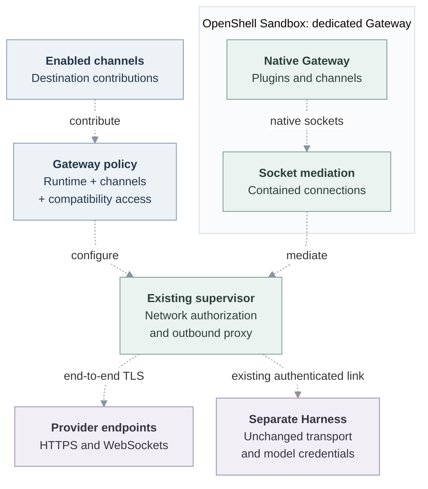

# Proposal: Policy-controlled outbound connectivity for dedicated Gateways

- **ID:** RFC-0024
- **Created:** 2026-10-28
- **Last updated:** 2026-10-28
- **Implementation plan:** [Gateway containment](../plans/0024-dedicated-gateway-containment.md)

## Problem and proposed solution

OpenClaw Enterprise (OCE) must let native Gateway plugins, channels and
integrations make outbound HTTPS and long-lived WebSocket connections. The
dedicated Harness's network policy does not control those Gateway connections:
the two processes run separately. A Gateway that cannot reach its enabled
integrations is not a usable Agent.

Run the dedicated Gateway inside a separately selected Gateway Sandbox, using
OpenShell first, so its native outbound connections reach OpenShell's existing
enforcement path. Keep the dedicated Harness separate, with its existing
placement, workspace, authentication and model-credential delivery unchanged.
Start with an explicit compatibility policy where destinations are not yet
fully known. Narrow policy without replacing the networking mechanism.

**This experiment is not implemented.** Authenticated ingress must also work
before the contained Gateway is usable. The [plan](../plans/0024-dedicated-gateway-containment.md)
records that integration dependency and the unrun Linux proof. Resolving or
documenting a dependency alone does not complete this experiment.

## Current upstream gap

Kubernetes Compute provisions the per-Agent Gateway as its own workload. The
selected OpenShell Sandbox provisions a dedicated Harness; selecting that path
is not independent Gateway containment. The current Channel Driver validates
credentials and looks up provider identities, but does not contribute Gateway
runtime destinations. These existing paths do not deliver policy-controlled
native Gateway egress with an unchanged Harness.

Extend the owning Compute, Sandbox and Channel contracts only where this normal
Agent deployment needs them. OpenShell launch, socket mediation and policy
translation belong in its Sandbox Driver, not OpenClaw Control Plane (OCC) core.
This is a Gateway connectivity experiment, not a general-purpose workload
platform.

## Scope and boundaries

The experiment must deliver:

- Native HTTPS and WebSockets from the contained Gateway through the existing
  OpenShell policy enforcement, including enabled channels' destinations.
- Normal authenticated Gateway access, readiness and a model/tool turn through
  the separate Harness.
- The Gateway configuration, required writable state, credentials and resource
  limits needed for startup, replacement, stop and delete.
- Failure without an uncontained serving fallback, plus cleanup of owned effects.

Do not add a generic workload API, scheduler, cross-provider workload migration,
new public resource, new proxy or credential broker. Do not relocate the
Harness, enable its Sandbox path implicitly, or give its model credentials to
the Gateway. Automatic credential substitution and TLS interception are outside
this experiment. Production qualification and merging this draft are not goals.

## Outbound traffic and policy

### Enforcement path

The proposed Gateway integration uses existing OpenShell networking components.
All dashed arrows below remain unverified for this Gateway caller.

1. A native plugin or channel opens an HTTPS or WebSocket connection in the
   Gateway process, or an explicitly supported child executable.
2. OpenShell's contained socket path mediates the connection. Proxy environment
   variables alone are not this boundary, and the Gateway does not get a direct
   network escape for integrations that ignore those variables.
3. The existing supervisor applies the translated executable and destination
   policy and opens an authorized upstream connection. The integration adds no
   OCE data-plane forwarder.
4. The Gateway authenticates the remote TLS peer and supplies its normal native
   credentials. HTTPS and WSS remain end-to-end TLS. Select OpenShell's explicit
   `tls: skip` mode to skip interception, not application certificate validation.

The Linux experiment must exercise this path from the real Gateway, not merely
inspect a rendered policy. Confirm the actual executable identities used by
Node, plugin subprocesses and startup downloads before granting them access.

### Channel contributions and compatibility access

Add a side-effect-free Channel Driver contribution for the enabled channel
configuration: destination host patterns, ports and transport requirements.
OCC collects non-secret contributions for the Agent revision; Compute passes
them to the Gateway's Sandbox policy. Channel implementations own provider
knowledge, while the Sandbox owns executable mapping and provider syntax.
No contribution carries a credential or authorizes request rewriting.

Start with Slack HTTPS API access and its Socket Mode WebSocket destinations.
Socket Mode can return a dynamic hostname; do not claim that one API hostname
covers the live socket. Propose `slack.com:443` and `**.slack.com:443`, with
explicit compatibility access for unverified integration/media destinations.
Native SDK source does not guarantee a Slack-only socket hostname; Sandbox
policy must enforce the admitted destination patterns.
Other enabled channels without a destination contributor must be identified,
not silently treated as restricted and functional.

Keep three policy inputs distinct: Gateway runtime needs, channel contributions,
and operator-selected compatibility access. Runtime needs include DNS, the
existing private Harness endpoint, configured OCC callbacks and required
plugin/package traffic. Record actual executables, destination patterns, ports
and private-IP allowances. Permissive compatibility access is acceptable, but
is not evidence of destination isolation. Removing a channel removes its contribution on
replacement; a wider compatibility rule can still permit that destination.

## Minimal deployment integration

Compute requests a Gateway-specific capability from the selected Sandbox,
independently of its existing Harness Sandbox selection. The integration must
not reuse Harness provisioning by changing the Harness descriptor,
`sandboxDriverId`, authentication or credential attachments. Absence of opt-in
keeps the current Gateway path; unsupported opt-in fails before an uncontained
Gateway starts.

Limit the contract to the inputs and results needed by this dedicated Gateway
caller: native startup/configuration, private state, resources, policy,
authenticated endpoint, readiness and owned cleanup. Translate those inputs
through supported OpenShell provisioning. Copying the entire Kubernetes Pod
template is not required. A generic template executor or workload adoption
framework is not a prerequisite.

Compute retains Agent lifecycle, routes, private-state ownership and the result
reported to OCC. The OpenShell Driver owns its contained runtime and provider
resources. Preserve the Gateway's channel/integration credentials and Harness
transport credential without exposing values in provider configuration or logs.
No model CredentialSource or Credential Proxy registration is required merely
to select Gateway containment.

## Authenticated ingress

Ingress is a compatibility dependency of this outbound experiment. The current
OCE route authenticates operator requests before setting `x-occ-identity`;
node routes remove operator identity. The native Gateway rejects ordinary
loopback trusted-proxy authentication. OpenShell's current service relay
presents a loopback peer, while direct Pod-IP ingress is excluded by its socket
confinement.

Recommend reusing the service relay and adding native verification of OCE-signed
ingress evidence. Existing authenticated OCE callers issue fresh evidence; the
Gateway receives verification material, not signing authority. This requires
native attribution, authentication, schema and policy-revalidation changes,
not a new forwarding service. Keep node credentials and role admission
separate from operator identity. Private status/readiness also needs a mapping
through the selected Sandbox because the current Pod proxy cannot reach loopback.

The [plan](../plans/0024-dedicated-gateway-containment.md#minimum-ingress-dependency)
names exact source owners, existing-auth alternatives, and unresolved node
attribution and proof-binding requirements. This is a recommendation pending
authority for native-repository changes and authentication design review, not
an approved wire protocol. Do not enable ordinary loopback identity trust,
accept raw identity headers or disable confinement. Ingress remains incomplete
until the supported path is implemented and exercised.

## Completion evidence

Use normal Linux Agent provisioning with genuine Gateway, Harness and OpenShell
images. The [verification procedure](../../docs/testing/gateway-containment.md)
defines the environment and evidence record. Delivery requires:

- HTTPS and a long-lived WebSocket from the actual contained Gateway through
  the existing enforcement path, with native TLS verification intact.
- Channel contributions in the applied Gateway policy; live channel login and
  message exchange reported separately from synthetic policy inspection.
- Authenticated operator access and rejection of forged identity at each
  reachable endpoint; no operator privilege through node routes.
- A real model/tool turn with unchanged Harness placement and credential custody.
- Required Gateway state across restart/replacement, normal stop/start/delete,
  and failure without an uncontained fallback.

Keep this RFC Proposed, report unimplemented code and unrun proof explicitly,
and leave the PR draft and unmerged. Existing Harness qualification is not
proof of Gateway connectivity with an unchanged Harness.

## Related

- [Compute Driver](../../docs/reference/drivers/compute.md)
- [Sandbox Driver](../../docs/reference/drivers/sandbox.md)
- [OpenShell Sandbox](../../docs/reference/drivers/openshell-sandbox.md)
- [Channel Driver](../../docs/reference/drivers/channel.md)
