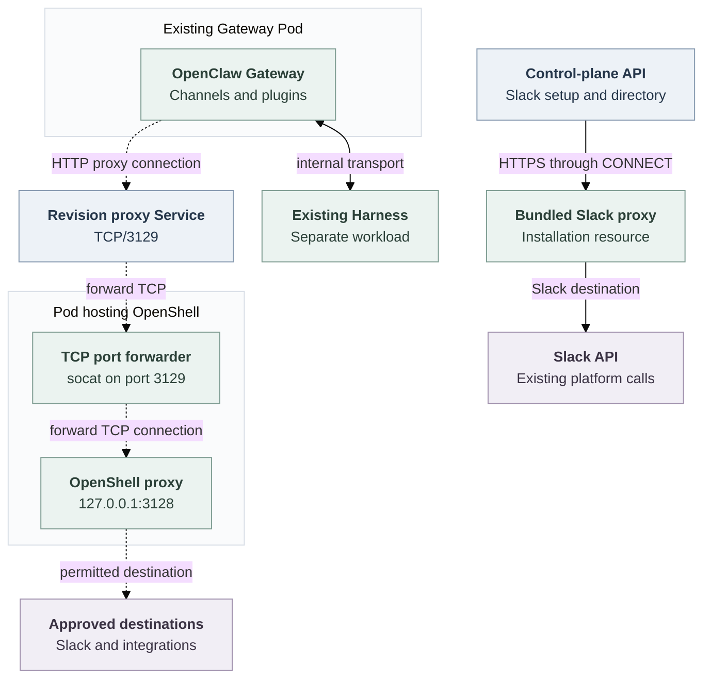
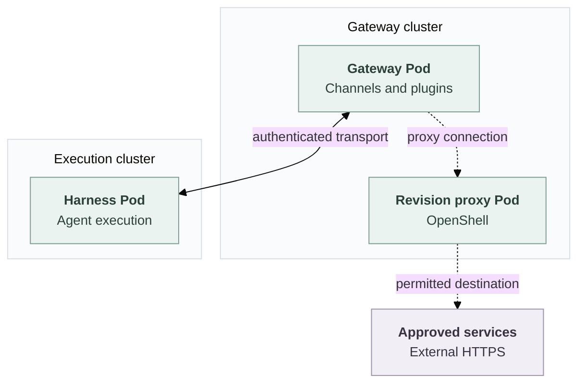

# Gateway outbound destination control via a standalone OpenShell proxy

## Problem

A dedicated Gateway runs Channels, plugins and integrations that call external services. Its [bundled Slack proxy](../../apps/controller/src/slack-proxy.mjs) allows Slack destinations on TCP/443 and rejects other services. Kubernetes blocks direct Internet access. A plugin therefore needs a route to the additional services approved for its Agent.

This proposal applies to dedicated mode. Embedded mode keeps its existing behavior.

## Proposed change

Give each dedicated Agent's Gateway its own outbound destination list and enforce it through the selected Credential Proxy capability:

**Gateway → OpenShell proxy → services approved for that Agent.**

The selected OpenShell Driver runs one proxy Pod per Agent revision, using OpenShell's existing proxy software and policy engine. Enabled Channels automatically contribute their required destinations. Each revision saves its Agent's approved destinations and Channel requirements.

Every dedicated Kubernetes Gateway uses this route for external HTTPS, whether its Harness runs in the same cluster or a separate execution cluster. Gateway and Harness placement and the Harness's existing protections stay unchanged. Reject a nonempty outbound destination list when the selected Compute cannot enforce it.

<a id="one-request-before-and-after"></a>

## How a request works

Suppose a plugin on Agent A needs `api.example.com:443`:

1. An administrator adds that destination to Agent A's outbound settings.
2. At deployment, the controller saves the policy in a new Agent revision and starts its proxy before its Gateway.
3. The plugin's HTTP client requests a CONNECT tunnel through the proxy.
4. OpenShell checks the destination and opens an allowed tunnel. HTTPS remains end-to-end between the Gateway and the external service.
5. Kubernetes blocks attempts to bypass the proxy. Agent B retains its own permissions.

Gateway HTTP and WebSocket clients must use this explicit proxy. Slack API and Socket Mode connections use the same route as other integrations.

## Agent permissions and deployment

The proposed Agent field `gatewayOutbound.destinations` holds additional approved destinations, separately from native OpenClaw Configuration. For example, Agent A's setting is:

```yaml
gatewayOutbound:
  destinations:
    - host: api.example.com
      port: 443
```

The default list is empty. Each enabled Channel contributes its required hosts from that Agent's configuration. Enabling Slack supplies its API and Socket Mode destinations automatically, including suffix wildcards for rotating WebSocket endpoints. Administrators approve extra hosts through the Agent's outbound settings.

The controller combines only that Agent's additional destinations and enabled Channel requirements. Manual entries use exact DNS hosts on TCP/443; trusted Channel Drivers can contribute DNS suffix wildcards. Every resulting policy must enforce the address exclusions described under Network enforcement and failure.

Setting or changing destinations requires both `update` and `administer` on the exact Agent. OpenClaw Control Plane (OCC) validates and persists the setting through the Agent API and exposes it through the Console and CLI. It records attributable mutations and authorization denials.

Deployment uses the existing deployment permissions. OCC saves the Agent's destination list, enabled Channel requirements, effective policy and selected Driver identities in the immutable Agent revision.

Each policy identifies its Namespace, Agent and revision. Compute checks that the policy enforces the required address exclusions before deployment.

Later Agent edits take effect through a new revision; reconciliation uses the policy saved in the existing revision. Disabling a Channel removes its contribution on the next deployment while preserving independently approved destinations.

Destination permissions cover hosts and ports. The Gateway retains integration credentials, and each external service authorizes the encrypted API requests.

## Processes, Pods and connections

Dashed arrows show the proposed Gateway route. The control-plane Slack route and internal Gateway–Harness transport remain unchanged.



The pinned OpenShell standalone `network-proxy` listener binds to loopback. `socat` forwards TCP from Service port 3129 to OpenShell at `127.0.0.1:3128`. OpenShell authorizes CONNECT destinations; TLS passes through to the external service. Remove the forwarder when the selected OpenShell version supports the required network listener directly.

The proxy uses a separate Pod so Kubernetes can give it external access while restricting the Gateway to the proxy and required internal services.

### Separate execution cluster

The proxy stays in the Gateway's cluster and managed namespace. Only the Harness is remote; Gateway traffic to external services does not cross the execution cluster. The same per-Agent destination policy and separate proxy Pod apply in both topologies.

Dashed arrows show the proposed external route. The solid arrow shows the existing Gateway–Harness transport.



Compute creates, checks and removes proxy resources through the Gateway cluster's Kubernetes client. It restricts Gateway egress to that revision's proxy and required platform services. Infrastructure address exclusions cover both clusters where their networks are reachable from the proxy.

The remote Harness uses a separate platform route, not an entry in the Agent's external destination list. Network rules restrict that route to the execution endpoint; the receiving service authenticates and authorizes access to the Agent's Harness. A shared ingress must not permit access to another Agent's Harness or arbitrary forwarding.

For example, Agent A's permission for `api.example.com:443` has the same effect with a local or remote Harness. Agent B gains no permission, and neither Agent can bypass its proxy through the execution endpoint.

Proxy failure blocks external traffic without a direct fallback. An execution-cluster outage interrupts Harness operations but does not change the Gateway's external route or permissions. Proxy cleanup remains in the Gateway cluster and follows the revision lifecycle below.

## Proxy lifecycle and cost

One proxy per Agent revision keeps its policy and connections independent. A policy change creates a new revision and proxy. Stopping one revision closes its connections while other Agents continue running.

Each running revision adds a proxy Pod, Deployment, Service, immutable policy files and network rules. A shared proxy would reduce resource use but require authenticated Agent identification, per-revision policy selection and independent connection removal. Separate instances use Kubernetes peer selection and workload termination for those responsibilities.

## Control-plane networking

OCC keeps its existing installation-level routes for sign-in, provider services and Slack setup. Its bundled Slack proxy serves bot-token validation and user/channel directory lookups, including before any Agent is deployed. This retains a separate Slack-only proxy implementation and gives control-plane operations a route independent of Agent lifecycles.

## Platform responsibilities

- **OCC** owns Agent destination settings, authorization, persistence and revision snapshots.
- **Compute** owns Gateway deployment and Kubernetes networking. It validates the revision's policy, configures the proxy address, preserves required internal routes and blocks bypass.
- **Credential Proxy** admits Gateway destination policies alongside its protected-credential operations.
- **OpenShell Sandbox Driver** manages the revision's proxy Pod, Service, policy files and network rules.
- **Channel Drivers** contribute the destinations required by the Agent's enabled Channels.

Using OpenShell to proxy Gateway traffic does not require an OpenShell management service or its credentials. The selected Drivers must validate the destination policy and create and remove the proxy. Harness or credential operations that require the management service must remain unavailable unless their required Drivers and an authenticated management Backend are configured.

Each deployment records which Drivers provide the Gateway proxy separately from those that run the Harness. Selecting OpenShell for Gateway traffic does not change how the Harness runs or receives repository credentials. Permission to reach an external destination does not grant access to Harness or repository credentials. Gateway-only use must not require unused management clients or placeholder service addresses and credentials.

The Driver interfaces are [Credential Proxy `gatewayDestinations.admit`](../../packages/contracts/src/credential-proxy.ts) and [Sandbox `gatewayProxy.prepare/remove`](../../packages/contracts/src/gateway-destinations.ts). Compute supplies the Agent revision and its destinations. See [paired Driver registration](../../docs/reference/drivers/selection.md#select-a-protected-sender) for how these Drivers are configured together.

## Network enforcement and failure

OpenShell checks external destinations; Kubernetes prevents connections that bypass those checks. The Gateway can connect only to its own proxy and required internal services. The proxy accepts connections only from the Gateway it was created for. Compute must refuse deployment if the selected Drivers cannot enforce the destination policy. If the proxy fails, external connections must fail rather than connect directly.

Proxy network rules and OpenShell's DNS/address checks exclude private, loopback, link-local, metadata and infrastructure addresses. An approved DNS name must resolve to an allowed external address. Native TLS certificate and hostname verification remain enabled.

The cluster must enforce Kubernetes NetworkPolicies. Only trusted administrators and platform components may change the Pod labels and network rules used by these restrictions. An additional rule can allow traffic that this design intends to block, so the rules must be checked together.

The Gateway must use the new proxy for all external HTTPS requests, including Slack. Remove existing Channel network rules that permit direct Internet connections, and prevent the Gateway from using the existing Slack-only proxy. Otherwise, it could avoid the new proxy's destination restrictions. The control plane continues to use the Slack-only proxy for its own operations. Direct Internet connections must remain blocked even when the Gateway's proxy environment variables are absent.

Before starting the Gateway, check that its proxy resources belong to the correct Agent revision, use its saved destination policy without changes, run the pinned software images and include a ready OpenShell proxy. Do not start the Gateway if any of these checks fail.

When stopping or replacing a deployment, stop its Gateway first. Then remove its proxy and wait for the proxy Pods and established connections to disappear. Deleting the Kubernetes Service alone does not close existing connections. Delete only resources belonging to that Agent revision.

Stopping an existing deployment must remain possible even if configuration changes would now prevent it from starting. Use the deployment's saved records to identify its proxy resources, and verify that they belong to that deployment before deleting them. If some resources cannot be removed, report what remains so cleanup can be retried. Continue stopping the deployment's other workloads, but never delete resources belonging to another deployment.

<a id="required-evidence-and-current-status"></a>

## Acceptance criteria

Exercise the regular Agent authoring, deploy, activation, replacement and stop paths to establish:

- Agent-specific destination writes, required permissions, audit evidence and persistence through the API, Console and CLI.
- Different extra destinations for two Agents: each can reach its approved service and is denied the other's service.
- Automatic Slack destinations for an Agent with Slack enabled, including API and Socket Mode connections.
- Immutable revision policies after Agent edits, with changes applied on a new deployment.
- Existing Harness containment and protected credential requests alongside Gateway destination control.
- Control-plane Slack validation, directory lookups and other installation-level routes, including with no Agent deployed.
- Refusal of denied hosts and ports, forbidden addresses, wrong policies, changed resources and proxy or forwarder outages.
- Denial of direct TCP, raw-IP, HTTP, UDP/QUIC, bundled Slack-proxy and alternate-proxy bypass attempts, including without proxy variables.
- Complete cleanup and closure of established connections after stop or replacement, including after admission configuration changes, preserving other Agents and the successor revision.
- Verify through the regular dedicated Agent workflow that its Gateway can use the proxy without an OpenShell management service. Separately, verify that operations which require that service cannot start without its credentials.
- The same enforcement with local and remote Harnesses, with proxy resources in the Gateway cluster. Remote Harness transport cannot bypass destination controls or reach another Agent's Harness; execution-cluster outages do not change external permissions.
- Rejection of nonempty destination settings when enforcement is unavailable.

The [implementation plan](../plans/0024-gateway-outbound-proxy-reuse.md), [source flow](../../docs/flows/gateway-outbound-destinations.md) and [QA procedure](../../docs/testing/gateway-outbound-destinations.md) hold delivery and verification details. See the pinned OpenShell [standalone role](https://github.com/NVIDIA/OpenShell/blob/bdb956f2cd65a635f1294fccf1d138d263bf650f/crates/openshell-supervisor/src/lib.rs#L536-L629) and [policy rules](../../deploy/runtime/gateway-proxy/sandbox-policy.rego).
