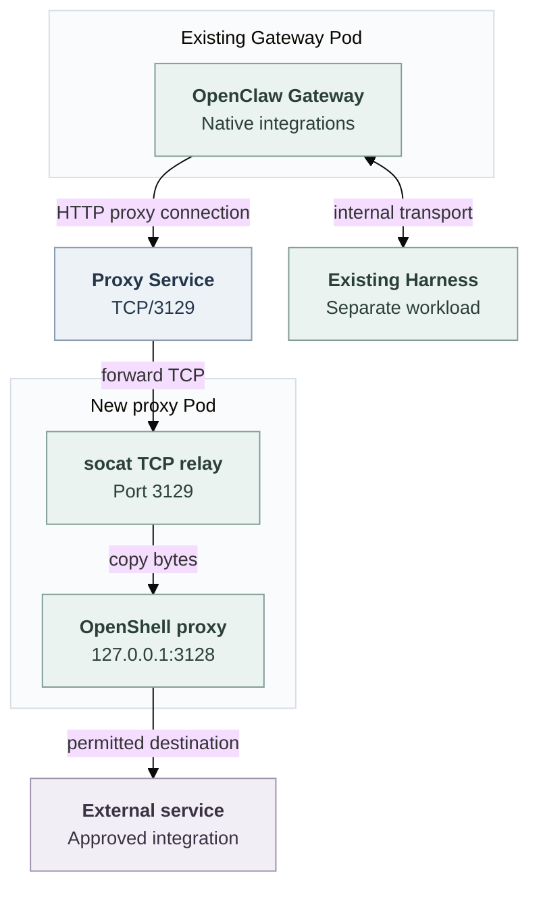

# Gateway outbound destination control via a standalone OpenShell proxy

## Problem and proposed solution

Gateway-hosted plugins, Channels and integrations need external connections. A separate Harness’s network access does not carry Gateway requests.

Kubernetes already uses default-deny networking. The [bundled Slack proxy](../../apps/controller/src/slack-proxy.mjs) permits Slack hostnames on TCP/443 and refuses other integrations. The missing capability is administrator-approved HTTPS for trusted Gateway code beyond that Slack-only route.

**This RFC proposes extending the platform's Credential Proxy capability with Gateway destination rules.** The Gateway uses the selected proxy; Kubernetes blocks direct Internet connections. The extension must preserve existing Harness containment and protected credential handling. Enabling Gateway destination control must not require choosing a destination-only mode instead of that protection. Credential Proxy is the platform interface, not another name for OpenShell.

For OpenShell, this proposal uses a new proxy-only Pod for each opted-in Agent revision. It reuses OpenShell’s existing proxy and policy engine, not an already running proxy instance. This proposal does not move or newly sandbox the Gateway or Harness. Existing Harness sandboxing stays unchanged.

## One request before and after

Consider a trusted integration sending an HTTPS request to `api.example.com:443`, an illustrative non-Slack endpoint.

**Before:** the bundled Slack proxy refuses this host. On the existing Slack-only route, the integration cannot connect, even if Slack itself works.

**With this option enabled:**

1. The Gateway's HTTP client connects to the new proxy Service and requests an HTTP CONNECT tunnel to `api.example.com:443`.
2. The Service sends the connection to the proxy Pod. A TCP relay passes it to OpenShell's local listener.
3. OpenShell checks the destination. If allowed, it connects to the approved service; otherwise it refuses the tunnel.
4. The Gateway verifies the service's TLS certificate and sends its request through the encrypted tunnel.
5. Kubernetes must block a direct connection that avoids the proxy.

This is an explicit proxy, not transparent interception. A client that ignores proxy settings fails to connect; it gets no direct fallback. Gateway HTTP and WebSocket clients must support this proxy route.

## Processes, Pods and connections

The Gateway sends external requests through the proxy. Its connection to the Harness remains separate.



The proxy Pod runs stock OpenShell supervisor network-proxy mode and `socat`, with no Gateway, Harness, workspace or credentials. OpenShell 0.1.5 listens only on loopback in this mode. The relay exposes that listener; OpenShell alone evaluates policy.

A separate Pod gives the proxy Internet permission without giving it to the Gateway. A Gateway sidecar would share Pod-level network permissions and would not establish this separation.

## Proxy instance tradeoff

This RFC proposes one Gateway destination proxy per opted-in Agent revision, not one per integration. Each revision has its own policy and proxy resources. The controller can stop its proxy without stopping another Agent’s proxy. A policy change creates a new revision and proxy rather than updating a policy shared by multiple Agents.

The cost grows with deployed revisions. For example, 100 simultaneously running opted-in revisions require 100 additional proxy Pods, each with a Deployment, Service, policy files and network rules. Existing Harness-side proxying and the bundled Slack proxy remain separate. Scheduling, resource use, readiness checks and cleanup add operational work.

A shared proxy could reduce instance count. It would need to identify each originating Agent and revision, select its policy, and close that revision’s connections without disrupting others. A proxy kept across revisions of one Agent would also need policy updates and connection draining.

This proposal selects per-revision instances to keep policies and lifecycles separate, at the cost of additional Pods. Reusing the Credential Proxy interface or OpenShell engine does not require sharing one running instance.

## What replaces the Slack route?

For an opted-in dedicated Gateway, the new proxy replaces its connection to the bundled Slack proxy. Compute selects the new proxy address and clears the old Channel egress grant; it does not chain the two proxies. Enabled Slack contributes its API and WebSocket hosts to the new policy, so existing Slack behavior must be preserved.

This proposal retains the bundled Slack proxy Deployment. API credential validation and directory lookup keep their separate Slack-proxy path. Non-opted-in Gateways retain the existing route. Those consumers must continue working independently of a Gateway revision.

## Configuration

This proposal introduces optional `runtime.gatewayOutbound` in the Kubernetes Compute Driver's installation configuration. It is not a native OpenClaw Gateway setting or a per-Agent switch.

Configuration fragment:

```yaml
runtime:
  gatewayOutbound:
    destinations:
      - host: api.example.com
        port: 443
```

When present, the option routes dedicated Agent revisions managed by that Compute Driver through the selected Credential Proxy. The administrator supplies additional destinations in this list; each revision also receives the destinations required by its enabled Channels. An empty list permits only those Channel destinations. When the option is absent, existing routes remain unchanged.

Compute saves the resulting policy in each Agent revision. Editing the installation configuration does not change the policy of an existing revision.

## Dedicated and embedded modes

**Dedicated:** this proposal covers single-cluster Kubernetes deployments. The Gateway stays in its Pod; the Harness keeps its placement, workspace and model credentials. The controller starts the proxy before the Gateway uses it. Required Gateway–Harness and workspace transports remain direct.

The selected Driver must support Gateway destination control alongside existing Harness containment and protected credential requests. Enabling this option must not disable or replace those protections.

**Embedded:** Gateway and Harness share their existing runtime. This proposal adds no destination proxy or network change. Existing refusal of enabled Channels in embedded mode remains; the bundled Slack proxy does not make embedded Slack supported.

## Policy, credentials and enforcement

The policy belongs to one Namespace, Agent and revision. Administrator destinations come from trusted installation configuration. Enabled Channels contribute their required hosts; Slack includes provider suffixes for rotating WebSocket endpoints. Do not combine different Agents' policies.

The destination list uses exact administrator DNS hosts on TCP/443 and trusted Channel suffix wildcards. An initially permissive compatibility policy is acceptable; it must preserve the private-address restrictions below.

Integration credentials remain in the Gateway. Dedicated Harness model credentials remain in the Harness. The new proxy receives neither. The Gateway verifies external TLS certificates; there is no TLS interception or credential rewriting. A permitted tunnel controls host and port, not encrypted API actions or data sent to an allowed service.

OpenShell decides destinations; Kubernetes prevents bypass. Gateway egress must reach only its revision's proxy and required internal services. Proxy ingress must select that Gateway. The proxy's external rules must exclude private, loopback, link-local, metadata and infrastructure ranges, alongside OpenShell's DNS/address checks. Allowed DNS names must not create a route to private addresses.

This requires an enforcing Kubernetes network plugin and trusted writers of Pod labels and network rules. OpenShell supplies no cryptographic Gateway identity in this mode. Remove the old Channel proxy grant for this selection and prevent broad ordinary rules from selecting this Gateway: Kubernetes allow rules are additive, so deny-all cannot cancel another allow. Removing proxy environment variables must not restore Internet access.

## Platform responsibilities and lifecycle

The controller divides this work among existing platform interfaces:

- **Compute** already owns Gateway deployment and Kubernetes networking. It saves the policy and selected implementation identities in the immutable Agent revision, configures the Gateway's proxy address, preserves internal routes and blocks bypass.
- **Credential Proxy** represents the selected proxy implementation. Extend it with destination-policy validation separate from credential exchange. Do not invent credential sources, grants or protected executions for a destination-only connection.
- **OpenShell Sandbox Driver** already manages OpenShell runtime resources. Extend it to create, check and remove the separate proxy Pod, Service, policy files and network rules. This is resource management, not placement of the Gateway inside a sandbox.
- **Channel Drivers** supply nonsecret destination requirements from the enabled configuration, not permission to use a provider account or API action.

The new generic ports are [Credential Proxy `gatewayDestinations.admit`](../../packages/contracts/src/credential-proxy.ts) for policy validation and [Sandbox `gatewayProxy.prepare/remove`](../../packages/contracts/src/gateway-destinations.ts) for proxy resources. Compute calls those ports, not an OpenShell-specific forwarding engine. Sandbox and Credential Proxy retain the existing [paired Driver registration](../../docs/reference/drivers/selection.md#select-a-protected-sender). The selected Driver supplies both interfaces and manages their runtime resources; this does not require one running proxy process for both traffic paths. Other implementations must supply those contracts or the deployment is refused.

Gateway destination checks and protected credential requests are separate operations of the selected capability. OpenClaw Control Plane (OCC) keeps its existing credential authorization responsibilities. The Driver must support both operations together; they may use separate proxy instances.

Before starting the Gateway, verify resource ownership, immutable policy, pinned images and readiness of OpenShell itself, not just the relay. Refuse changed or missing dependencies. Proxy or relay failure must not open a direct route.

A policy change requires a new Agent revision and proxy. Stop or replacement stops the old Gateway before its proxy and must wait for Pods and established connections to disappear. Delete only that revision’s resources. Service removal or a policy-file edit alone does not prove connection withdrawal.

## Acceptance criteria

The regular Agent deploy, worker, activation, replacement and stop path must meet these requirements:

- Approved Gateway HTTPS while the same Agent retains working protected Harness credential requests and containment. Neither traffic path may inherit the other’s permissions.
- Non-Slack HTTPS, preserved Gateway Slack API/Socket Mode behavior after route replacement, unchanged API Slack validation/directory access, TLS verification and Harness/model/workspace behavior.
- Denied hosts and ports, wrong-policy refusal, proxy/relay outage and tamper rejection.
- Direct TCP, raw-IP, HTTP, UDP/QUIC and alternate-proxy attempts denied, including without proxy variables; private-address protection and cross-Agent isolation.
- Revision-specific access, complete cleanup and closure of established connections when a revision stops or is replaced.

The [plan](../plans/0024-gateway-outbound-proxy-reuse.md) records delivery, the [source flow](../../docs/flows/gateway-outbound-destinations.md) traces implementation, and the [QA procedure](../../docs/testing/gateway-outbound-destinations.md) lists detailed checks and prerequisites. See the pinned OpenShell [standalone role](https://github.com/NVIDIA/OpenShell/blob/bdb956f2cd65a635f1294fccf1d138d263bf650f/crates/openshell-supervisor/src/lib.rs#L536-L629) and [policy rules](../../deploy/runtime/gateway-proxy/sandbox-policy.rego).
