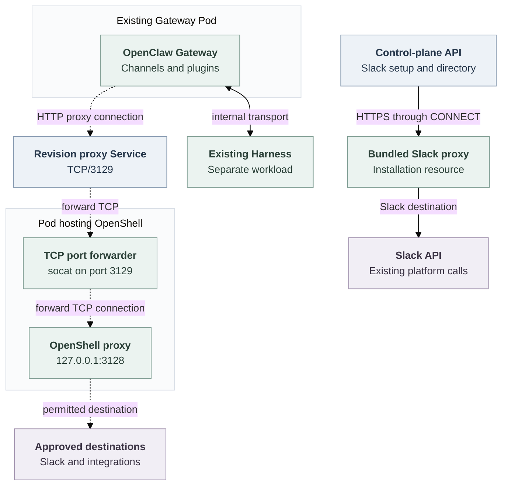

# Gateway outbound destination control via a standalone OpenShell proxy

## Problem

A dedicated Gateway runs Channels, plugins and integrations that call external services. Its [bundled Slack proxy](../../apps/controller/src/slack-proxy.mjs) allows Slack destinations on TCP/443 and rejects other services. Kubernetes blocks direct Internet access. A plugin therefore needs a route to the additional services approved for its Agent.

This proposal applies to dedicated mode. Embedded mode keeps its existing behavior.

## Proposed change

Give each dedicated Agent's Gateway its own outbound destination list and enforce it through the selected Credential Proxy capability:

**Gateway → OpenShell proxy → services approved for that Agent.**

The selected OpenShell Driver runs one proxy Pod per Agent revision, using OpenShell's existing proxy software and policy engine. Enabled Channels automatically contribute their required destinations. Each revision saves its Agent's approved destinations and Channel requirements.

Every dedicated Gateway in a single-cluster Kubernetes deployment uses this route for external HTTPS. Gateway and Harness placement and the Harness's existing protections stay unchanged. Separate execution clusters retain their existing behavior.

<a id="one-request-before-and-after"></a>

## How a request works

Suppose a plugin on Agent A needs `api.example.com:443`:

1. An administrator adds that destination to Agent A's outbound settings.
2. At deployment, the controller saves the policy in a new Agent revision and starts its proxy before its Gateway.
3. The plugin's HTTP client requests a CONNECT tunnel through the proxy.
4. OpenShell checks the destination and opens an allowed tunnel. HTTPS remains end-to-end between the Gateway and the external service.
5. Kubernetes blocks attempts to bypass the proxy. Agent B retains its own permissions.

Gateway HTTP and WebSocket clients must use this explicit proxy. Slack API and Socket Mode connections use the same route as other integrations.

## Agent permissions and deployment

The proposed Agent field `gatewayOutbound.destinations` holds additional approved destinations, separately from native OpenClaw Configuration. For example, Agent A's setting is:

```yaml
gatewayOutbound:
  destinations:
    - host: api.example.com
      port: 443
```

The default list is empty. Each enabled Channel contributes its required hosts from that Agent's configuration. Enabling Slack supplies its API and Socket Mode destinations automatically, including suffix wildcards for rotating WebSocket endpoints. Administrators approve extra hosts through the Agent's outbound settings.

The controller combines only that Agent's additional destinations and enabled Channel requirements. Manual entries use exact DNS hosts on TCP/443; trusted Channel Drivers can contribute DNS suffix wildcards. Every resulting policy must enforce the address exclusions described under Network enforcement and failure.

Setting or changing destinations requires both `update` and `administer` on the exact Agent. OpenClaw Control Plane (OCC) validates and persists the setting through the Agent API and exposes it through the Console and CLI. It records attributable mutations and authorization denials.

Deployment uses the existing deployment permissions. OCC saves the Agent's destination list, enabled Channel requirements, effective policy and selected Driver identities in the immutable Agent revision.

Each policy identifies its Namespace, Agent and revision. Compute checks that the policy enforces the required address exclusions before deployment.

Later Agent edits take effect through a new revision; reconciliation uses the policy saved in the existing revision. Disabling a Channel removes its contribution on the next deployment while preserving independently approved destinations.

Destination permissions cover hosts and ports. The Gateway retains integration credentials, and each external service authorizes the encrypted API requests.

## Processes, Pods and connections

Dashed arrows show the proposed Gateway route. The control-plane Slack route and internal Gateway–Harness transport remain unchanged.



The pinned OpenShell standalone `network-proxy` listener binds to loopback. `socat` forwards TCP from Service port 3129 to OpenShell at `127.0.0.1:3128`. OpenShell authorizes CONNECT destinations; TLS passes through to the external service. Remove the forwarder when the selected OpenShell version supports the required network listener directly.

The proxy uses a separate Pod so Kubernetes can give it external access while restricting the Gateway to the proxy and required internal services.

## Proxy lifecycle and cost

One proxy per Agent revision keeps its policy and connections independent. A policy change creates a new revision and proxy. Stopping one revision closes its connections while other Agents continue running.

Each running revision adds a proxy Pod, Deployment, Service, immutable policy files and network rules. A shared proxy would reduce resource use but require authenticated Agent identification, per-revision policy selection and independent connection removal. Separate instances use Kubernetes peer selection and workload termination for those responsibilities.

## Control-plane networking

OCC keeps its existing installation-level routes for sign-in, provider services and Slack setup. Its bundled Slack proxy serves bot-token validation and user/channel directory lookups, including before any Agent is deployed. This retains a separate Slack-only proxy implementation and gives control-plane operations a route independent of Agent lifecycles.

## Platform responsibilities

- **OCC** owns Agent destination settings, authorization, persistence and revision snapshots.
- **Compute** owns Gateway deployment and Kubernetes networking. It validates the revision's policy, configures the proxy address, preserves required internal routes and blocks bypass.
- **Credential Proxy** admits Gateway destination policies alongside its protected-credential operations.
- **OpenShell Sandbox Driver** manages the revision's proxy Pod, Service, policy files and network rules.
- **Channel Drivers** contribute the destinations required by the Agent's enabled Channels.

The Driver extensions are [Credential Proxy `gatewayDestinations.admit`](../../packages/contracts/src/credential-proxy.ts) and [Sandbox `gatewayProxy.prepare/remove`](../../packages/contracts/src/gateway-destinations.ts). Compute passes the revision and its destinations to those interfaces. Sandbox and Credential Proxy use the existing [paired Driver registration](../../docs/reference/drivers/selection.md#select-a-protected-sender). The selected Driver must support both Gateway destination control and protected Harness operations, with separate permissions and proxy instances.

Selecting the paired Driver capabilities for the Gateway proxy does not select
that Driver to provision the Harness or change repository credential delivery.
The revision identifies the Gateway proxy pair separately from its Harness
Sandbox selection. Gateway destination permission grants no authority to release
Harness or repository credentials.

## Network enforcement and failure

OpenShell authorizes destinations; Kubernetes prevents bypass. Gateway egress reaches only its revision's proxy and required internal services. Proxy ingress selects only that revision's Gateway. The Gateway's external HTTPS route is exclusively through OpenShell, including Slack. Compute refuses deployment when the selected capability or policy is unavailable. Proxy failure blocks external traffic.

Proxy network rules and OpenShell's DNS/address checks exclude private, loopback, link-local, metadata and infrastructure addresses. An approved DNS name must resolve to an allowed external address. Native TLS certificate and hostname verification remain enabled.

Enforcement requires a Kubernetes network plugin that enforces NetworkPolicies and trusted writers of Pod labels and network rules. Kubernetes allow rules are additive. Remove the Gateway's old Channel egress grant and its access to the bundled Slack proxy, and ensure other rules cannot admit an alternate external route. Direct connections remain blocked when proxy environment variables are absent.

Before starting a Gateway, verify resource ownership, immutable policy, pinned images and readiness of OpenShell itself. Refuse changed or missing dependencies. Stop or replacement first stops the old Gateway, then removes its proxy and waits for its Pods and established connections to disappear. Delete only that revision's resources. Service removal alone cannot close established tunnels.

<a id="required-evidence-and-current-status"></a>

## Acceptance criteria

Exercise the regular Agent authoring, deploy, activation, replacement and stop paths to establish:

- Agent-specific destination writes, required permissions, audit evidence and persistence through the API, Console and CLI.
- Different extra destinations for two Agents: each can reach its approved service and is denied the other's service.
- Automatic Slack destinations for an Agent with Slack enabled, including API and Socket Mode connections.
- Immutable revision policies after Agent edits, with changes applied on a new deployment.
- Existing Harness containment and protected credential requests alongside Gateway destination control.
- Control-plane Slack validation, directory lookups and other installation-level routes, including with no Agent deployed.
- Refusal of denied hosts and ports, forbidden addresses, wrong policies, changed resources and proxy or forwarder outages.
- Denial of direct TCP, raw-IP, HTTP, UDP/QUIC, bundled Slack-proxy and alternate-proxy bypass attempts, including without proxy variables.
- Complete cleanup and closure of established connections after stop or replacement, preserving other Agents and the successor revision.

The [implementation plan](../plans/0024-gateway-outbound-proxy-reuse.md), [source flow](../../docs/flows/gateway-outbound-destinations.md) and [QA procedure](../../docs/testing/gateway-outbound-destinations.md) hold delivery and verification details. See the pinned OpenShell [standalone role](https://github.com/NVIDIA/OpenShell/blob/bdb956f2cd65a635f1294fccf1d138d263bf650f/crates/openshell-supervisor/src/lib.rs#L536-L629) and [policy rules](../../deploy/runtime/gateway-proxy/sandbox-policy.rego).
