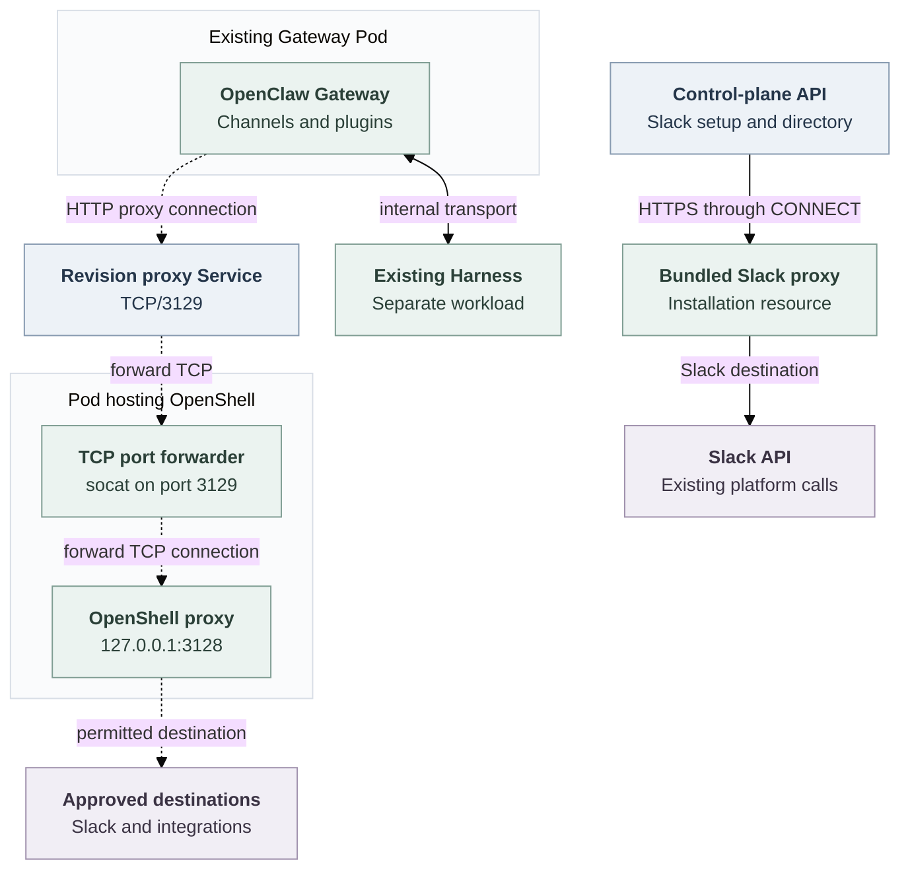

# Gateway outbound destination control via a standalone OpenShell proxy

## Problem

A dedicated Gateway runs Channels, plugins and integrations that call external services. Today, its outbound route uses the [bundled Slack proxy](../../apps/controller/src/slack-proxy.mjs), which allows Slack destinations on TCP/443 and rejects other services. Kubernetes blocks direct Internet access. A plugin therefore cannot call an administrator-approved non-Slack service through this route.

## Proposed change

Replace the Gateway's Slack-only route with a destination-controlled proxy:

**Gateway → OpenShell proxy → Slack or another approved HTTPS service.**

Extend the existing Credential Proxy capability to authorize Gateway destinations. The selected OpenShell Driver runs one proxy Pod per Agent revision, using OpenShell's existing proxy software and policy engine.

Every supported dedicated Gateway uses this route. It cannot fall back to the old Slack proxy or direct Internet access. Gateway and Harness placement stays unchanged, as do the Harness's existing protections.

This proposal covers dedicated execution on single-cluster Kubernetes deployments. Embedded networking and separate execution clusters are outside its scope.

<a id="one-request-before-and-after"></a>

## How a request works

Suppose a Gateway plugin needs `api.example.com:443`:

1. The administrator adds that destination to the allowed list.
2. At deployment, the controller saves the policy and starts the revision's proxy before its Gateway.
3. The plugin's HTTP client requests a CONNECT tunnel through the proxy.
4. OpenShell checks the destination. If allowed, it opens the tunnel; otherwise it refuses the request. HTTPS remains end-to-end between the Gateway and the external service.
5. Kubernetes blocks attempts to bypass the proxy.

Gateway HTTP and WebSocket clients must use this explicit proxy; connections are not intercepted transparently. Enabled Slack supplies its required destinations and uses the same route as other integrations. Its API and Socket Mode connections must continue working.

## Destination policy and configuration

Each Gateway proxy enforces a policy saved for one Namespace, Agent and revision. The controller combines two inputs:

- **Installation-wide administrator destinations.** The Kubernetes Compute Driver's `runtime.gatewayOutbound.destinations` list supplies a common baseline for every dedicated Gateway managed by that Driver.
- **Agent-specific Channel destinations.** Each enabled Channel contributes its required hosts from that Agent's configuration. Slack includes suffix wildcards for rotating WebSocket endpoints. A Channel must not contribute permissions to another Agent's policy.

Configuration fragment within the Compute Driver's installation configuration:

```yaml
runtime:
  gatewayOutbound:
    destinations:
      - host: api.example.com
        port: 443
```

`gatewayOutbound` configures destination rules; it does not enable or disable proxy routing. If the section or list is absent or empty, the administrator baseline is empty and enabled Channels still contribute their requirements. A missing proxy capability refuses deployment; it does not restore the Slack-only route or direct Internet access.

The common baseline makes administrator configuration simple, but grants each listed destination to every dedicated Gateway using that Compute Driver. Separate per-revision policies do not make those common grants Agent-specific. This RFC does not add a per-Agent custom-destination field or automatic discovery of arbitrary plugin endpoints. Additional plugin services must be explicitly approved in the administrator list; Channel contributions alone do not cover them.

The destination list uses exact administrator DNS hosts on TCP/443 and trusted Channel suffix wildcards. An initially permissive compatibility policy is acceptable, but it must preserve the private-address restrictions below. Permissions apply to hosts and ports, not encrypted API actions.

Compute saves the combined policy in the immutable Agent revision. Editing installation configuration does not change an existing revision's policy; deploying with changed destinations requires a new revision.

## Processes, Pods and connections

Dashed arrows show the proposed Gateway route. The control-plane Slack route and internal Gateway–Harness transport remain unchanged.



OpenShell is the proxy; the Pod hosts it. In the pinned OpenShell 0.1.5 standalone `network-proxy` mode, the listener must use loopback. [OpenShell v0.1.6 enforces the same restriction](https://github.com/NVIDIA/OpenShell/blob/v0.1.6/crates/openshell-supervisor/src/lib.rs#L651-L675), so that upgrade alone does not remove the need for the forwarder. `socat` exposes the listener to the Service; it makes no policy decisions and does not terminate TLS. Remove the forwarder when the selected OpenShell version supports a suitable listener directly.

The proxy runs separately from the Gateway because Kubernetes network permissions apply to the Pod. A sidecar would share the Gateway's Pod-level permissions and would not provide this separation. The standalone proxy does not require a second OpenShell management-server installation.

## Instance and lifecycle tradeoffs

One proxy per Agent revision keeps policy and cleanup independent. Stopping one revision must close its connections without disrupting another Agent. A policy change creates a new revision and proxy rather than changing shared policy in place.

The cost grows with deployed revisions: 100 running dedicated revisions require 100 additional proxy Pods, each with a Deployment, Service, policy files and network rules. Existing Harness-side proxying and the control-plane Slack proxy remain separate. Scheduling, resource use, readiness and cleanup add operational work.

A shared Gateway proxy would reduce instance count, but would need to identify the originating Agent and revision, select the correct policy, and close one revision's connections without disrupting others. Keeping a proxy across revisions of one Agent would also require policy updates and connection draining. This proposal chooses per-revision instances to avoid those shared lifecycle requirements. Reusing the Credential Proxy interface or OpenShell engine does not require sharing one running process.

## Why control-plane networking stays unchanged

The OpenClaw Control Plane (OCC) API does not run Agent plugins. Its external requests serve installation-level features such as sign-in, provider services and Slack setup. Their destinations depend on the installation's configuration, not on each Agent's plugin list.

The OCC API keeps its existing routes. In particular, it uses the bundled Slack proxy for bot-token validation and user/channel directory lookups. The API performs those operations by calling Slack; the proxy only supplies the network route. These calls can occur before any Agent is deployed, so their route must not depend on an Agent revision.

**The bundled Slack proxy remains for those control-plane calls, not for dedicated Gateways.** Keeping it avoids expanding this Gateway change into a control-plane egress redesign. The cost is retaining a separate Slack-only proxy implementation. Replacing it later would require installation-owned policy and client configuration for the affected platform features. This RFC does not add an installation-level OpenShell proxy.

## Platform responsibilities and enforcement

The controller extends existing interfaces:

- **Compute** owns Gateway deployment and Kubernetes networking. It saves the policy and selected Driver identities in the Agent revision, configures the proxy address, preserves required internal routes and blocks bypass.
- **Credential Proxy** adds destination-policy admission alongside its existing protected-credential operations. Gateway destination control must not require disabling Harness protection.
- **OpenShell Sandbox Driver** manages the revision's proxy Pod, Service, policy files and network rules. This is resource management, not placement of the Gateway inside a sandbox.
- **Channel Drivers** contribute the destinations required by the Agent's enabled Channels.

The proposed extensions are [Credential Proxy `gatewayDestinations.admit`](../../packages/contracts/src/credential-proxy.ts) and [Sandbox `gatewayProxy.prepare/remove`](../../packages/contracts/src/gateway-destinations.ts). Compute calls those interfaces, not an OpenShell-specific forwarding engine. Sandbox and Credential Proxy retain the existing [paired Driver registration](../../docs/reference/drivers/selection.md#select-a-protected-sender). The selected Driver must support both Gateway destination control and protected Harness operations; these can use separate proxy instances.

OpenShell authorizes destinations; Kubernetes prevents bypass. Gateway egress must reach only its own proxy and required internal services. Proxy ingress must select that revision's Gateway. External proxy rules must exclude private, loopback, link-local, metadata and infrastructure ranges, alongside OpenShell's DNS/address checks. Allowed DNS names must not create a route to private addresses.

This requires an enforcing Kubernetes network plugin and trusted writers of Pod labels and network rules. Standalone OpenShell supplies no cryptographic Gateway identity. Remove the Gateway's old Channel egress grant, remove its access from the bundled Slack proxy's ingress rules, and prevent broader rules from granting it an alternate route. Kubernetes allow rules are additive; a deny-all policy cannot cancel another allow rule. Removing proxy environment variables must not restore Internet access.

Before starting a Gateway, verify resource ownership, immutable policy, pinned images and readiness of OpenShell itself, not just the forwarder. Refuse changed or missing dependencies. Proxy failure must not open another route. Stop or replacement first stops the old Gateway, then removes its proxy and waits for its Pods and established connections to disappear. Delete only that revision's resources; Service removal alone does not close established tunnels.

## Acceptance criteria

Exercise the regular Agent deploy, activation, replacement and stop path to establish:

- Approved non-Slack HTTPS and preserved Slack API/Socket Mode connections through the revision proxy.
- Existing Harness containment and protected credential requests alongside Gateway destination control, without sharing permissions between the two traffic paths.
- Unchanged control-plane Slack validation, directory lookups and other installation-level network routes, including with no Agent deployed.
- Refusal of denied hosts and ports, wrong policies, changed proxy resources and proxy/forwarder outages.
- Denial of direct TCP, raw-IP, HTTP, UDP/QUIC, bundled Slack-proxy and alternate-proxy bypass attempts, including without proxy variables; private-address protection and cross-Agent isolation.
- Revision-specific access, complete cleanup and closure of established connections after stop or replacement.

The [implementation plan](../plans/0024-gateway-outbound-proxy-reuse.md), [source flow](../../docs/flows/gateway-outbound-destinations.md) and [QA procedure](../../docs/testing/gateway-outbound-destinations.md) hold delivery and verification details. See the pinned OpenShell [standalone role](https://github.com/NVIDIA/OpenShell/blob/bdb956f2cd65a635f1294fccf1d138d263bf650f/crates/openshell-supervisor/src/lib.rs#L536-L629) and [policy rules](../../deploy/runtime/gateway-proxy/sandbox-policy.rego).
