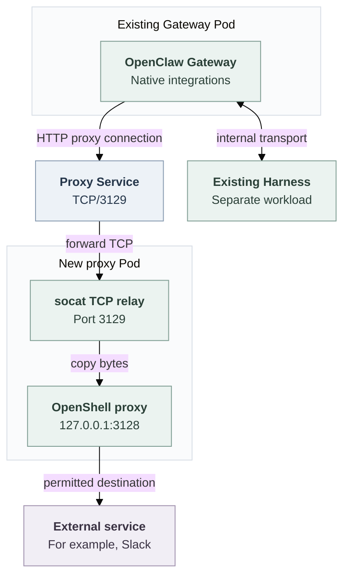

# Gateway outbound destination control via a standalone OpenShell proxy

## Problem and proposed solution

Native plugins, Channels and integrations run in the Gateway and need external connections. Giving a separate Harness network access does not serve requests made by the Gateway.

Kubernetes already uses default-deny networking. Channels can use an administrator-configured HTTP(S) proxy; without a usable route, required requests fail. That existing route does not provide the per-Agent OpenShell policy proposed here. The problem is to make Gateway connections work through configurable policy, not simply to remove Internet access.

Run a separate OpenShell proxy Pod for each Agent revision. Configure the existing Gateway to use it, and use Kubernetes network rules to block direct Internet connections. Keep the Gateway and Harness where they already run. Reuse OpenShell's proxy and policy engine instead of writing another forwarding implementation.

**This is an experimental, dedicated-mode implementation. Embedded networking is unchanged. Actual Gateway traffic and Kubernetes enforcement have not yet been proved. Keep the PR draft and unmerged.**

## One request before and after

Consider a Slack integration sending `POST https://slack.com/api/chat.postMessage` from the Gateway.

**Before:** the client uses the existing Channel proxy when configured and supported. Without a usable route, the request fails. The Harness does not carry this request.

**With this option enabled:**

1. The Gateway's HTTP client connects to the new proxy Service and requests an HTTP CONNECT tunnel to `slack.com:443`.
2. The Service sends the connection to the proxy Pod. A TCP relay passes it to OpenShell's local listener.
3. OpenShell checks the destination. If allowed, it opens the connection to Slack; otherwise it refuses the tunnel.
4. The Gateway verifies Slack's TLS certificate and sends the authenticated request through the encrypted tunnel.
5. Kubernetes must block a direct connection that avoids the proxy.

This is an explicit proxy, not transparent interception. A client that ignores proxy settings fails to connect; it gets no direct fallback. HTTP and WebSocket support in the actual Gateway clients is therefore a required compatibility check.

## Processes, Pods and connections

The diagram shows the path implemented in source, not a verified live deployment. The Harness connection is separate from the external request.

The proxy Pod contains neither Gateway nor Harness, workspace or integration credentials. It runs stock OpenShell supervisor network-proxy mode and stock `socat`. OpenShell 0.1.5 accepts only a loopback listener in this mode, so the relay exposes it through the Service. The relay copies bytes; OpenShell alone evaluates destination policy.

A separate Pod gives the proxy Internet permission without giving that permission to the Gateway. A sidecar in the Gateway Pod would share its Pod-level network permissions and would not establish this separation. The proxy adds one Deployment and Service per Agent revision, plus policy files and network rules.

## Dedicated and embedded modes

**Dedicated:** the option applies to supported single-cluster Kubernetes deployments when `runtime.gatewayOutbound` is configured. The Gateway stays in its Pod; the Harness keeps its placement, workspace and model credentials. The controller starts the proxy before the Gateway uses it. Required Gateway–Harness and workspace transports remain direct. Deployments without this option keep their existing routes.

The implementation requires the selected OpenShell destination-policy and proxy-resource capabilities. It rejects combinations with protected execution, repository credential authority, anonymous GitHub-read admission or a separate execution cluster. It does not automatically support every dedicated deployment.

**Embedded:** Gateway and Harness share their existing runtime. This PR does not create a destination proxy or change their networking. It provides no new OpenShell destination enforcement for embedded mode; this is a scope limit, not a claim that proxy enforcement is impossible there.

## Policy, credentials and enforcement

The policy belongs to one Namespace, Agent and revision. Administrator destinations come from trusted installation configuration. Enabled Channels contribute their required hosts; Slack includes provider suffixes for rotating WebSocket endpoints. Do not combine different Agents' policies.

An initially permissive compatibility policy is acceptable to the connectivity goal. The current implementation is narrower: exact administrator DNS hostnames on TCP/443, plus trusted Channel suffix wildcards. It has no general allow-all compatibility setting. This is an implementation limit, not a reason to break required clients silently.

Integration credentials remain in the Gateway. Dedicated Harness model credentials remain in the Harness. The new proxy receives neither. The Gateway verifies external TLS certificates; there is no TLS interception or credential rewriting. A permitted tunnel controls host and port, not encrypted API actions or data sent to an allowed service.

OpenShell decides destinations; Kubernetes prevents bypass. Gateway egress must reach only its revision's proxy and required internal services. Proxy ingress must select that Gateway. The proxy's external rules must exclude private, loopback, link-local, metadata and infrastructure ranges, alongside OpenShell's DNS/address checks. Allowed DNS names must not create a route to private addresses.

This requires an enforcing Kubernetes network plugin and trusted writers of Pod labels and network rules. OpenShell supplies no cryptographic Gateway identity in this mode. Remove the old Channel proxy grant for this selection and prevent broad ordinary rules from selecting this Gateway: Kubernetes allow rules are additive, so deny-all cannot cancel another allow. Removing proxy environment variables must not restore Internet access.

## Platform responsibilities and lifecycle

The controller divides this work among existing platform interfaces:

- **Compute** already owns Gateway deployment and Kubernetes networking. It saves the policy and selected implementation identities in the immutable Agent revision, configures the Gateway's proxy address, preserves internal routes and blocks bypass.
- **Credential Proxy** represents the selected proxy implementation. Extend it with destination-policy validation separate from credential exchange. Do not invent credential sources, grants or protected executions for a destination-only connection.
- **OpenShell Sandbox Driver** already manages OpenShell runtime resources. Extend it to create, check and remove the separate proxy Pod, Service, policy files and network rules. This is resource management, not placement of the Gateway inside a sandbox.
- **Channel Drivers** supply nonsecret destination requirements from the enabled configuration, not permission to use a provider account or API action.

The OpenShell registration constructs the policy and resource-management implementations together. Compute checks that both match the revision's saved selections. These extensions are proposed contracts, not existing generic remote-proxy support.

Before starting the Gateway, verify resource ownership, immutable policy, pinned images and readiness of OpenShell itself, not just the relay. Refuse changed or missing dependencies. Proxy or relay failure must not open a direct route.

A policy change requires a new Agent revision and proxy. Stop or replacement first stops the old Gateway, then removes its proxy and waits for the Pods and established connections to disappear. Delete only that revision's resources. Service removal or a policy-file edit alone does not prove connection withdrawal.

## Required evidence and current status

The pinned OpenShell/relay Docker test passes. It does not establish actual Gateway client compatibility or Kubernetes enforcement. The real-Agent Kubernetes scenario exists but remains unrun; its cluster, runtime, authorized credentials and controlled public endpoints have not been prepared for that proof.

Acceptance requires the regular Agent deploy, worker, activation, replacement and stop path to demonstrate:

- Working HTTPS and Channel/WebSocket traffic, preserved TLS verification, and unchanged Harness/model/workspace behavior.
- Denied hosts and ports, wrong-policy refusal, proxy/relay outage and tamper rejection.
- Direct TCP, raw-IP, HTTP, UDP/QUIC and alternate-proxy attempts denied, including without proxy variables; private-address protection and cross-Agent isolation.
- Revision-specific access, complete cleanup and measured closure of established connections. The current lifecycle stops predecessors first; stale endpoint withdrawal does not prove simultaneous cross-revision isolation.

The [plan](../plans/0024-gateway-outbound-proxy-reuse.md) records delivery, the [source flow](../../docs/flows/gateway-outbound-destinations.md) traces implementation, and the [QA procedure](../../docs/testing/gateway-outbound-destinations.md) lists detailed checks and prerequisites. The selected OpenShell source is pinned at `bdb956f2cd65a635f1294fccf1d138d263bf650f`; see its [standalone role](https://github.com/NVIDIA/OpenShell/blob/bdb956f2cd65a635f1294fccf1d138d263bf650f/crates/openshell-supervisor/src/lib.rs#L536-L629) and [policy rules](../../deploy/runtime/gateway-proxy/sandbox-policy.rego).
