# Gateway outbound architecture and interface report

## Scope and baseline

This report compares the [proposed destination-control design](index.md) with
upstream `main` at
[`5dae426ec5c591b43609a4b50c154016e2c5483c`](https://github.com/openclaw/openclaw-enterprise/commit/5dae426ec5c591b43609a4b50c154016e2c5483c),
inspected on 28 October 2026. The change contains the RFC and reading materials
only. Source inspection establishes current contracts and gaps; it is not a
runtime test or a deployment qualification.

The task is to let an administrator control where trusted Gateway software can
connect, using existing proxy primitives. It does not change which program holds
a credential, how a provider authenticates a request, or which provider actions
the credential permits.

## One request

An administrator approves `clawhub.ai` for a dedicated Gateway and deploys its
Agent. The Gateway's normal ClawHub client requests the service through the
selected network proxy. The proxy identifies the Gateway, checks its admitted
destination policy and resolved addresses, and forwards the permitted TCP/443
connection. A request to an unapproved host fails. Direct connections cannot
bypass the proxy's policy.

The client performs the TLS handshake with ClawHub and verifies its certificate.
The forwarding path does not terminate that TLS connection. If an integration
uses an authorization header, its Gateway client still supplies the real
credential as it does today. This design neither reads nor rewrites that header.



The policy applies to the whole Gateway. Trusted plugins in that process can
still read its credentials and use any destination granted to the Gateway. Host
approval does not provide plugin isolation, HTTP operation restrictions, or
protection against misuse of an approved API.

## What changes from main

| Area                                 | Current main                                                                                          | Proposed change                                                                                      |
| ------------------------------------ | ----------------------------------------------------------------------------------------------------- | ---------------------------------------------------------------------------------------------------- |
| Administrator intent                 | No general Agent Gateway destination selection.                                                       | Add a Gateway destination selection and Installation ceiling.                                        |
| Channel destinations                 | Compute contains fixed channel requirements.                                                          | Selected Channel Drivers contribute their requirements.                                              |
| Gateway enforcement                  | A configured channel proxy; bundled CONNECT forwarding admits Slack hosts.                            | The selected proxy enforces the Gateway's admitted destination policy.                               |
| Proxy contracts                      | Credential/source-bound protected execution.                                                          | Add an optional destination-only Gateway capability.                                                 |
| Gateway credentials                  | Native integration credentials enter the Gateway workload.                                            | No change.                                                                                           |
| Dedicated model authentication       | Existing Harness authentication path; the dedicated Gateway receives no Harness inference credential. | No change.                                                                                           |
| TLS and application requests         | Native client authentication and TLS verification.                                                    | No credential substitution, TLS interception, or response rewriting.                                 |
| Ordinary embedded execution          | Combined Gateway/Harness with its supported network and credential configuration.                     | No change; no new policy selection or sandbox.                                                       |
| Runtime packaging and infrastructure | Selected Compute/Sandbox/proxy implementations.                                                       | No new forwarding implementation, proxy Deployment, image version, or supplier patch in this change. |

The setting names in the RFC are proposed OCE API fields. They are not supported
on current main. This document does not promote them into the current feature
reference or claim that selecting an existing proxy enables them today.

## Shared infrastructure and workload counts

A shared OpenShell service, a Driver registration, an enforcement process, and a
workload sandbox are different things. Main selects one bundled OpenShell
Backend; that service can manage multiple independent Harness sandboxes.
Each sandbox has a distinct Sandbox identity and policy. This does not imply a
separate Kubernetes ServiceAccount for each Agent.

For two dedicated Codex Agents with one running revision each:

- **Without the optional OpenShell Harness placement:** main does not require
  OpenShell sandboxes for those Agents.
- **With OpenShell Harness placement:** there are two Harness sandboxes, one
  for each Codex execution. Each OpenClaw Gateway remains outside that sandbox.
- **Under this proposal:** neither Harness placement changes, and no additional
  Gateway sandbox is mandated. The enforcing adapter's supported transport will
  determine its process and connection ownership. No fixed extra-Pod count is
  established by this RFC.

For ordinary embedded OpenClaw, the Gateway and Harness continue to share their
existing workload. There is no new OpenShell sandbox and no automatic conversion
to dedicated execution. Existing network restrictions and supported channel
topology still apply; “unchanged” does not mean unrestricted access to cluster or
metadata addresses.

## Current interfaces and callers

The following declarations exist on the pinned main. The
[source catalogue](sources.md) links their complete definitions.

### Channel Driver

```typescript
validateCredentials?(
  values: Readonly<Record<string, unknown>>,
  withSecret: ChannelCredentialReader,
): Promise<void>;

lookupDirectory(
  input: ChannelDirectoryLookupInput,
  signal?: AbortSignal,
): Promise<ChannelDirectoryResult>;
```

These methods serve control-plane setup. Neither declares Gateway runtime
destinations. The proposal adds a nonsecret destination contribution for the
enabled channel configuration. It must distinguish those runtime destinations
from setup traffic; an Agent grant cannot widen control-plane network access.

### Credential Proxy Driver

```typescript
configureRevision(context: ProxyRevisionContext): Promise<ProxyWiring>;

wiringStatus(
  context: ProxyRevisionContext,
  prepared: ProxyWiring,
): Promise<EgressInstallation | undefined>;

verifyInstallation(
  context: ProxyRevisionContext,
  installation: EgressInstallation,
): Promise<boolean>;

removeRevision(context: ProxyRevisionContext): Promise<boolean>;
```

These methods configure and verify an execution's credential-bound plan.
`ProxyPlan.routes` contains source/binding/grant records. The bundled OpenShell
adapter limits an ordinary protected plan to one binding and one literal host,
then enables credential and execution authority middleware. It is not an
arbitrary Gateway destination-policy API.

The proposed optional capability needs four behaviors: admit/install a
destination policy, observe its effective installation, recheck that the correct
Gateway still uses it, and withdraw its connections. Its input contains the
Gateway's revision identity and nonsecret destination rules, not a credential
source. It must not reuse credential-bound plans by inventing empty sources or
tokens. Concrete method signatures belong to the supported transport design;
the required behaviors do not depend on a particular supplier protocol.

The existing exchange callbacks `resolve`, `authorizeSend`, `beginResponse`,
`renewResponse`, and `protectResponse` are **not requirements of this delivery**.
Destination authorization needs no Secret read, token preparation, credential
installation, provider adapter, or response-custody protocol.

### Compute and Sandbox

Compute owns the Gateway workload, Secrets, baseline network isolation, routing,
and activation. The selected proxy owns its Gateway destination rules and
connection lifecycle. Sandbox retains its existing Harness and network-policy
responsibilities. OCC calls these capabilities through their platform contracts;
it does not add OpenShell branches to core admission.

The current Sandbox method `provisionHarness(context)` creates a dedicated
Harness. `harnessEndpoint(context)` and `harnessStatus(context)` identify and
check that Harness. They do not provision or identify a Gateway. Reusing their
implementation cannot justify presenting a Gateway as a Harness.

## OpenShell compatibility

OpenShell's network-policy rules already express executable, host, and port
permissions. OCE renders ordinary Sandbox additions with
`tls: NETWORK_TLS_MODE_SKIP`. This supplies a destination-control primitive
without requiring credential rewriting or HTTPS inspection.

That primitive operates inside an OpenShell-managed sandbox. It does not expose
a supported remote forwarding endpoint that an arbitrary existing Gateway Pod
can join. Current OCE's OpenShell adapter provisions dedicated Harnesses; it does
not wrap an ordinary Gateway merely because the same Backend is selected.

**The missing Gateway-facing transport is an implementation dependency.** The
destination-only capability must not be advertised until a supported adapter
can authenticate the Gateway, bind its policy, and prevent direct bypass while
preserving the intended workload and credential boundaries. Stock OpenShell's
existing functionality alone does not establish this path.

Moving the Gateway workload into an OpenShell sandbox could supply a network
boundary, but it would also require placement, Secret projection, storage,
routing, and lifecycle work. This RFC does not select that expansion. It also
does not patch OpenShell, package its internal host-proxy library as a new
service, or silently replace the requested destination-only design with
protected credential execution. If no supported adapter meets the contract,
runtime delivery remains unavailable.

## Authorization and lifecycle

1. An authorized administrator changes the exact Agent's outbound selection.
   OCC checks `update` and `administer` and records the attributable decision.
2. Deployment checks current authority and the selected Compute/proxy
   capabilities, then freezes the policy and channel contributions in the
   revision. Unsupported explicit selections fail; they do not choose another
   execution mode.
3. Compute prepares the existing Gateway and its required private peers. The
   selected proxy installs the exact revision's destination rules. Compute
   observes effective enforcement before activating the route.
4. The proxy checks each new external connection against the correct Gateway
   policy and address exclusions. An allowed destination carries the native
   client's encrypted traffic; it is not a provider-operation authorization.
5. Desired-state changes take effect through deployment. Removing a channel
   removes only that contribution. An independent administrator grant can remain.
6. Stop, withdrawal, and replacement close the affected connections and remove
   only the intended revision's access. Unconfirmed cleanup remains pending.
   Proxy failure never grants a direct route.

No new token-renewal loop, credential store, migration, or persistent provider
session protocol is part of this delivery. Implementation must use existing
revision ownership and worker reconciliation rather than inventing a second
authorization or lifecycle system.

## Verification and implementation status

The PR contains no runtime implementation. Required behavioral evidence is
therefore **pending**, not passed or skipped. Documentation builds, source-link
checks, PDF inspection, and independent review establish only the document's
consistency and scope.

A later implementation must extend the real Agent API/worker workflow with the
selected supported proxy and enforce these observable outcomes:

| Required case                          | Observable outcome                                                                                                                              |
| -------------------------------------- | ----------------------------------------------------------------------------------------------------------------------------------------------- |
| Approved and unapproved host           | The real Gateway caller succeeds only for the approved destination.                                                                             |
| Channel contribution                   | Enabling and disabling a channel changes its contribution at deployment without deleting independent grants.                                    |
| Direct bypass and forbidden address    | Direct sockets and DNS answers naming excluded infrastructure cannot bypass policy.                                                             |
| Two Agents                             | One Gateway cannot use the other's rules or connection identity.                                                                                |
| Proxy failure and unknown installation | New connections or activation fail; no broader route opens.                                                                                     |
| Withdrawal and replacement             | Affected connections close; stale cleanup cannot remove the successor's access.                                                                 |
| Native credentials and TLS             | A real integration still uses its native credential from the Gateway; certificate verification stays enabled and the proxy does not rewrite it. |
| Ordinary embedded execution            | Existing credential delivery, network behavior, and placement remain unchanged.                                                                 |

Use the repository's integration requirements. A mocked policy decision, direct
helper call, or successful startup alone cannot prove the normal Gateway path.
No model, credential, provider, or production qualification is claimed here.
